# 01 — PRODUCT SPEC · 확정 기능 명세

> 문서 상태: 사용자 검수용. 구현 완료 아님. `SWAP-01`은 사용자 최종 결정으로 해결됐다. 크기가 다른 카드도 간격 보존을 우선한다.

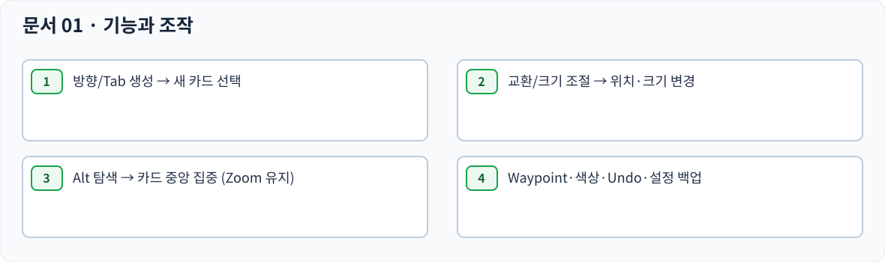

**출처:** 본 대화의 사용자 확정 답변, 최초 첨부 Canvas Mindmap 이미지, 이전 Planning Pack 01–05. 최초 PROJECT_INSTRUCTIONS.md가 없으므로 17개 항목 제목과의 대조는 미완료.

## 기능 원칙

- 별도의 숨겨진 부모·자식 데이터 구조를 임의로 추가하지 않는다. Canvas 카드 좌표·연결선과 선택을 기준으로 동작을 표현한다.
- 기능 요구사항의 `확정`, `재검토`, `기술 검증`, `원본 검토` 상태를 구분한다.
- 아래 모든 그림은 해당 기능을 나타내는 **비축척 개념도**이며, 특정 픽셀 정렬 수치가 지정된 상세 도식은 `SWAP-01_RESOLVED.svg` 등에서 별도로 다룬다.

## 01. 생성·삽입

### CM-001 · 생성 모드 선택 — 확정

**동작:** Ctrl을 약 1초 누르면 작은 생성 Context Menu가 열리고 상하 방향키로 생성/연결 생성 중 선택한다.

**전:** 선택된 카드 1개 → **입력:** Ctrl 약 1초 + 메뉴 ↑/↓ → **후:** 생성 또는 연결 생성 모드 선택

**검증:** T01,T02 · **도식:** [`CM-001.svg`](diagrams/CM-001.svg)

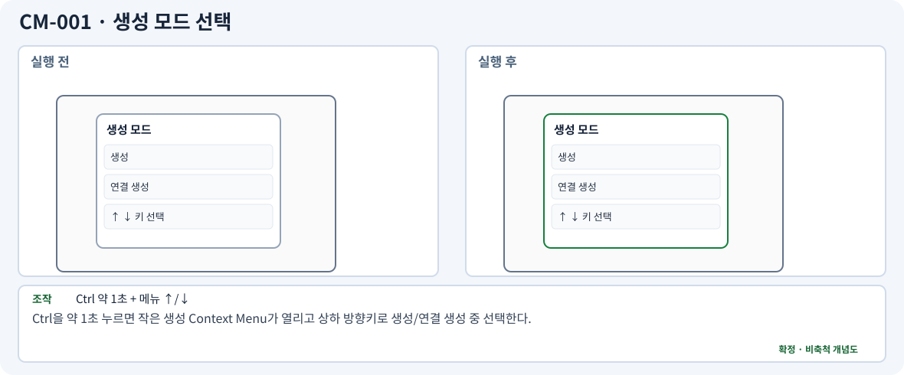

### CM-002 · 일반 생성 — 확정

**동작:** 일반 생성은 새 카드만 만든다. 연결선을 추가하지 않는다.

**전:** A 선택 → **입력:** 일반 생성 · Ctrl+→ → **후:** A 옆에 B 신규 카드, 연결선 없음

**검증:** T01 · **도식:** [`CM-002.svg`](diagrams/CM-002.svg)

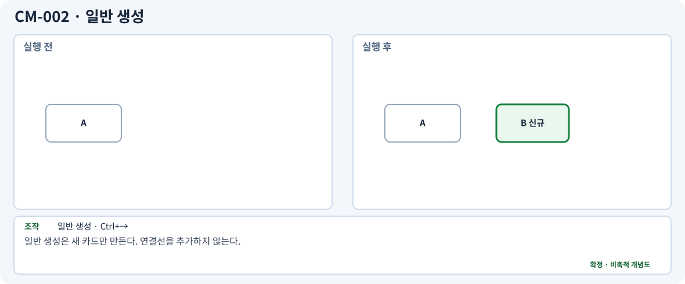

### CM-003 · 연결 생성 — 확정

**동작:** 연결 생성은 새 카드와 연결선을 함께 만든다.

**전:** A 선택 → **입력:** 연결 생성 · Ctrl+→ → **후:** A–B 연결과 B 신규 카드

**검증:** T02 · **도식:** [`CM-003.svg`](diagrams/CM-003.svg)

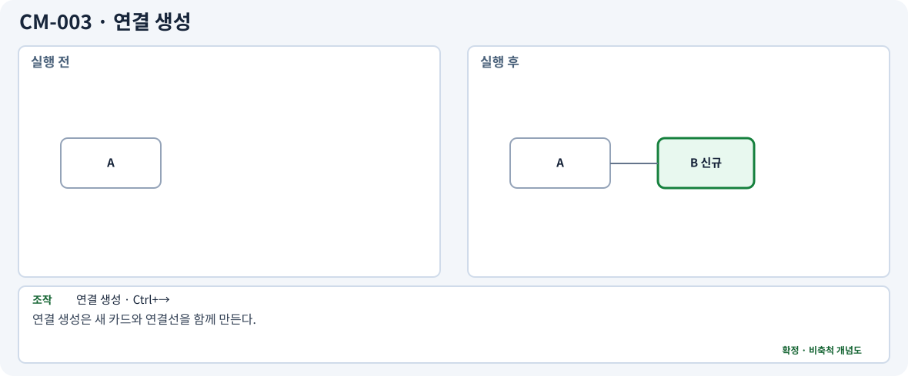

### CM-004 · 방향 생성 — 확정

**동작:** Ctrl+↑/↓/←/→를 입력하면 해당 방향으로 카드를 생성한다.

**전:** A 선택 → **입력:** Ctrl+방향키 → **후:** 입력 방향으로 B 생성

**검증:** T01 · **도식:** [`CM-004.svg`](diagrams/CM-004.svg)

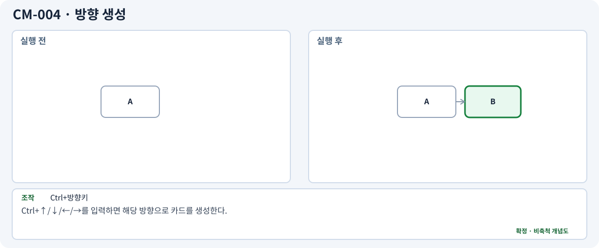

### CM-005 · 생성 기본 간격 — 확정

**동작:** 카드 기본 간격은 Canvas 좌표 100px이며 사용자가 Settings에서 수정 가능하다. 화면 Zoom과 혼동하지 않는다.

**전:** A 카드 → **입력:** Ctrl+→ / Tab → **후:** A와 B의 지정 간격 100 Canvas px

**검증:** T01 · **도식:** [`CM-005.svg`](diagrams/CM-005.svg)

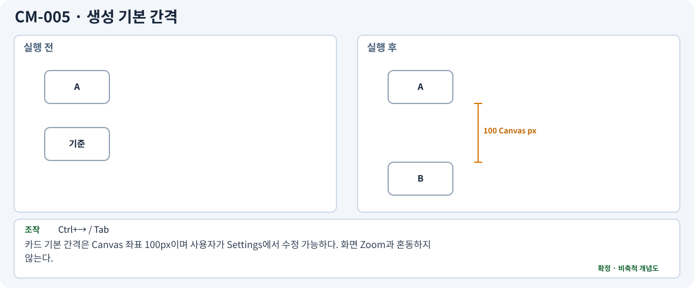

### CM-006 · 새 카드 기본 크기 — 확정

**동작:** Tab과 Ctrl+방향키 모두 설정의 기본 카드 가로·세로 크기를 사용한다. 이전 카드의 크기를 복사하지 않는다.

**전:** A는 수동 확대한 카드 → **입력:** 생성 → **후:** B는 설정된 기본 카드 크기

**검증:** T01 · **도식:** [`CM-006.svg`](diagrams/CM-006.svg)

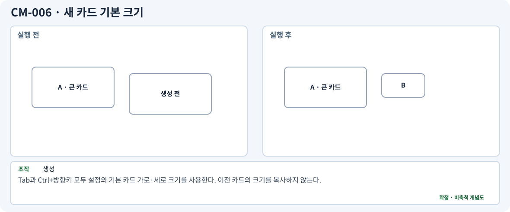

### CM-007 · 생성 후 선택 — 확정

**동작:** 생성 즉시 새 카드를 선택하고 기존 선택은 해제한다.

**전:** A 선택 → **입력:** 새 카드 B 생성 → **후:** B 선택 / A 선택 해제

**검증:** T01 · **도식:** [`CM-007.svg`](diagrams/CM-007.svg)

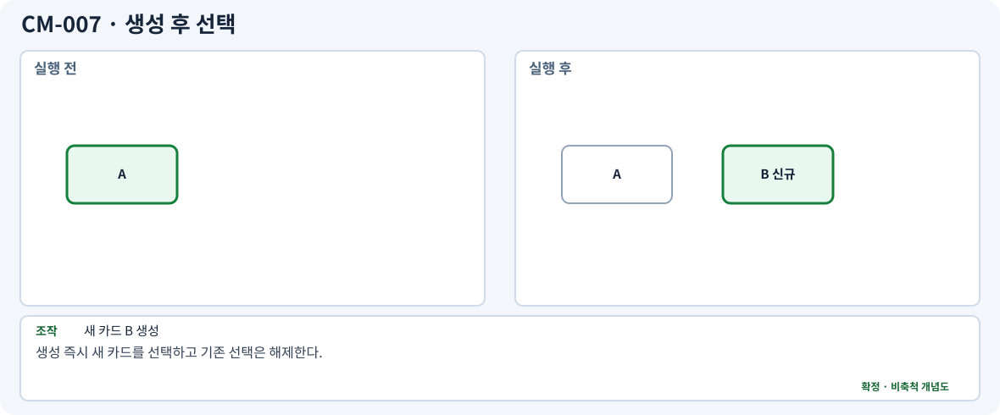

### CM-008 · 생성 후 편집 모드 — 확정

**동작:** 새 카드 생성 즉시 텍스트 편집 모드로 진입하지 않는다. Ctrl+Space는 편집/조작 모드 전환이다.

**전:** B 생성 직후 → **입력:** Ctrl+Space → **후:** 편집 모드 진입 / 재입력 시 조작 모드

**검증:** T01 · **도식:** [`CM-008.svg`](diagrams/CM-008.svg)

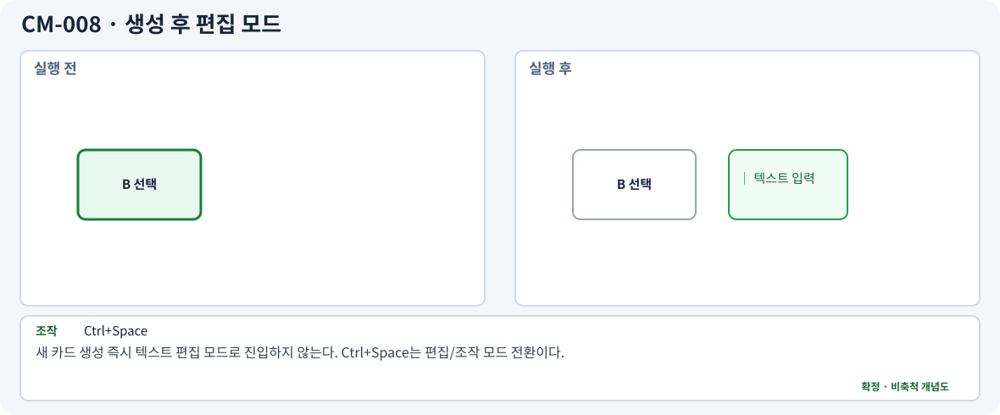

### CM-009 · Tab 형제 삽입 — 확정

**동작:** Tab은 현재 선택된 카드 바로 아래에 같은 줄 계열의 새 카드를 삽입하고 자동 선택한다. 별도의 부모·자식 데이터 구조를 만들지 않는다.

**전:** A–B, A–C, A–D / B 선택 → **입력:** Tab → **후:** A–B, A–E(선택), A–C, A–D

**검증:** T04,T05 · **도식:** [`CM-009.svg`](diagrams/CM-009.svg)

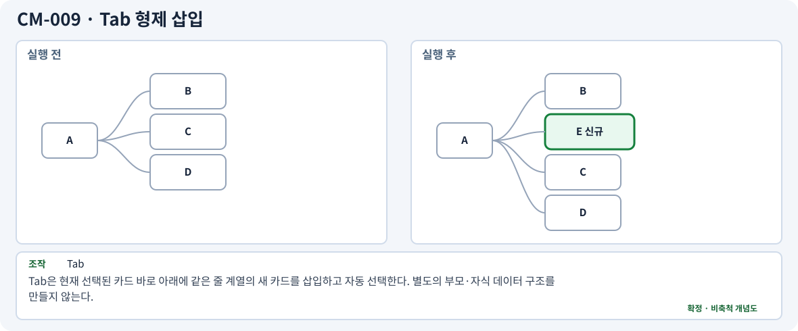

### CM-010 · Tab 비연결 모드 — 확정

**동작:** 일반 생성 모드의 Tab은 연결선 없이 동일한 아래쪽 삽입 동작을 실행한다.

**전:** B 선택 / 일반 생성 → **입력:** Tab → **후:** E를 B 아래 삽입, E의 연결선 없음

**검증:** T04 · **도식:** [`CM-010.svg`](diagrams/CM-010.svg)

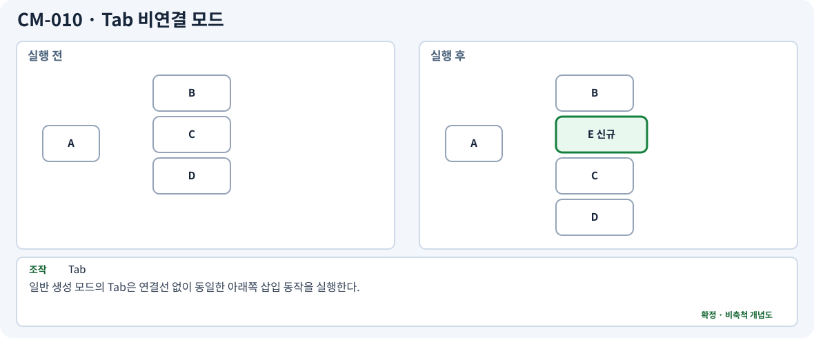

### CM-011 · Tab 연결 모드 — 재검토

**동작:** 연결 생성 모드의 Tab도 같은 위치에 삽입한다. 기존 연결 출발점과의 연결 방식은 최초 원본의 연결 규칙과 대조한다.

**전:** A–B·A–C / B 선택 → **입력:** 연결 생성 / Tab → **후:** B 아래 E 삽입 / A–E 연결 예상

> 주의: 연결 출발점 판정에 별도 계층 정보를 임의 도입 금지

**검증:** T33 · **도식:** [`CM-011.svg`](diagrams/CM-011.svg)

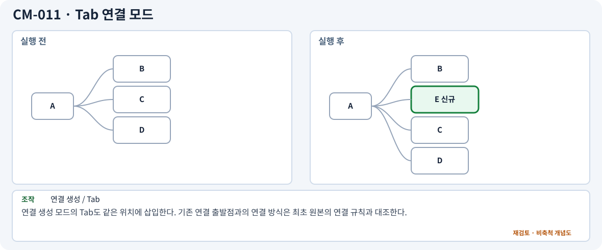

### CM-012 · Tab 왼쪽 정렬 — 확정

**동작:** Tab으로 추가한 카드의 왼쪽 모서리는 선택된 카드의 왼쪽 모서리와 정렬된다.

**전:** B와 C의 너비가 다름 → **입력:** B 선택 후 Tab → **후:** E 왼쪽 끝은 B와 동일

**검증:** T04 · **도식:** [`CM-012.svg`](diagrams/CM-012.svg)

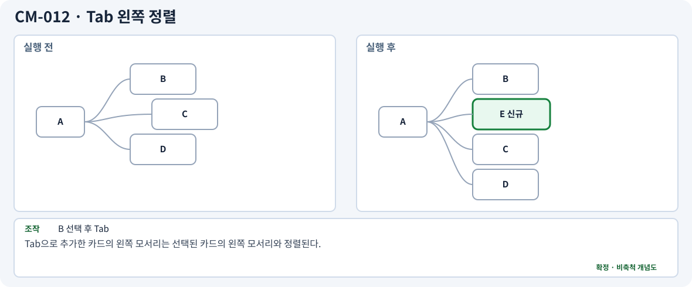

### CM-013 · Tab 빈 공간 활용 — 확정

**동작:** Tab 삽입 위치에 충분한 빈 공간이 있으면 기존 카드의 좌표를 바꾸지 않는다.

**전:** B와 C 사이 빈 공간 충분 → **입력:** B에서 Tab → **후:** E만 빈 공간에 삽입, C·D 그대로

**검증:** T04 · **도식:** [`CM-013.svg`](diagrams/CM-013.svg)

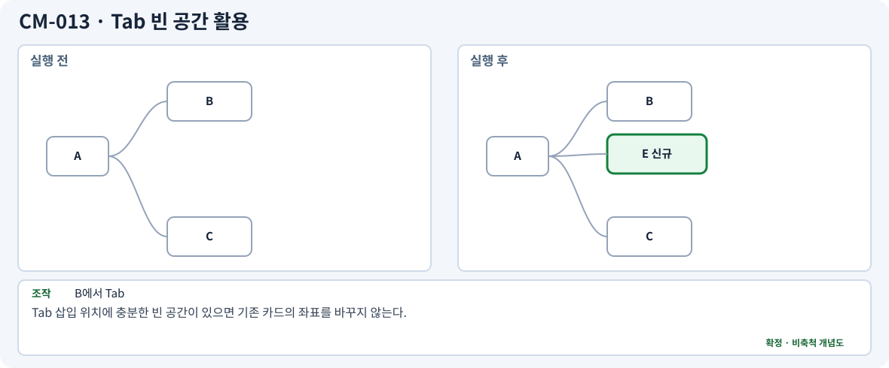

### CM-014 · Tab 부족분만 이동 — 확정

**동작:** Tab 삽입에 공간이 부족하면 부족한 거리만큼 아래 연속 카드 전체를 이동한다. 이동 카드들의 기존 간격을 보존한다.

**전:** 빈 공간 60px / 필요 공간 100px → **입력:** B에서 Tab → **후:** C·D를 40px 아래 이동

**검증:** T05 · **도식:** [`CM-014.svg`](diagrams/CM-014.svg)

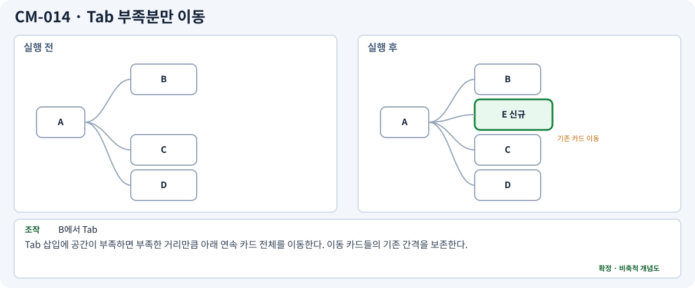

### CM-015 · 방향 생성 충돌 — 확정

**동작:** Ctrl+방향키 생성 위치에 카드가 있으면 지정한 방향으로 밀고 빈 공간을 만든다. 기준 카드는 고정한다.

**전:** A B C 가로 배치 → **입력:** A에서 Ctrl+→ → **후:** A E B C / A 좌표 유지

**검증:** T02 · **도식:** [`CM-015.svg`](diagrams/CM-015.svg)

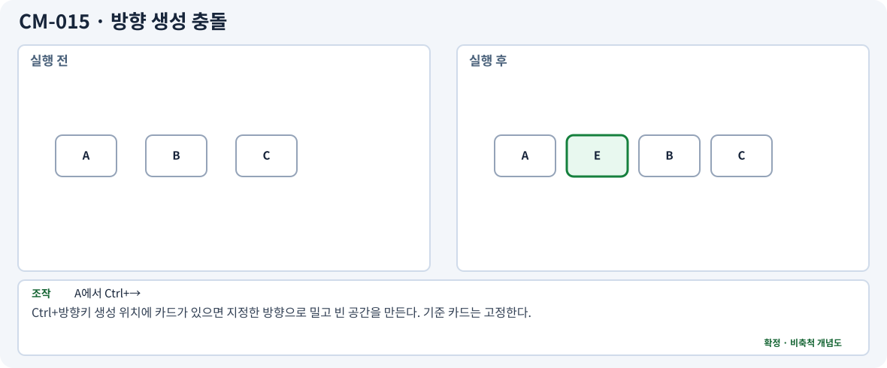

### CM-016 · 연속 카드 밀어내기 — 확정

**동작:** 새 카드 생성으로 연속 배치 카드가 충돌하면 이동 방향의 연속 카드들을 함께 밀고, 기존 순서를 유지한다.

**전:** A B C D → **입력:** A에서 Ctrl+→ → **후:** A E B C D

**검증:** T02 · **도식:** [`CM-016.svg`](diagrams/CM-016.svg)

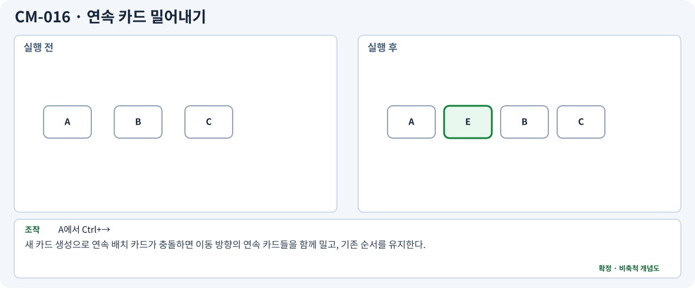

### CM-017 · 연결된 카드 동반 이동 — 확정

**동작:** 밀려나는 카드와 연결된 다른 카드도 연결선 방향이나 단계에 무관하게 이동한다.

**전:** B–D 연결 / A E 추가 예정 → **입력:** A에서 Ctrl+→ → **후:** B 이동, D도 함께 이동

**검증:** T02 · **도식:** [`CM-017.svg`](diagrams/CM-017.svg)

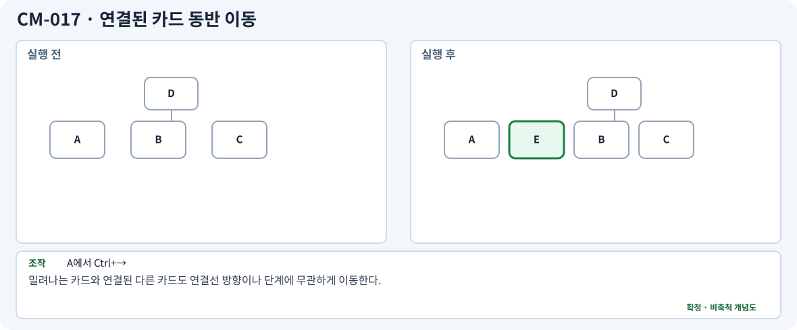

### CM-018 · 연쇄 충돌 전파 — 확정

**동작:** 이동 중 다른 카드 X와 충돌하면 X도 같은 방향으로 밀고, X에 연결된 카드들도 함께 이동한다.

**전:** B–D 이동 경로에 X–X1 → **입력:** A에서 E 생성 → **후:** B·D·X·X1 동반 이동

**검증:** T02 · **도식:** [`CM-018.svg`](diagrams/CM-018.svg)

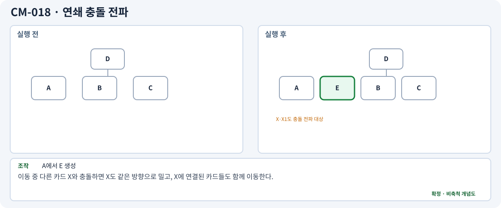

### CM-019 · 연결선 없는 카드 동일 처리 — 확정

**동작:** 연결선 유무는 카드 충돌·밀어내기 기본 규칙을 바꾸지 않는다.

**전:** A, B, C 연결선 없음 → **입력:** A에서 Ctrl+→ → **후:** E 생성 및 B·C 이동

**검증:** T02 · **도식:** [`CM-019.svg`](diagrams/CM-019.svg)

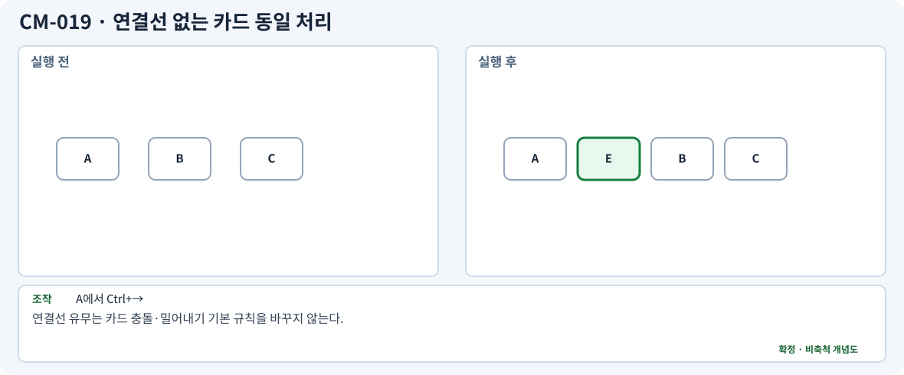

### CM-020 · 기준 카드 고정 — 확정

**동작:** 생성 기준 카드 A가 밀리는 카드와 연결되어 있더라도 A는 이동시키지 않는다.

**전:** A–B 연결 / A 선택 → **입력:** A에서 Ctrl+→ → **후:** A 위치 고정, B 이동

**검증:** T02 · **도식:** [`CM-020.svg`](diagrams/CM-020.svg)

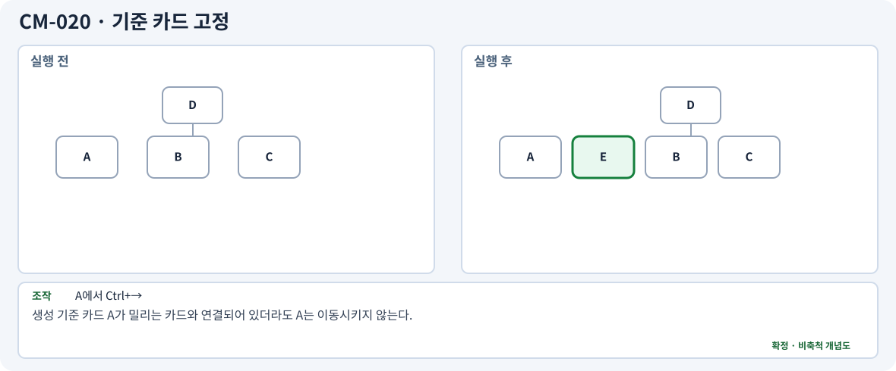

### CM-021 · 공유 연결 카드 예외 — 확정

**동작:** A와 B 모두에 연결된 C가 있고 A를 기준으로 B가 밀리는 경우, C는 기존 위치에 남는다.

**전:** A–B, A–C, B–C → **입력:** A에서 E 생성, B 이동 → **후:** C 기존 좌표 유지

**검증:** T02 · **도식:** [`CM-021.svg`](diagrams/CM-021.svg)

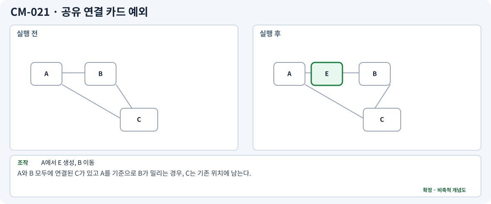

### CM-022 · 생성 Undo 그룹 — 확정

**동작:** 신규 카드 생성과 그에 따른 모든 이동·연결선은 한 번의 Undo 작업으로 취급한다.

**전:** A B C → **입력:** Ctrl+→ 로 E 생성, B·C 이동 → **후:** Ctrl+Z 한 번: A B C 복원

**검증:** T03 · **도식:** [`CM-022.svg`](diagrams/CM-022.svg)

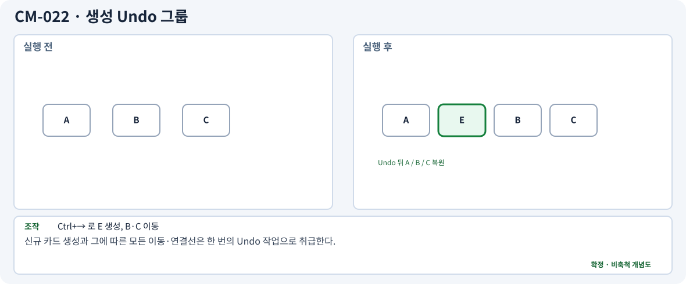

## 02. 위치 교환

### CM-023 · 교환 키·단일 선택 — 확정

**동작:** Ctrl+Alt+↑/↓는 단일 카드 선택에서만 위치 교환을 실행한다.

**전:** E 선택 / 아래 C → **입력:** Ctrl+Alt+↓ → **후:** E와 C 세로 순서 교환

**검증:** T06 · **도식:** [`CM-023.svg`](diagrams/CM-023.svg)

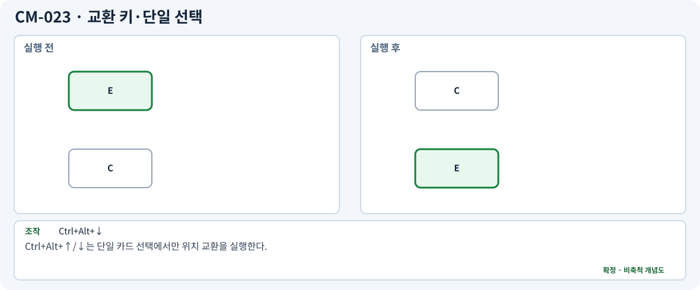

### CM-024 · 위치 교환 시 가로좌표 교환과 세로 순서 변경 — 확정

**동작:** 선택 카드와 대상 카드의 **가로 X좌표는 서로 교환**한다. **세로는 위아래 순서를 교환하되 기존 카드 사이 간격 보존을 우선**하여 Y좌표를 필요한 만큼 보정한다. 크기가 달라도 원래 Y좌표를 기계적으로 맞바꾸지 않는다.

**전:** E=(X100,Y100,높이80) / C=(X120,Y280,높이160), 간격100 → **입력:** E에서 Ctrl+Alt+↓ → **후:** C=(X100,Y100), E=(X120,Y360). 두 카드의 가로 위치는 서로 교환, 세로 순서는 교환하고 간격 100 유지.

> **SWAP-01 확정:** 사용자 최종 결정은 간격 유지 우선. 이전의 무조건적인 X·Y 원좌표 맞교환 표현을 폐기한다.

**검증:** T06 · **도식:** [`CM-024.svg`](diagrams/CM-024.svg)

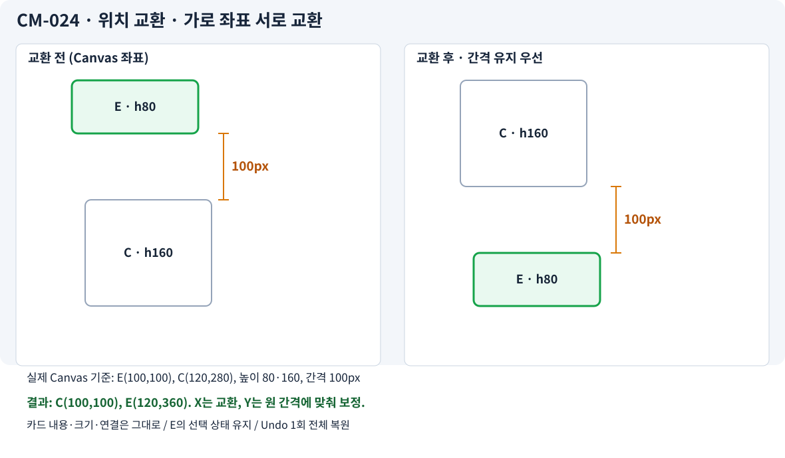

### CM-025 · 기존 간격 보존을 위한 좌표 보정 — 확정

**동작:** 크기가 다른 카드끼리 교환할 때 **각 카드의 크기를 유지**하고, 교환 대상 두 카드 사이 기존 빈 공간의 거리를 유지하도록 세로 위치를 보정한다. 카드 내용·연결 관계·선택 상태는 유지한다.

**전:** E Y100 높이80 / C Y280 높이160 / 간격100 → **입력:** Ctrl+Alt+↓ → **후:** C Y100 높이160 / E Y360 높이80 / 간격100.

> **SWAP-01 해결:** 기존 간격 우선, 필요한 만큼 Y좌표 보정으로 확정.

**검증:** T06 · **도식:** [`CM-025.svg`](diagrams/CM-025.svg)

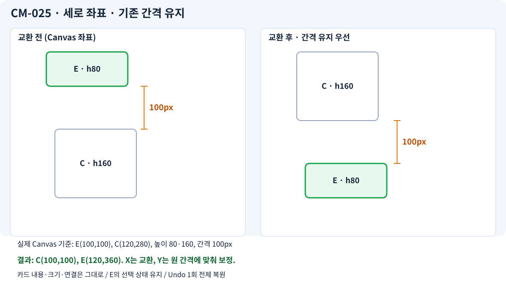

### CM-026 · X 허용 오차 — 확정

**동작:** 두 카드의 왼쪽 모서리 X좌표 차이가 기본 40px 이하여야 교환할 수 있다. 설정에서 변경 가능하다.

**전:** E X100 / C X145 → **입력:** Ctrl+Alt+↓ → **후:** 45px 차이 → 교환 불가

**검증:** T07 · **도식:** [`CM-026.svg`](diagrams/CM-026.svg)

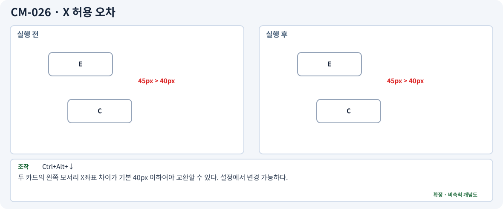

### CM-027 · 후보 선택 순서 — 확정

**동작:** 유효 X 범위 안에서 이동 방향으로 세로상 가장 가까운 후보를 선택한다.

**전:** E 아래 C, D 모두 40px 내 → **입력:** Ctrl+Alt+↓ → **후:** 세로로 가까운 C 선택

**검증:** T06 · **도식:** [`CM-027.svg`](diagrams/CM-027.svg)

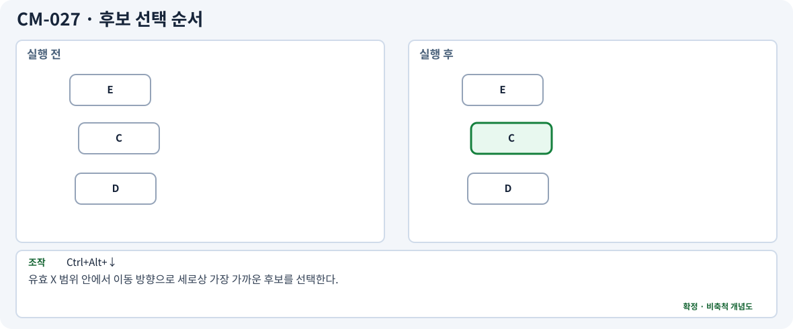

### CM-028 · 대상 없음 — 확정

**동작:** 교환할 카드가 없으면 아무 움직임도 안내도 없다.

**전:** E 아래 후보 없음 → **입력:** Ctrl+Alt+↓ → **후:** E 위치/선택 유지

**검증:** T07 · **도식:** [`CM-028.svg`](diagrams/CM-028.svg)

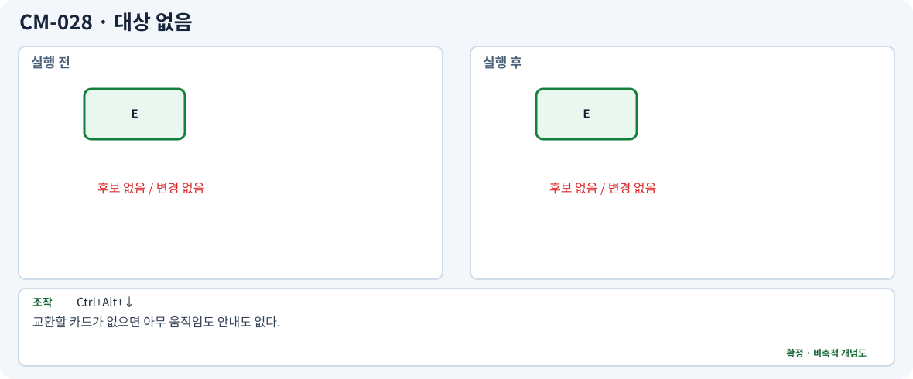

### CM-029 · 크기·내용·연결 보존 — 확정

**동작:** 교환은 카드 내용·크기·연결 대상을 바꾸지 않으며 연결선은 해당 카드 위치를 따라간다.

**전:** A–E 연결 / C는 별도 → **입력:** E와 C 교환 → **후:** A–E 연결 그대로

**검증:** T08 · **도식:** [`CM-029.svg`](diagrams/CM-029.svg)

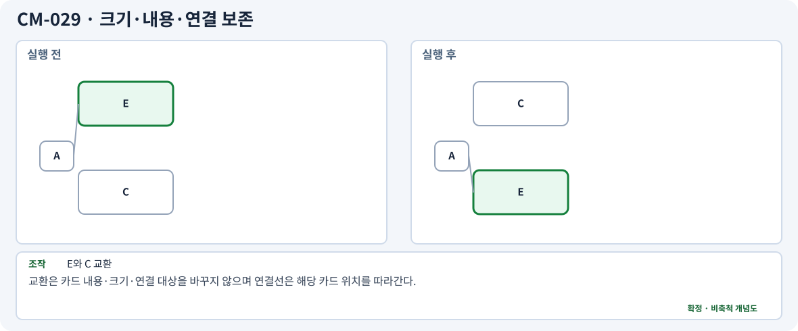

### CM-030 · 교환 Undo 그룹 — 확정

**동작:** 위치 교환은 Ctrl+Z 한 번으로 두 카드의 직전 위치를 모두 복원한다.

**전:** E 위 / C 아래 → **입력:** Ctrl+Alt+↓ 후 Ctrl+Z → **후:** E 위 / C 아래

**검증:** T08 · **도식:** [`CM-030.svg`](diagrams/CM-030.svg)

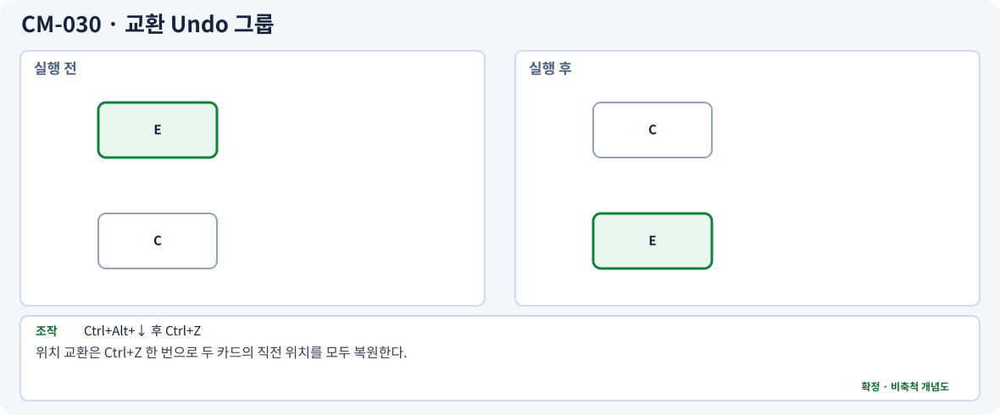

## 03. 수동 크기

### CM-031 · 방향별 크기 변경 — 확정

**동작:** Ctrl+Shift+→/←로 너비 증가/감소, Ctrl+Shift+↓/↑로 높이 증가/감소.

**전:** 너비200 높이100 → **입력:** Ctrl+Shift+→ → **후:** 너비220 높이100

**검증:** T09 · **도식:** [`CM-031.svg`](diagrams/CM-031.svg)

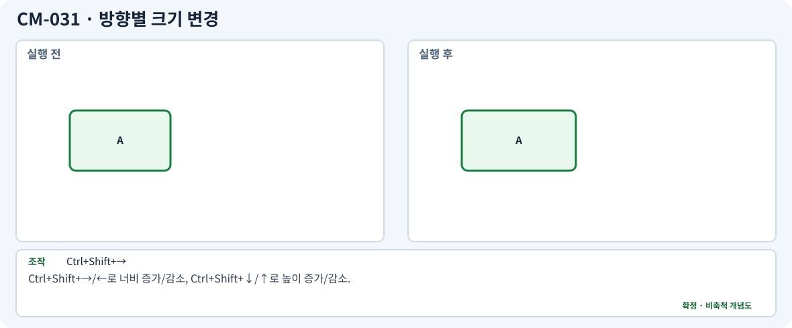

### CM-032 · 고정 단위 — 확정

**동작:** 크기 조절 단위 기본 20px은 Settings에서 수정할 수 있다.

**전:** 너비200 → **입력:** Ctrl+Shift+→ 1회 → **후:** 너비220 (+20)

**검증:** T09 · **도식:** [`CM-032.svg`](diagrams/CM-032.svg)

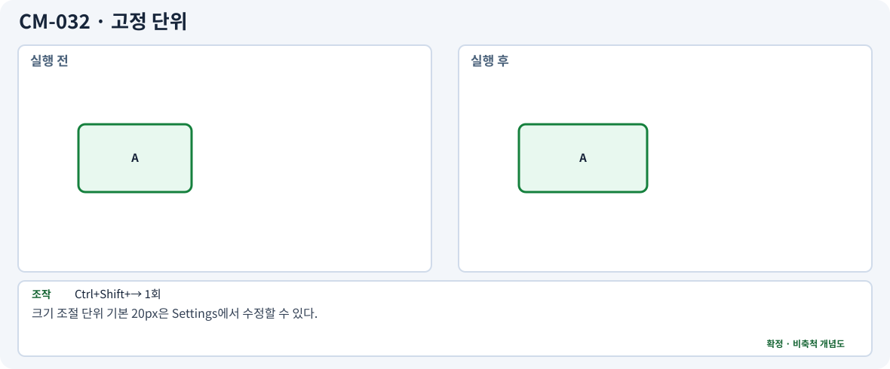

### CM-033 · 단일 선택만 — 확정

**동작:** 수동 크기 변경은 카드 하나만 선택되었을 때만 실행한다.

**전:** A와 B 동시 선택 → **입력:** Ctrl+Shift+→ → **후:** 모두 크기 유지

**검증:** T09 · **도식:** [`CM-033.svg`](diagrams/CM-033.svg)

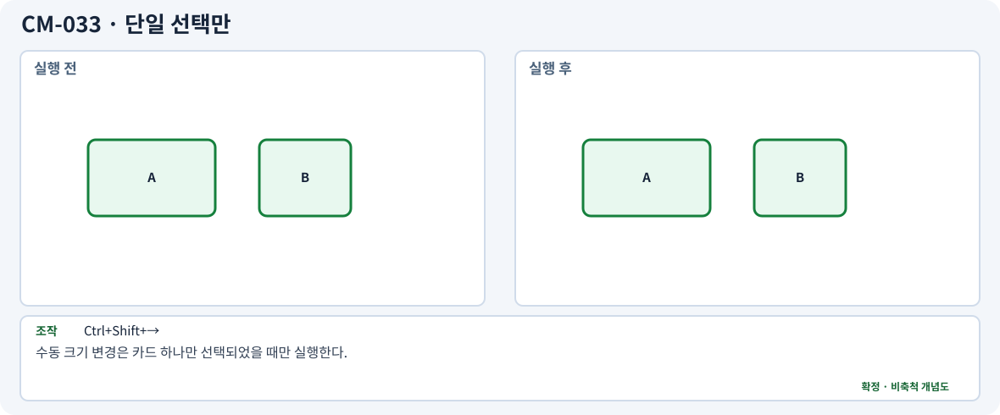

### CM-034 · 왼쪽 위 고정 — 확정

**동작:** 크기 조절 시 카드의 왼쪽 위 모서리 좌표를 바꾸지 않는다.

**전:** A X100,Y100 W200 → **입력:** Ctrl+Shift+→ → **후:** X100,Y100 W220

**검증:** T09 · **도식:** [`CM-034.svg`](diagrams/CM-034.svg)

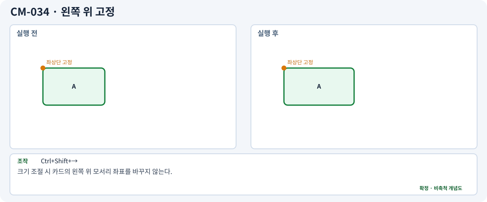

### CM-035 · 겹침 허용 — 확정

**동작:** 수동으로 카드를 확대하면서 다른 카드와 겹쳐도 밀어내지 않는다.

**전:** A 옆 B → **입력:** A 너비 증가 → **후:** A와 B 겹침, B 원위치

**검증:** T09 · **도식:** [`CM-035.svg`](diagrams/CM-035.svg)

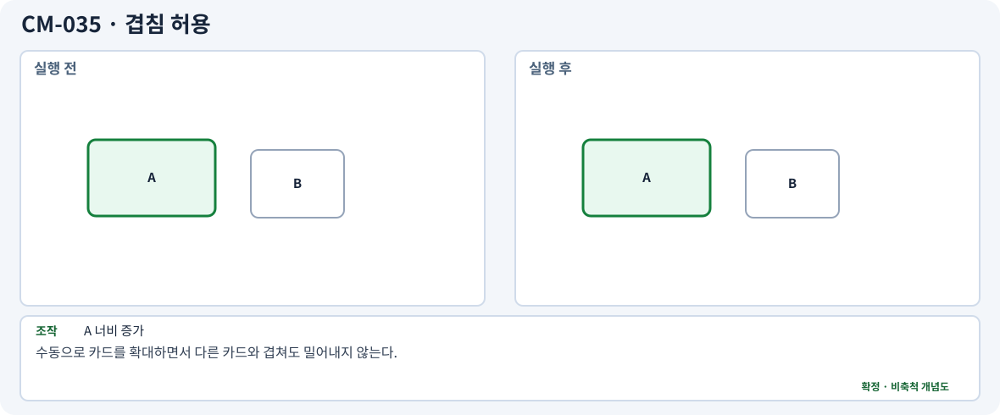

### CM-036 · Obsidian 최소값 — 확정

**동작:** 플러그인에서 카드 최소 크기를 새로 제한하지 않고 Obsidian 기본 제한을 사용한다.

**전:** 작은 카드 → **입력:** Ctrl+Shift+← 반복 → **후:** 기본 Obsidian 최소 한계 적용

**검증:** T09 · **도식:** [`CM-036.svg`](diagrams/CM-036.svg)

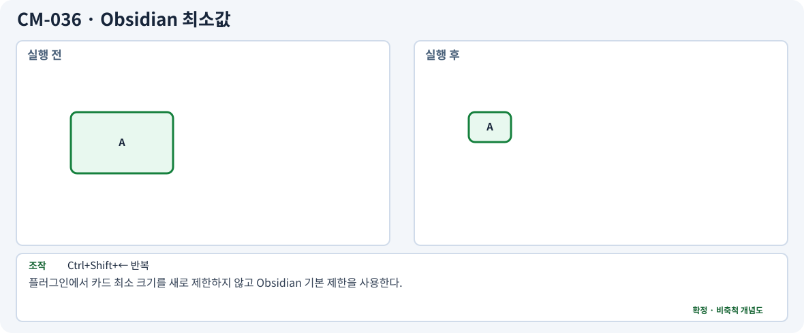

### CM-037 · 연속 조절 — 확정

**동작:** Ctrl+Shift+방향키를 길게 누르면 반복 조절하고 키를 놓으면 멈춘다.

**전:** 너비200 → **입력:** Ctrl+Shift+→ 길게 누름 → **후:** 220→240→260 ... / 키 해제 중단

**검증:** T10 · **도식:** [`CM-037.svg`](diagrams/CM-037.svg)

### CM-038 · 연속 Undo — 확정

**동작:** 하나의 길게 누르기 전체를 Ctrl+Z 한 번으로 조절 전 크기로 복구한다.

**전:** 너비200 → **입력:** 키 길게 → 너비260 → Undo → **후:** 너비200

**검증:** T10 · **도식:** [`CM-038.svg`](diagrams/CM-038.svg)

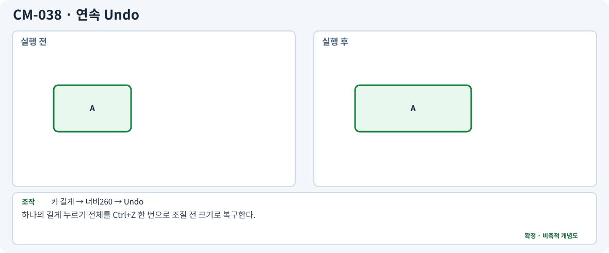

## 04. Auto Resize

### CM-039 · ON/OFF 토글 — 확정

**동작:** Auto Resize는 ON/OFF 모드만 제공하며 일회성 크기 맞춤 명령은 제공하지 않는다.

**전:** Auto Resize OFF → **입력:** 설정/단축키로 ON → **후:** Auto Resize ON

**검증:** T11 · **도식:** [`CM-039.svg`](diagrams/CM-039.svg)

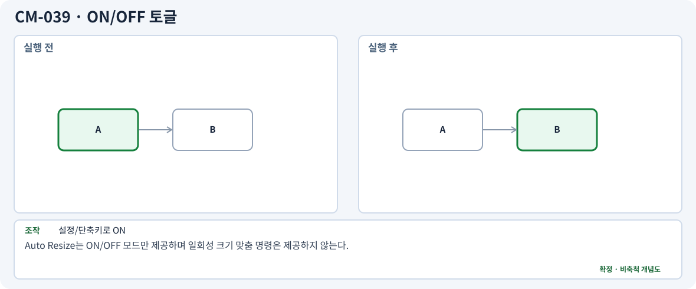

### CM-040 · 기본 단축키 — 확정

**동작:** Auto Resize 토글 기본 단축키 Ctrl+Shift+R, Obsidian 설정에서 변경 가능. 사용자가 기존 단축키 제안을 "확정하고"라고 승인한 대화 기록에 근거.

**전:** Auto Resize OFF → **입력:** Ctrl+Shift+R → **후:** Auto Resize ON

**검증:** T11 · **도식:** [`CM-040.svg`](diagrams/CM-040.svg)

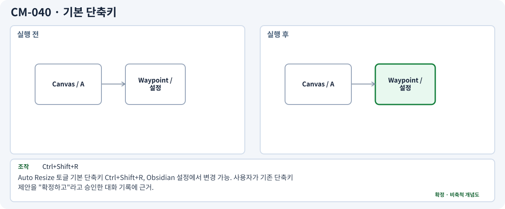

### CM-041 · 편집 종료 트리거 — 확정

**동작:** ON에서는 카드 텍스트 편집을 마치면 내용에 맞춰 가로·세로를 동시에 조절한다.

**전:** 카드 내용과 크기 불일치 → **입력:** 편집 종료 → **후:** 가로·세로 내용에 맞춤

**검증:** T11 · **도식:** [`CM-041.svg`](diagrams/CM-041.svg)

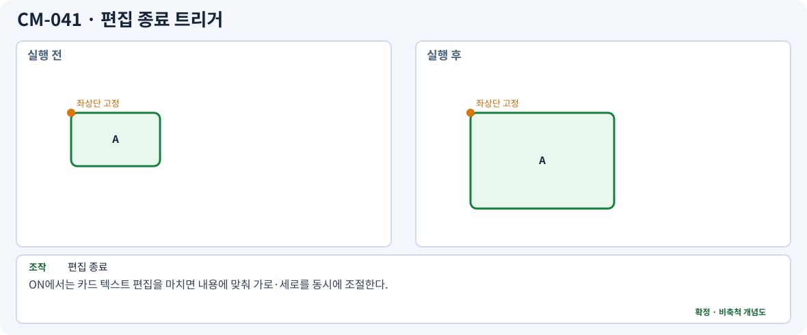

### CM-042 · 편집 중 크기 유지 — 확정

**동작:** 입력 중에는 카드 크기를 수시로 조절하지 않고 수동 변경 상태를 유지한다.

**전:** 편집 중 높이160 → **입력:** 텍스트 입력 → **후:** 높이160 유지, 편집 종료시 Auto Resize

**검증:** T11 · **도식:** [`CM-042.svg`](diagrams/CM-042.svg)

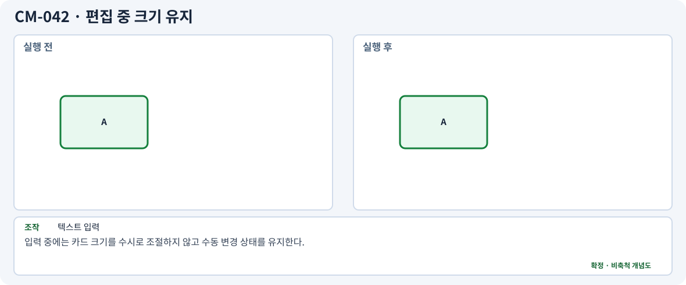

### CM-043 · 텍스트 변경 없어도 동작 — 확정

**동작:** ON 상태라면 실제 텍스트를 수정하지 않고 편집을 종료해도 Auto Resize를 실행한다.

**전:** 내용 변경 없음 → **입력:** 편집 시작 → 편집 종료 → **후:** 현재 내용으로 크기 맞춤

**검증:** T11 · **도식:** [`CM-043.svg`](diagrams/CM-043.svg)

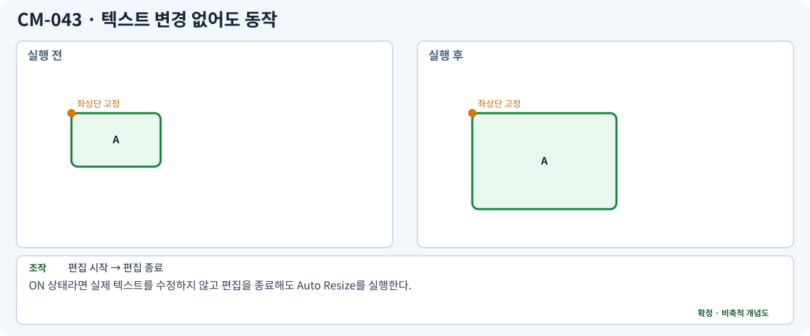

### CM-044 · 좌상단 고정·겹침 — 확정

**동작:** Auto Resize는 좌상단 좌표 고정, 다른 카드와 겹쳐도 주변을 밀지 않는다.

**전:** A 옆 B → **입력:** A 편집 종료 → **후:** A 크기 변경, B 고정

**검증:** T11 · **도식:** [`CM-044.svg`](diagrams/CM-044.svg)

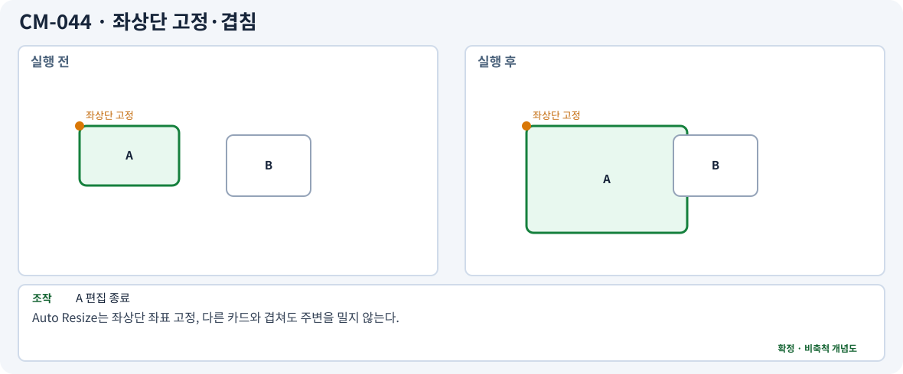

### CM-045 · ON 전환 시 기존 카드 유지 — 확정

**동작:** Auto Resize를 ON으로 바꾼 즉시 기존 모든 카드 크기를 재계산하지 않는다.

**전:** 기존 카드 100개, OFF → **입력:** ON 토글 → **후:** 기존 카드 크기 그대로

**검증:** T11 · **도식:** [`CM-045.svg`](diagrams/CM-045.svg)

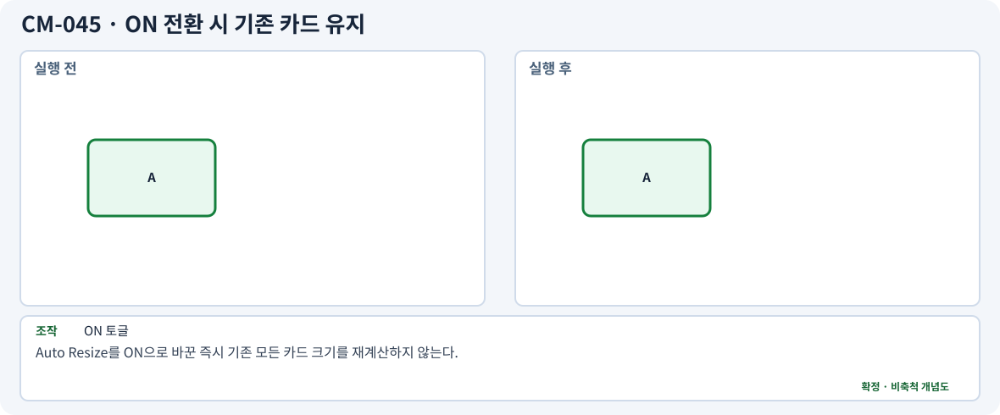

### CM-046 · 전체 Canvas 동일 상태 — 확정

**동작:** Auto Resize ON/OFF 상태는 Canvas마다 나누지 않고 전체 Canvas에 공유한다.

**전:** 작업.canvas OFF / 공부.canvas OFF → **입력:** 작업.canvas ON → **후:** 모든 Canvas ON

**검증:** T11 · **도식:** [`CM-046.svg`](diagrams/CM-046.svg)

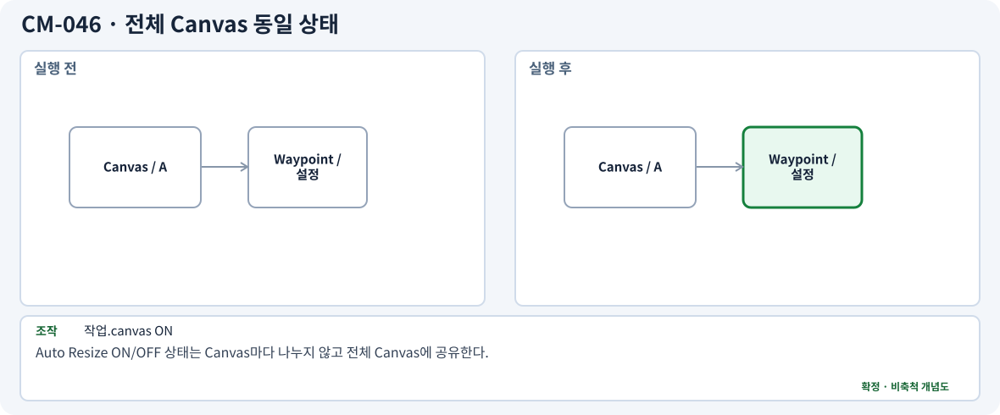

### CM-047 · 재실행 후 상태 복원 — 확정

**동작:** 마지막 Auto Resize ON/OFF 값을 저장하고 Obsidian을 재시작해도 유지한다.

**전:** Auto Resize ON → **입력:** Obsidian 재시작 → **후:** Auto Resize ON

**검증:** T29 · **도식:** [`CM-047.svg`](diagrams/CM-047.svg)

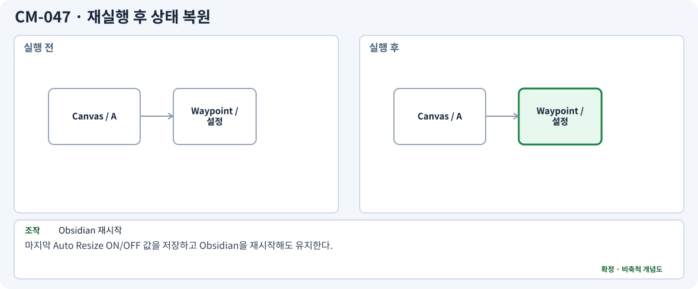

### CM-048 · 크기 Undo가 텍스트 유지 — 확정

**동작:** Auto Resize 직후 Undo 첫 회는 크기 변경만 복원하고 편집된 텍스트는 유지한다.

**전:** 텍스트 수정 + 자동 크기 맞춤 → **입력:** Ctrl+Z 1회 → **후:** 텍스트 유지 / 기존 크기 복원

**검증:** T12 · **도식:** [`CM-048.svg`](diagrams/CM-048.svg)

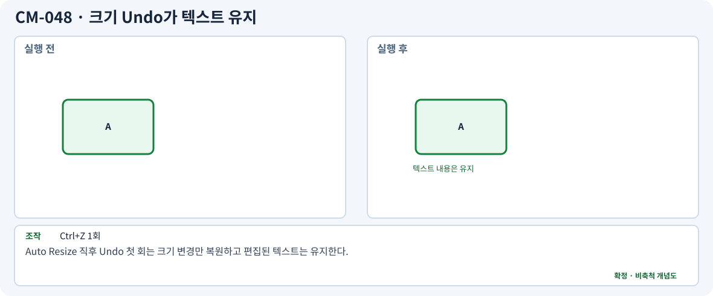

### CM-049 · Auto Resize Undo 후 ON 유지 — 확정

**동작:** Auto Resize 크기를 취소해도 ON 상태는 유지되며 다음 편집 종료 시 재적용한다.

**전:** Auto Resize ON / 크기 취소 → **입력:** 다음 편집 종료 → **후:** 내용 맞춤 다시 실행

**검증:** T12 · **도식:** [`CM-049.svg`](diagrams/CM-049.svg)

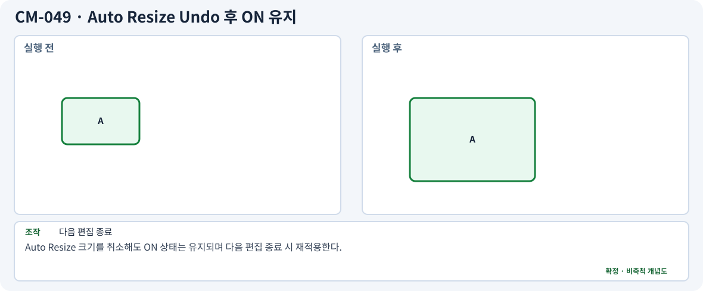

### CM-050 · 복수 카드 개별 조절 — 기술 검증

**동작:** 여러 카드에 Auto Resize를 적용하는 상황은 각 카드 내용에 따른 개별 크기를 사용한다. 편집 완료와 다중 선택 트리거의 연결은 기술 검증 필요.

**전:** 내용이 다른 카드 A,B 선택 → **입력:** 각 카드 자동 맞춤 → **후:** A/B 각각 내용에 따른 크기

> 주의: 단일 편집 종료 트리거와 다중 선택 지원을 임의로 병합하지 말 것

**검증:** T11 · **도식:** [`CM-050.svg`](diagrams/CM-050.svg)

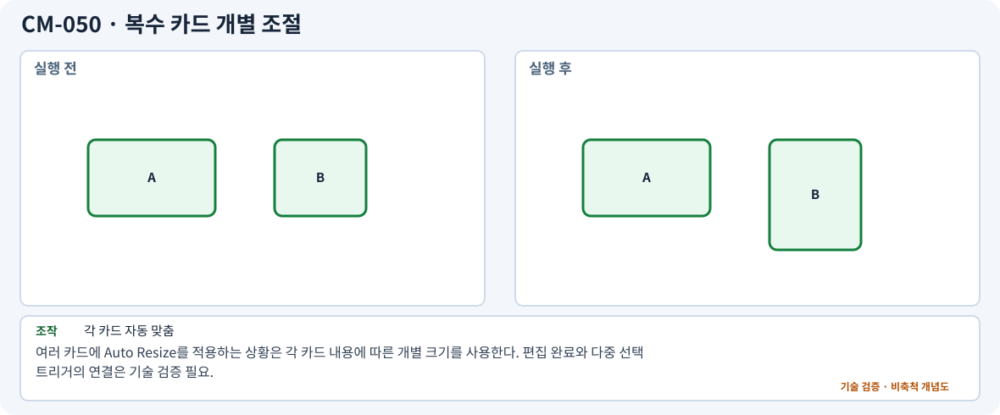

## 05. Alt 탐색

### CM-051 · 단일 선택만 — 확정

**동작:** Alt+방향키 탐색은 선택된 카드가 하나일 때만 동작한다.

**전:** A,B 다중 선택 → **입력:** Alt+→ → **후:** 선택 변경 없음

**검증:** T15 · **도식:** [`CM-051.svg`](diagrams/CM-051.svg)

### CM-052 · 방향 최단거리 — 확정

**동작:** 선택된 카드의 입력 방향에서 가장 가까운 카드를 탐색한다.

**전:** A 왼쪽 / B 가까이 / C 멀리 → **입력:** Alt+→ → **후:** B 선택

**검증:** T13 · **도식:** [`CM-052.svg`](diagrams/CM-052.svg)

### CM-053 · 동거리 중심선 — 확정

**동작:** 거리가 동일한 후보들 중 입력 방향 중심선에 더 가까운 카드를 선택한다.

**전:** B,C 동일 거리 / B 중심선 가까움 → **입력:** Alt+→ → **후:** B 선택

**검증:** T13 · **도식:** [`CM-053.svg`](diagrams/CM-053.svg)

### CM-054 · 연결 무관·Group 제외 — 확정

**동작:** 연결선이 없더라도 카드 탐색 가능하고 Group은 대상에서 제외한다.

**전:** A 오른쪽 Group, B 카드 → **입력:** Alt+→ → **후:** B 선택

**검증:** T13 · **도식:** [`CM-054.svg`](diagrams/CM-054.svg)

### CM-055 · 탐색 대상 없음 — 확정

**동작:** 해당 방향에 카드가 없으면 현재 선택을 유지하며 아무 동작하지 않는다.

**전:** A 오른쪽 빈 공간 → **입력:** Alt+→ → **후:** A 선택 유지

**검증:** T13 · **도식:** [`CM-055.svg`](diagrams/CM-055.svg)

### CM-056 · 화면 중앙 정렬 — 확정

**동작:** 목표 카드가 현재 화면 안에 보여도 항상 그 카드를 화면 중앙에 맞춘다.

**전:** B가 화면 오른쪽 가장자리 → **입력:** Alt+→ → **후:** B 화면 가운데

**검증:** T13 · **도식:** [`CM-056.svg`](diagrams/CM-056.svg)

### CM-057 · Zoom 불변 — 확정

**동작:** Alt 탐색에서 화면은 이동하지만 확대 배율은 변경하지 않는다. Shift+2 Zoom 동작은 사용하지 않는다.

**전:** 현재 Canvas Zoom 40% → **입력:** Alt+→ → **후:** Zoom 40% 유지

**검증:** T13 · **도식:** [`CM-057.svg`](diagrams/CM-057.svg)

### CM-058 · 화면 이동 250ms — 확정

**동작:** 부드러운 중앙 이동 기본 시간 250ms, 설정에서 변경 가능하다.

**전:** A 선택 → **입력:** Alt+→ → **후:** 250ms 이동 후 B 중심

**검증:** T13 · **도식:** [`CM-058.svg`](diagrams/CM-058.svg)

### CM-059 · 이동 중 재입력 — 확정

**동작:** 이동 애니메이션 도중 새 탐색 명령이 들어오면 기존 이동을 중단하고 새 대상으로 이동한다.

**전:** B로 이동 중 → **입력:** Alt+→ 재입력 → **후:** B 중단 후 C로 이동

**검증:** T14 · **도식:** [`CM-059.svg`](diagrams/CM-059.svg)

### CM-060 · 키 길게 누름 단발 — 확정

**동작:** Alt+방향키를 계속 누르고 있어도 한 번만 탐색하며 재탐색은 키를 놓았다 눌러야 한다.

**전:** A 선택 → **입력:** Alt+→ 유지 → **후:** B까지만 이동

**검증:** T15 · **도식:** [`CM-060.svg`](diagrams/CM-060.svg)

### CM-061 · 편집 중 차단 — 확정

**동작:** 텍스트 편집 중 Alt+방향키 카드 탐색을 실행하지 않는다.

**전:** A 텍스트 편집 중 → **입력:** Alt+→ → **후:** 카드 탐색 없음

**검증:** T15 · **도식:** [`CM-061.svg`](diagrams/CM-061.svg)

## 06. Waypoint

### CM-062 · 카드 Waypoint — 확정

**동작:** 카드 Waypoint는 지정 카드의 현재 위치를 추적하며 호출 시 중앙에 배치하고 현재 Zoom을 유지한다.

**전:** 카드 A 등록 후 이동 → **입력:** Num1 → **후:** A의 새 위치로 / Zoom 유지

**검증:** T18 · **도식:** [`CM-062.svg`](diagrams/CM-062.svg)

### CM-063 · 카메라 Waypoint — 확정

**동작:** 카메라 Waypoint는 등록 당시 Canvas 화면 위치와 Zoom을 저장하고 호출하면 복원한다.

**전:** 화면 위치 P / Zoom60% 저장 → **입력:** Num2 → **후:** 위치 P / Zoom60% 복원

**검증:** T19 · **도식:** [`CM-063.svg`](diagrams/CM-063.svg)

### CM-064 · 번호 공유 — 확정

**동작:** 카드/카메라 Waypoint는 숫자패드 번호를 공유하며 한 번호에 하나만 등록한다.

**전:** 1번 카드 A → **입력:** 1번 카메라 등록 → **후:** 1번은 카메라로 대체

**검증:** T16 · **도식:** [`CM-064.svg`](diagrams/CM-064.svg)

### CM-065 · 카드 등록 키 — 확정

**동작:** Ctrl+숫자패드 1~9로 카드 Waypoint를 등록하거나 같은 대상 재입력 시 해제한다.

**전:** A 선택 / 1번 비어 있음 → **입력:** Ctrl+Num1 → **후:** 1번에 A 등록

**검증:** T16 · **도식:** [`CM-065.svg`](diagrams/CM-065.svg)

### CM-066 · 카메라 등록 키 — 확정

**동작:** Ctrl+Shift+숫자패드 1~9로 현재 카메라 위치·Zoom Waypoint를 등록한다.

**전:** 현재 화면 Zoom60% → **입력:** Ctrl+Shift+Num2 → **후:** 2번에 카메라 저장

**검증:** T19 · **도식:** [`CM-066.svg`](diagrams/CM-066.svg)

### CM-067 · 등록 번호 호출 — 확정

**동작:** 숫자패드 1~9만 누르면 해당 Canvas의 등록 Waypoint로 이동한다.

**전:** 1번 카드 A 등록 → **입력:** Num1 → **후:** 카드 A 중앙 이동

**검증:** T18 · **도식:** [`CM-067.svg`](diagrams/CM-067.svg)

### CM-068 · 같은 대상 재입력 해제 — 확정

**동작:** 이미 1번에 A가 등록되어 있을 때 A에서 Ctrl+Num1을 다시 누르면 1번을 해제한다.

**전:** 1번 A 등록 → **입력:** A 선택 후 Ctrl+Num1 → **후:** 1번 미등록

**검증:** T16 · **도식:** [`CM-068.svg`](diagrams/CM-068.svg)

### CM-069 · 다른 대상 덮어쓰기 — 확정

**동작:** 1번에 A 등록 후 B에서 Ctrl+Num1을 누르면 A의 등록·배지가 사라지고 B의 정보로 덮어쓴다.

**전:** 1번 카드 A → **입력:** B 선택 후 Ctrl+Num1 → **후:** 1번 카드 B, A 배지 제거

**검증:** T16 · **도식:** [`CM-069.svg`](diagrams/CM-069.svg)

### CM-070 · 덮어쓰기 Undo — 확정

**동작:** Waypoint 덮어쓰기는 Ctrl+Z로 기존 대상과 이름 등 등록 정보를 복원할 수 있다.

**전:** 1번 카드 A → **입력:** B 덮어쓰기 후 Ctrl+Z → **후:** 1번 카드 A와 이름 복원

**검증:** T17 · **도식:** [`CM-070.svg`](diagrams/CM-070.svg)

### CM-071 · 텍스트 이름 자동 생성 — 확정

**동작:** 카드 Waypoint의 기본 이름은 등록 당시 텍스트 카드 첫 줄로 만들고 이후 내용이 변해도 자동 갱신하지 않는다.

**전:** 카드 첫 줄 "세계관" → **입력:** Ctrl+Num1 → **후:** 1번 이름 "세계관"

**검증:** T16 · **도식:** [`CM-071.svg`](diagrams/CM-071.svg)

### CM-072 · 빈·파일 이름 — 확정

**동작:** 빈 텍스트 카드 등록 이름은 카드 N, Markdown/이미지/Canvas 파일 카드 이름은 파일명이다.

**전:** 빈 카드 / image.png → **입력:** Waypoint 등록 → **후:** 카드 N / image.png

**검증:** T16 · **도식:** [`CM-072.svg`](diagrams/CM-072.svg)

### CM-073 · 카메라 이름 — 확정

**동작:** 카메라 Waypoint 기본 이름은 카메라 Waypoint N 형태로 생성한다.

**전:** Num2 비어 있음 → **입력:** Ctrl+Shift+Num2 → **후:** 카메라 Waypoint 2

**검증:** T19 · **도식:** [`CM-073.svg`](diagrams/CM-073.svg)

### CM-074 · 덮어쓰기 이름 초기화 — 확정

**동작:** 다른 대상에 번호를 덮어쓰면 기존 사용자 지정 이름을 버리고 새 이름을 자동 생성한다.

**전:** 1번 "주인공 설정" → **입력:** B로 덮어쓰기 → **후:** B의 이름으로 변경

**검증:** T16 · **도식:** [`CM-074.svg`](diagrams/CM-074.svg)

### CM-075 · 카드 삭제와 등록 해제 — 확정

**동작:** Waypoint 등록 카드가 삭제되면 등록도 자동 해제한다.

**전:** 카드 A, 1번 등록 → **입력:** 카드 A 삭제 → **후:** 1번 등록 해제

**검증:** T21 · **도식:** [`CM-075.svg`](diagrams/CM-075.svg)

### CM-076 · 카드 삭제 Undo 복원 — 확정

**동작:** 등록 카드 삭제를 Ctrl+Z로 되돌리면 카드와 등록된 Waypoint를 함께 복원한다.

**전:** 카드 A 삭제 / 1번 해제 → **입력:** Ctrl+Z → **후:** A와 1번 등록 복원

**검증:** T21 · **도식:** [`CM-076.svg`](diagrams/CM-076.svg)

### CM-077 · Canvas별 독립 등록 — 확정

**동작:** Waypoint는 Canvas마다 독립 관리하고 서로 같은 번호를 사용해도 충돌하지 않는다.

**전:** 작업.canvas 1번 A → **입력:** 공부.canvas 1번 B 등록 → **후:** 작업 1번 A 유지 / 공부 1번 B

**검증:** T20 · **도식:** [`CM-077.svg`](diagrams/CM-077.svg)

### CM-078 · 영구 저장 — 확정

**동작:** Waypoint는 Obsidian 재시작 뒤에도 유지되며 다시 해당 Canvas에서 호출 가능하다.

**전:** 작업.canvas 1번 A → **입력:** Obsidian 재시작 → **후:** 1번 A 복원

**검증:** T29 · **도식:** [`CM-078.svg`](diagrams/CM-078.svg)

### CM-079 · Canvas 복제 — 확정

**동작:** Canvas를 복제하면 Waypoint도 복제되고 카드 참조는 복사본 해당 카드로 재매핑된다.

**전:** 작업.canvas 1번 A → **입력:** Canvas 복제 → **후:** 복사본 1번 복제 A / 독립

**검증:** T20 · **도식:** [`CM-079.svg`](diagrams/CM-079.svg)

### CM-080 · Canvas rename/move — 확정

**동작:** Canvas 파일명이나 폴더 경로가 변경되어도 Waypoint 등록을 유지한다.

**전:** 작업.canvas 1번 A → **입력:** 이름 변경 / 폴더 이동 → **후:** 등록 유지

**검증:** T20 · **도식:** [`CM-080.svg`](diagrams/CM-080.svg)

### CM-081 · 카드 위치 이동 — 확정

**동작:** Waypoint를 등록한 카드가 다른 위치로 옮겨져도 같은 카드를 따라간다.

**전:** A 위치 P / 1번 등록 → **입력:** 카드 A를 Q로 이동 → **후:** Num1 → Q로 이동

**검증:** T18 · **도식:** [`CM-081.svg`](diagrams/CM-081.svg)

### CM-082 · 번호 배지 위치 — 확정

**동작:** 등록한 Waypoint 번호는 카드 왼쪽 위에 항상 표시하며 카드 Zoom과 관계없이 화면상 크기가 같다.

**전:** A 카드 / 1번 등록 → **입력:** Zoom 40% → 80% → **후:** 배지 화면 크기 일정

**검증:** T18 · **도식:** [`CM-082.svg`](diagrams/CM-082.svg)

### CM-083 · 배지 겹침 처리 — 확정

**동작:** 여러 Waypoint 배지가 겹쳐도 각 카드의 왼쪽 위 위치를 자동 조정하지 않는다.

**전:** A,B 카드 아주 근접 → **입력:** Canvas 축소 → **후:** 배지 서로 겹쳐도 고정

**검증:** T18 · **도식:** [`CM-083.svg`](diagrams/CM-083.svg)

## 07. Waypoint Manager

### CM-084 · 팝업 토글 키 — 확정

**동작:** Ctrl+Alt+W로 Waypoint Manager를 열고 동일 키로 닫으며 사용자 단축키 변경 가능하다.

**전:** 팝업 닫힘 → **입력:** Ctrl+Alt+W → **후:** 팝업 열림 / 재입력으로 닫힘

**검증:** T22 · **도식:** [`CM-084.svg`](diagrams/CM-084.svg)

### CM-085 · 커서 위치 — 확정

**동작:** Waypoint Manager는 현재 마우스 커서 근처에 열리고 Canvas 위에 떠 있지만 Canvas 작업을 막지 않는다.

**전:** Canvas와 커서 → **입력:** Ctrl+Alt+W → **후:** 커서 근처 비모달 팝업

**검증:** T22 · **도식:** [`CM-085.svg`](diagrams/CM-085.svg)

### CM-086 · 화면 경계 — 확정

**동작:** 화면 가장자리에 커서가 있으면 팝업이 잘리지 않도록 자동으로 화면 안쪽으로 위치를 조정한다.

**전:** 커서 화면 오른쪽 아래 → **입력:** 팝업 열기 → **후:** 전체 팝업 화면 안에 표시

**검증:** T22 · **도식:** [`CM-086.svg`](diagrams/CM-086.svg)

### CM-087 · 팝업 외부 클릭 — 확정

**동작:** Waypoint Manager 밖을 클릭하면 즉시 팝업이 닫힌다.

**전:** Manager 열림 → **입력:** 팝업 바깥 클릭 → **후:** Manager 닫힘

**검증:** T22 · **도식:** [`CM-087.svg`](diagrams/CM-087.svg)

### CM-088 · Canvas 전환 — 확정

**동작:** Canvas 파일을 전환하면 열린 Manager가 자동으로 닫힌다.

**전:** 작업.canvas Manager 열림 → **입력:** 공부.canvas로 전환 → **후:** Manager 닫힘

**검증:** T22 · **도식:** [`CM-088.svg`](diagrams/CM-088.svg)

### CM-089 · 외곽 드래그 크기 조절 — 확정

**동작:** 상하좌우 외곽 테두리와 네 모서리 자체를 잡아 팝업의 크기를 마우스로 조절한다. 별도 버튼 아님.

**전:** 소형 팝업 → **입력:** 외곽 테두리 드래그 → **후:** 너비·높이 변경

**검증:** T22 · **도식:** [`CM-089.svg`](diagrams/CM-089.svg)

### CM-090 · 마지막 크기 복원 — 확정

**동작:** 팝업의 마지막 크기를 저장하고 닫았다 열거나 앱 재실행 후 복원한다.

**전:** 팝업 사용자 확대 → **입력:** 팝업 닫기 / 다시 열기 → **후:** 같은 크기로 복원

**검증:** T22 · **도식:** [`CM-090.svg`](diagrams/CM-090.svg)

### CM-091 · 항목만 목록 표시 — 확정

**동작:** Waypoint Manager는 등록된 번호만 오름차순으로 보여주며 미등록 번호는 표시하지 않는다.

**전:** 1,3,5 등록 → **입력:** Manager 열기 → **후:** 1·3·5만 표시

**검증:** T22 · **도식:** [`CM-091.svg`](diagrams/CM-091.svg)

### CM-092 · 팝업 높이·스크롤 — 확정

**동작:** 소형 기본 팝업이며 항목이 많아지면 최대 높이 안에서 내부 스크롤한다. 정확한 초기 px는 미확정.

**전:** Waypoint 다수 등록 → **입력:** Manager 열기 → **후:** 소형 팝업 + 목록 스크롤

**검증:** T22 · **도식:** [`CM-092.svg`](diagrams/CM-092.svg)

### CM-093 · 목록 클릭 이동 — 확정

**동작:** Manager 목록 항목을 클릭하면 해당 Waypoint로 이동하고 팝업은 자동 닫힌다.

**전:** 1번 A 등록, Manager 열림 → **입력:** 1번 행 클릭 → **후:** A로 이동 / Manager 닫힘

**검증:** T24 · **도식:** [`CM-093.svg`](diagrams/CM-093.svg)

### CM-094 · 인라인 이름 편집 — 확정

**동작:** 이름을 목록에서 바로 편집하며 Enter는 저장, Esc는 취소한다.

**전:** 이름 "세계관" → **입력:** 수정 후 Enter / Esc → **후:** Enter=새 이름 / Esc=옛 이름

**검증:** T23 · **도식:** [`CM-094.svg`](diagrams/CM-094.svg)

### CM-095 · 이름 편집 외부 클릭 — 확정

**동작:** 이름 편집 중 팝업 외부를 클릭하면 입력 내용을 취소하고 팝업을 닫는다.

**전:** 미저장 이름 "플롯" → **입력:** 팝업 바깥 클릭 → **후:** 기존 이름 유지 + 팝업 닫힘

**검증:** T23 · **도식:** [`CM-095.svg`](diagrams/CM-095.svg)

### CM-096 · 목록 삭제 — 확정

**동작:** Manager 목록 삭제 아이콘 클릭 시 확인 없이 Waypoint 등록만 제거하고 원본 카드는 유지한다.

**전:** 1번 A 등록 → **입력:** 휴지통 클릭 → **후:** 1번만 해제 / 카드 A 유지

**검증:** T24 · **도식:** [`CM-096.svg`](diagrams/CM-096.svg)

## 08. 색상 팔레트

### CM-097 · 색상 팔레트 토글 — 확정

**동작:** Ctrl+Alt+C로 색상 팔레트를 커서 근처에 열고 다시 입력하면 닫는다. 사용자 단축키 변경 가능하다.

**전:** 카드 선택 → **입력:** Ctrl+Alt+C → **후:** 커서 근처 팔레트

**검증:** T25 · **도식:** [`CM-097.svg`](diagrams/CM-097.svg)

### CM-098 · 다중 Item 색상 — 확정

**동작:** 색상 변경을 지원하는 모든 선택 Canvas Item에 하나의 선택 색상을 일괄 적용하고 팔레트를 닫는다.

**전:** A 빨강 / B 파랑 / C 노랑 → **입력:** 초록 색상 클릭 → **후:** A·B·C 초록색 / 팔레트 닫힘

**검증:** T25 · **도식:** [`CM-098.svg`](diagrams/CM-098.svg)

### CM-099 · 기본+사용자 색상 — 확정

**동작:** Obsidian 기본 색상과 사용자가 등록한 색상 모두를 같은 팝업에서 선택할 수 있다.

**전:** 기본 색상 6칩 → **입력:** 사용자 색상 등록 → **후:** 기본+사용자 색상 목록

**검증:** T26 · **도식:** [`CM-099.svg`](diagrams/CM-099.svg)

### CM-100 · 사용자 색상 추가 — 확정

**동작:** 시각적 Color Picker에서 색상을 선택하면 별도 저장 버튼 없이 즉시 팔레트에 저장한다. HEX 직접 입력 UI 없음.

**전:** 사용자 색상 없음 → **입력:** Color Picker에서 분홍 선택 → **후:** 분홍 칩 즉시 추가

**검증:** T26 · **도식:** [`CM-100.svg`](diagrams/CM-100.svg)

### CM-101 · 동일 색상 중복 금지 — 확정

**동작:** 동일 사용자 색상은 목록에 한 번만 저장한다.

**전:** 분홍 칩 1개 → **입력:** 같은 분홍 다시 선택 → **후:** 분홍 칩 여전히 1개

**검증:** T26 · **도식:** [`CM-101.svg`](diagrams/CM-101.svg)

### CM-102 · Canvas 전체 공유 — 확정

**동작:** 사용자가 추가한 색상 목록은 Canvas마다 별도로 저장하지 않고 전 Canvas에서 사용한다.

**전:** 작업.canvas 분홍 추가 → **입력:** 공부.canvas 열기 → **후:** 분홍 칩 그대로

**검증:** T26 · **도식:** [`CM-102.svg`](diagrams/CM-102.svg)

### CM-103 · 색상 칩 삭제 — 확정

**동작:** 사용자 색상 칩을 우클릭하면 저장 목록에서 삭제할 수 있으나 이미 색칠된 Canvas 카드는 변하지 않는다.

**전:** A 분홍 / 팔레트 분홍칩 → **입력:** 칩 우클릭 삭제 → **후:** A는 분홍 / 팔레트 칩 제거

**검증:** T26 · **도식:** [`CM-103.svg`](diagrams/CM-103.svg)

### CM-104 · 선택 없이 취소 — 확정

**동작:** Esc·팝업 밖 클릭·단축키 재입력으로 닫되 색상을 선택하지 않았다면 카드 색상을 변경하지 않는다.

**전:** A 빨강 → **입력:** 팔레트 열기 → Esc → **후:** A 빨강 그대로

**검증:** T25 · **도식:** [`CM-104.svg`](diagrams/CM-104.svg)

### CM-105 · 기본 색상 복원 항목 제외 — 확정

**동작:** 기본 색상 복원용 별도 메뉴 항목은 추가하지 않고 Obsidian 기존 기능을 사용한다.

**전:** 팔레트에 기본 색상 존재 → **입력:** 원래 색상으로 복원 → **후:** 별도의 리셋 버튼 없음

**검증:** T26 · **도식:** [`CM-105.svg`](diagrams/CM-105.svg)

### CM-106 · 일괄 색상 Undo — 확정

**동작:** 다른 기존 색상을 갖는 카드 여러 개를 일괄 변경한 경우 Undo 한 번으로 개별 원래 색상을 모두 복원한다.

**전:** A 빨강 / B 파랑 → **입력:** 둘 다 초록 → Ctrl+Z → **후:** A 빨강 / B 파랑

**검증:** T25 · **도식:** [`CM-106.svg`](diagrams/CM-106.svg)

## 09. Undo/Redo·기본 동작

### CM-107 · Undo/Redo 키 — 확정

**동작:** Undo는 Ctrl+Z, Redo는 Ctrl+Shift+Z를 사용한다.

**전:** 작업 적용 → **입력:** Ctrl+Z / Ctrl+Shift+Z → **후:** 취소 / 다시 적용

**검증:** T03 · **도식:** [`CM-107.svg`](diagrams/CM-107.svg)

### CM-108 · 작업별 역순 — 확정

**동작:** 생성→크기→색상 변경 순서로 실행했으면 Undo는 색상→크기→생성 순이다.

**전:** 생성 → 크기 → 색상 → **입력:** Ctrl+Z 연속 → **후:** 색상 → 크기 → 생성 취소

**검증:** T03 · **도식:** [`CM-108.svg`](diagrams/CM-108.svg)

### CM-109 · Redo 복구 순서 — 확정

**동작:** 여러 작업을 역순 Undo했다면 Redo는 원래 실행 순으로 복원한다.

**전:** 생성·크기·색상 취소됨 → **입력:** Ctrl+Shift+Z 연속 → **후:** 생성 → 크기 → 색상

**검증:** T03 · **도식:** [`CM-109.svg`](diagrams/CM-109.svg)

### CM-110 · 새 작업 후 Redo 초기화 — 확정

**동작:** Undo 후 새로운 작업을 실행하면 이전 Redo 기록은 초기화된다.

**전:** 크기 Undo 상태 → **입력:** 새 색상 변경 → **후:** 이전 크기 Redo 불가

**검증:** T03 · **도식:** [`CM-110.svg`](diagrams/CM-110.svg)

### CM-111 · Canvas별 기록 — 확정

**동작:** Undo/Redo 이력은 Canvas별 독립 관리하고 Obsidian 재실행 뒤 초기화한다.

**전:** 작업.canvas A / 공부.canvas B → **입력:** 공부.canvas Ctrl+Z → **후:** B 취소 / A 유지

**검증:** T29 · **도식:** [`CM-111.svg`](diagrams/CM-111.svg)

### CM-112 · 기본 Undo 제한 — 확정

**동작:** Undo 기록의 최대 개수는 Obsidian 기본 제한을 따르며 플러그인 설정을 추가하지 않는다.

**전:** 작업 누적 → **입력:** Ctrl+Z → **후:** Obsidian 기본 한계 적용

**검증:** T32 · **도식:** [`CM-112.svg`](diagrams/CM-112.svg)

### CM-113 · 다중 카드 이동 Undo — 확정

**동작:** 여러 카드를 함께 방향키로 이동했다면 Ctrl+Z 한 번으로 전체 이동 위치를 복원한다.

**전:** A,B,C 동시 선택 → **입력:** → 이동 후 Ctrl+Z → **후:** A,B,C 원위치

**검증:** T03 · **도식:** [`CM-113.svg`](diagrams/CM-113.svg)

### CM-114 · 연속 이동 Undo — 확정

**동작:** 방향키를 길게 눌러 다중 카드가 여러 번 움직여도 한 번의 키 누름을 하나의 Undo 작업으로 취급한다.

**전:** A,B 선택 → **입력:** → 길게 → Ctrl+Z → **후:** 누름 전 위치 복원

**검증:** T03 · **도식:** [`CM-114.svg`](diagrams/CM-114.svg)

### CM-115 · Obsidian 기본 방향키 우선 — 확정

**동작:** 일반 방향키 카드 이동의 기본 동작을 중복 구현하지 않고 Obsidian 동작을 우선한다.

**전:** Canvas 카드 선택 → **입력:** 일반 방향키 → **후:** 기본 Canvas 이동 동작

**검증:** T32 · **도식:** [`CM-115.svg`](diagrams/CM-115.svg)

### CM-116 · Undo 후 선택 상태 — 기술 검증

**동작:** 다중 선택 이동을 Undo한 뒤 선택 상태의 유지/해제는 사용자 미확정이다. 먼저 Obsidian 기본 동작을 검증한다.

**전:** A,B 선택 후 이동 → **입력:** Ctrl+Z → **후:** 위치 복원 / 선택 여부 미확정

> 주의: 상태를 임의로 확정하지 말 것

**검증:** T32 · **도식:** [`CM-116.svg`](diagrams/CM-116.svg)

## 10. 데이터·백업·수명주기

### CM-117 · Canvas 원본 데이터 — 확정

**동작:** 카드 내용·위치·크기·연결선·적용 색상은 Canvas 원본이며 플러그인 제거만으로 삭제하지 않는다.

**전:** Canvas 카드 색상 적용 → **입력:** 플러그인 비활성화/제거 → **후:** 원본 카드/색상 유지

**검증:** T29,T30 · **도식:** [`CM-117.svg`](diagrams/CM-117.svg)

### CM-118 · 플러그인 전용 데이터 — 확정

**동작:** Waypoint·사용자 색상 목록·Settings 값은 Canvas 카드에 적용된 실제 색상과 분리해 관리한다.

**전:** Canvas 원본 + Plugin Data → **입력:** 사용자 색상 저장 → **후:** 팔레트 목록과 카드색 별도

**검증:** T30 · **도식:** [`CM-118.svg`](diagrams/CM-118.svg)

### CM-119 · 비활성화 보존 — 확정

**동작:** 플러그인을 껐다 켜도 Waypoint·색상 목록·설정·팝업 크기가 유지된다.

**전:** 데이터 저장됨 → **입력:** 플러그인 OFF→ON → **후:** 데이터 복원

**검증:** T29 · **도식:** [`CM-119.svg`](diagrams/CM-119.svg)

### CM-120 · 제거 후 재설치 보존 요구 — 기술 검증

**동작:** 제거 후 재설치에도 플러그인 전용 데이터 보존을 요구한다. 실제 제거 정책·저장 위치는 Codex가 검증해야 한다.

**전:** Waypoint·설정 보유 → **입력:** 플러그인 제거→재설치 → **후:** 복원 요구 / 기술 미검증

**검증:** T30 · **도식:** [`CM-120.svg`](diagrams/CM-120.svg)

### CM-121 · 설정만 백업 — 확정

**동작:** 백업 대상은 Settings 값만 포함한다. Waypoint·사용자 색상 목록·Canvas·Markdown·Undo 기록은 제외한다.

**전:** Settings / Waypoint / 색상 목록 → **입력:** Settings 백업 → **후:** 설정만 파일에 포함

**검증:** T27 · **도식:** [`CM-121.svg`](diagrams/CM-121.svg)

### CM-122 · 백업 위치 사용자 선택 — 확정

**동작:** Windows 저장 대화상자에서 백업 파일 저장 위치를 직접 선택한다.

**전:** 설정 화면 → **입력:** 백업 클릭 → **후:** Windows 저장창 표시

**검증:** T27 · **도식:** [`CM-122.svg`](diagrams/CM-122.svg)

### CM-123 · 복원 확인 후 전체 교체 — 확정

**동작:** 백업 설정을 복원할 때 확인창 승인 후 현재 설정 전체를 교체한다. 취소하면 변경하지 않는다.

**전:** 현재 설정 B / 백업 A → **입력:** 파일 선택 → 확인 → **후:** 승인: 설정 A / 취소: B 유지

**검증:** T27 · **도식:** [`CM-123.svg`](diagrams/CM-123.svg)

### CM-124 · 유효성 오류 전체 중단 — 확정

**동작:** 백업 파일이 손상되었거나 유효하지 않으면 부분 적용 없이 복원 전체 중단, 기존 모든 데이터 유지 및 오류 안내.

**전:** 현재 설정 B → **입력:** 손상된 백업 열기 → **후:** B 유지 / 복원 중단 / 오류 알림

**검증:** T28 · **도식:** [`CM-124.svg`](diagrams/CM-124.svg)

### CM-125 · 외부 rename/move 검증 — 기술 검증

**동작:** Canvas 외부 파일 관리자 복제·이동까지 Waypoint 참조가 유지되는지는 검증 전 보장하지 않는다.

**전:** 외부에서 Canvas 조작 → **입력:** 복제/이동 → **후:** 지원 가능 범위 확인 전 미보장

**검증:** T20 · **도식:** [`CM-125.svg`](diagrams/CM-125.svg)

## 11. 원본 이미지 추가 기능 검토

### CM-126 · 빈 카드 파일 전환 — 원본 검토

**동작:** 원본 이미지에는 빈 카드에서 파일 선택 UI를 열어 Markdown/Canvas/Image를 고르는 동작과 이미지 Panel 사용 요구가 있다. 이후 채팅에서 완결된 흐름·테스트는 미확인.

**전:** 빈 Canvas 카드 → **입력:** 파일 선택 열기 → **후:** MD / Canvas / Image로 전환 요구

> 주의: 파일 전환의 저장/Undo/누락 여부는 추가 자료 대조

**검증:** T33 · **도식:** [`CM-126.svg`](diagrams/CM-126.svg)

### CM-127 · 입력 상태 전환 — 확정

**동작:** Ctrl+Space로 텍스트 편집과 카드 조작 상태를 전환한다. Obsidian 기본 동작과 충돌 여부는 기술 검증 대상.

**전:** 카드 선택 → **입력:** Ctrl+Space → **후:** 텍스트 편집 시작 / 다음 입력 시 종료

**검증:** T34 · **도식:** [`CM-127.svg`](diagrams/CM-127.svg)

### CM-128 · 색상 단축키 설정 — 확정

**동작:** 원본 이미지에는 색상 단축키를 사용자가 설정할 수 있다는 표시가 있다. Ctrl+Alt+C 기본 팝업 단축키와 구분해 운영한다.

**전:** 팔레트 사용 → **입력:** Obsidian 단축키 설정 → **후:** 변경된 키 적용

**검증:** T35 · **도식:** [`CM-128.svg`](diagrams/CM-128.svg)

## 위치 교환의 최종 확정 · SWAP-01

사용자는 **기존 간격 유지 우선**을 최종 결정했다. 서로 다른 높이의 카드는 X좌표를 상호 교환하고 위아래 순서를 바꾸되, Y좌표를 보정하여 교환 전의 두 카드 사이 빈 공간을 유지한다.

대표 사례: E=(X100,Y100,h80), C=(X120,Y280,h160), 간격100px → C=(X100,Y100,h160), E=(X120,Y360,h80), 간격100px. 원래 Y좌표를 그대로 맞바꾸는 20px 간격 대안은 폐기했다.

관련 결정서: [SWAP_01_RESOLVED.md](SWAP_01_RESOLVED.md).

