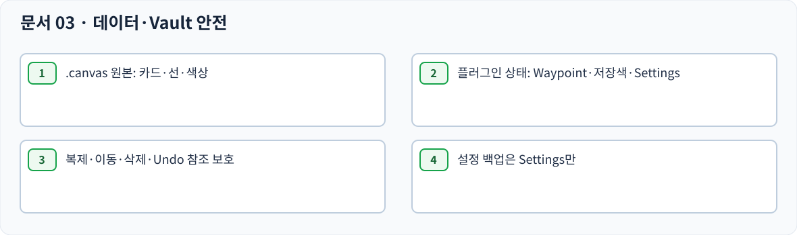

# 03 — DATA & SAFETY · 원본 보호·생명주기

> 문서 상태: 사용자 검수용. 구현 완료 아님. `SWAP-01`은 사용자 최종 결정으로 해결됐다. 크기가 다른 카드도 간격 보존을 우선한다.

## 데이터 경계

| 데이터 | 기준 상태 | 삭제·복원 규칙 |
|---|---|---|
| Canvas 카드·위치·크기·연결선·적용색 | Vault `.canvas` 원본 | 플러그인 비활성화/제거만으로 삭제 금지 |
| 카드 Waypoint | Canvas별 플러그인 참조 | 카드 현재 위치 추적, 카드 삭제 시 해제·Undo 복원 |
| 카메라 Waypoint | Canvas별 플러그인 상태 | 화면 좌표와 Zoom 복원 |
| Waypoint 이름 | 플러그인 데이터 | 등록 때 자동, 사용자 변경, 덮어쓰면 새 이름 |
| 사용자 색상 목록 | 모든 Canvas에서 공유 | 칩 삭제해도 카드 원본 색은 유지 |
| Settings / UI 크기 | 플러그인 설정 | 재실행에도 저장·복원 |
| Undo/Redo 이력 | Canvas별 세션 | Obsidian 재시작 후 초기화 |

## 복제·이동·실패·원자성

카드 생성과 연쇄 밀어내기는 하나의 논리 작업이며 중간 실패 시 부분 이동을 남기지 않는다. Canvas 복제 시 Waypoint 등록도 복제하고 참조는 복사본 카드로 연결되어야 한다. Canvas rename/move 뒤에도 등록 정보를 유지한다. 원본을 임의 덮어쓰지 않는다. 외부 파일 관리자와의 상호작용 범위는 기술 검증이다.

- **CM-062 카드 Waypoint** — 카드 Waypoint는 지정 카드의 현재 위치를 추적하며 호출 시 중앙에 배치하고 현재 Zoom을 유지한다. [전후 도식](diagrams/CM-062.svg)
- **CM-063 카메라 Waypoint** — 카메라 Waypoint는 등록 당시 Canvas 화면 위치와 Zoom을 저장하고 호출하면 복원한다. [전후 도식](diagrams/CM-063.svg)
- **CM-064 번호 공유** — 카드/카메라 Waypoint는 숫자패드 번호를 공유하며 한 번호에 하나만 등록한다. [전후 도식](diagrams/CM-064.svg)
- **CM-065 카드 등록 키** — Ctrl+숫자패드 1~9로 카드 Waypoint를 등록하거나 같은 대상 재입력 시 해제한다. [전후 도식](diagrams/CM-065.svg)
- **CM-066 카메라 등록 키** — Ctrl+Shift+숫자패드 1~9로 현재 카메라 위치·Zoom Waypoint를 등록한다. [전후 도식](diagrams/CM-066.svg)
- **CM-067 등록 번호 호출** — 숫자패드 1~9만 누르면 해당 Canvas의 등록 Waypoint로 이동한다. [전후 도식](diagrams/CM-067.svg)
- **CM-068 같은 대상 재입력 해제** — 이미 1번에 A가 등록되어 있을 때 A에서 Ctrl+Num1을 다시 누르면 1번을 해제한다. [전후 도식](diagrams/CM-068.svg)
- **CM-069 다른 대상 덮어쓰기** — 1번에 A 등록 후 B에서 Ctrl+Num1을 누르면 A의 등록·배지가 사라지고 B의 정보로 덮어쓴다. [전후 도식](diagrams/CM-069.svg)
- **CM-070 덮어쓰기 Undo** — Waypoint 덮어쓰기는 Ctrl+Z로 기존 대상과 이름 등 등록 정보를 복원할 수 있다. [전후 도식](diagrams/CM-070.svg)
- **CM-071 텍스트 이름 자동 생성** — 카드 Waypoint의 기본 이름은 등록 당시 텍스트 카드 첫 줄로 만들고 이후 내용이 변해도 자동 갱신하지 않는다. [전후 도식](diagrams/CM-071.svg)
- **CM-072 빈·파일 이름** — 빈 텍스트 카드 등록 이름은 카드 N, Markdown/이미지/Canvas 파일 카드 이름은 파일명이다. [전후 도식](diagrams/CM-072.svg)
- **CM-073 카메라 이름** — 카메라 Waypoint 기본 이름은 카메라 Waypoint N 형태로 생성한다. [전후 도식](diagrams/CM-073.svg)
- **CM-074 덮어쓰기 이름 초기화** — 다른 대상에 번호를 덮어쓰면 기존 사용자 지정 이름을 버리고 새 이름을 자동 생성한다. [전후 도식](diagrams/CM-074.svg)
- **CM-075 카드 삭제와 등록 해제** — Waypoint 등록 카드가 삭제되면 등록도 자동 해제한다. [전후 도식](diagrams/CM-075.svg)
- **CM-076 카드 삭제 Undo 복원** — 등록 카드 삭제를 Ctrl+Z로 되돌리면 카드와 등록된 Waypoint를 함께 복원한다. [전후 도식](diagrams/CM-076.svg)
- **CM-077 Canvas별 독립 등록** — Waypoint는 Canvas마다 독립 관리하고 서로 같은 번호를 사용해도 충돌하지 않는다. [전후 도식](diagrams/CM-077.svg)
- **CM-078 영구 저장** — Waypoint는 Obsidian 재시작 뒤에도 유지되며 다시 해당 Canvas에서 호출 가능하다. [전후 도식](diagrams/CM-078.svg)
- **CM-079 Canvas 복제** — Canvas를 복제하면 Waypoint도 복제되고 카드 참조는 복사본 해당 카드로 재매핑된다. [전후 도식](diagrams/CM-079.svg)
- **CM-080 Canvas rename/move** — Canvas 파일명이나 폴더 경로가 변경되어도 Waypoint 등록을 유지한다. [전후 도식](diagrams/CM-080.svg)
- **CM-081 카드 위치 이동** — Waypoint를 등록한 카드가 다른 위치로 옮겨져도 같은 카드를 따라간다. [전후 도식](diagrams/CM-081.svg)
- **CM-082 번호 배지 위치** — 등록한 Waypoint 번호는 카드 왼쪽 위에 항상 표시하며 카드 Zoom과 관계없이 화면상 크기가 같다. [전후 도식](diagrams/CM-082.svg)
- **CM-083 배지 겹침 처리** — 여러 Waypoint 배지가 겹쳐도 각 카드의 왼쪽 위 위치를 자동 조정하지 않는다. [전후 도식](diagrams/CM-083.svg)
- **CM-084 팝업 토글 키** — Ctrl+Alt+W로 Waypoint Manager를 열고 동일 키로 닫으며 사용자 단축키 변경 가능하다. [전후 도식](diagrams/CM-084.svg)
- **CM-085 커서 위치** — Waypoint Manager는 현재 마우스 커서 근처에 열리고 Canvas 위에 떠 있지만 Canvas 작업을 막지 않는다. [전후 도식](diagrams/CM-085.svg)
- **CM-086 화면 경계** — 화면 가장자리에 커서가 있으면 팝업이 잘리지 않도록 자동으로 화면 안쪽으로 위치를 조정한다. [전후 도식](diagrams/CM-086.svg)
- **CM-087 팝업 외부 클릭** — Waypoint Manager 밖을 클릭하면 즉시 팝업이 닫힌다. [전후 도식](diagrams/CM-087.svg)
- **CM-088 Canvas 전환** — Canvas 파일을 전환하면 열린 Manager가 자동으로 닫힌다. [전후 도식](diagrams/CM-088.svg)
- **CM-089 외곽 드래그 크기 조절** — 상하좌우 외곽 테두리와 네 모서리 자체를 잡아 팝업의 크기를 마우스로 조절한다. 별도 버튼 아님. [전후 도식](diagrams/CM-089.svg)
- **CM-090 마지막 크기 복원** — 팝업의 마지막 크기를 저장하고 닫았다 열거나 앱 재실행 후 복원한다. [전후 도식](diagrams/CM-090.svg)
- **CM-091 항목만 목록 표시** — Waypoint Manager는 등록된 번호만 오름차순으로 보여주며 미등록 번호는 표시하지 않는다. [전후 도식](diagrams/CM-091.svg)
- **CM-092 팝업 높이·스크롤** — 소형 기본 팝업이며 항목이 많아지면 최대 높이 안에서 내부 스크롤한다. 정확한 초기 px는 미확정. [전후 도식](diagrams/CM-092.svg)
- **CM-093 목록 클릭 이동** — Manager 목록 항목을 클릭하면 해당 Waypoint로 이동하고 팝업은 자동 닫힌다. [전후 도식](diagrams/CM-093.svg)
- **CM-094 인라인 이름 편집** — 이름을 목록에서 바로 편집하며 Enter는 저장, Esc는 취소한다. [전후 도식](diagrams/CM-094.svg)
- **CM-095 이름 편집 외부 클릭** — 이름 편집 중 팝업 외부를 클릭하면 입력 내용을 취소하고 팝업을 닫는다. [전후 도식](diagrams/CM-095.svg)
- **CM-096 목록 삭제** — Manager 목록 삭제 아이콘 클릭 시 확인 없이 Waypoint 등록만 제거하고 원본 카드는 유지한다. [전후 도식](diagrams/CM-096.svg)
- **CM-097 색상 팔레트 토글** — Ctrl+Alt+C로 색상 팔레트를 커서 근처에 열고 다시 입력하면 닫는다. 사용자 단축키 변경 가능하다. [전후 도식](diagrams/CM-097.svg)
- **CM-098 다중 Item 색상** — 색상 변경을 지원하는 모든 선택 Canvas Item에 하나의 선택 색상을 일괄 적용하고 팔레트를 닫는다. [전후 도식](diagrams/CM-098.svg)
- **CM-099 기본+사용자 색상** — Obsidian 기본 색상과 사용자가 등록한 색상 모두를 같은 팝업에서 선택할 수 있다. [전후 도식](diagrams/CM-099.svg)
- **CM-100 사용자 색상 추가** — 시각적 Color Picker에서 색상을 선택하면 별도 저장 버튼 없이 즉시 팔레트에 저장한다. HEX 직접 입력 UI 없음. [전후 도식](diagrams/CM-100.svg)
- **CM-101 동일 색상 중복 금지** — 동일 사용자 색상은 목록에 한 번만 저장한다. [전후 도식](diagrams/CM-101.svg)
- **CM-102 Canvas 전체 공유** — 사용자가 추가한 색상 목록은 Canvas마다 별도로 저장하지 않고 전 Canvas에서 사용한다. [전후 도식](diagrams/CM-102.svg)
- **CM-103 색상 칩 삭제** — 사용자 색상 칩을 우클릭하면 저장 목록에서 삭제할 수 있으나 이미 색칠된 Canvas 카드는 변하지 않는다. [전후 도식](diagrams/CM-103.svg)
- **CM-104 선택 없이 취소** — Esc·팝업 밖 클릭·단축키 재입력으로 닫되 색상을 선택하지 않았다면 카드 색상을 변경하지 않는다. [전후 도식](diagrams/CM-104.svg)
- **CM-105 기본 색상 복원 항목 제외** — 기본 색상 복원용 별도 메뉴 항목은 추가하지 않고 Obsidian 기존 기능을 사용한다. [전후 도식](diagrams/CM-105.svg)
- **CM-106 일괄 색상 Undo** — 다른 기존 색상을 갖는 카드 여러 개를 일괄 변경한 경우 Undo 한 번으로 개별 원래 색상을 모두 복원한다. [전후 도식](diagrams/CM-106.svg)
- **CM-107 Undo/Redo 키** — Undo는 Ctrl+Z, Redo는 Ctrl+Shift+Z를 사용한다. [전후 도식](diagrams/CM-107.svg)
- **CM-108 작업별 역순** — 생성→크기→색상 변경 순서로 실행했으면 Undo는 색상→크기→생성 순이다. [전후 도식](diagrams/CM-108.svg)
- **CM-109 Redo 복구 순서** — 여러 작업을 역순 Undo했다면 Redo는 원래 실행 순으로 복원한다. [전후 도식](diagrams/CM-109.svg)
- **CM-110 새 작업 후 Redo 초기화** — Undo 후 새로운 작업을 실행하면 이전 Redo 기록은 초기화된다. [전후 도식](diagrams/CM-110.svg)
- **CM-111 Canvas별 기록** — Undo/Redo 이력은 Canvas별 독립 관리하고 Obsidian 재실행 뒤 초기화한다. [전후 도식](diagrams/CM-111.svg)
- **CM-112 기본 Undo 제한** — Undo 기록의 최대 개수는 Obsidian 기본 제한을 따르며 플러그인 설정을 추가하지 않는다. [전후 도식](diagrams/CM-112.svg)
- **CM-113 다중 카드 이동 Undo** — 여러 카드를 함께 방향키로 이동했다면 Ctrl+Z 한 번으로 전체 이동 위치를 복원한다. [전후 도식](diagrams/CM-113.svg)
- **CM-114 연속 이동 Undo** — 방향키를 길게 눌러 다중 카드가 여러 번 움직여도 한 번의 키 누름을 하나의 Undo 작업으로 취급한다. [전후 도식](diagrams/CM-114.svg)
- **CM-115 Obsidian 기본 방향키 우선** — 일반 방향키 카드 이동의 기본 동작을 중복 구현하지 않고 Obsidian 동작을 우선한다. [전후 도식](diagrams/CM-115.svg)
- **CM-116 Undo 후 선택 상태** — 다중 선택 이동을 Undo한 뒤 선택 상태의 유지/해제는 사용자 미확정이다. 먼저 Obsidian 기본 동작을 검증한다. [전후 도식](diagrams/CM-116.svg)
- **CM-117 Canvas 원본 데이터** — 카드 내용·위치·크기·연결선·적용 색상은 Canvas 원본이며 플러그인 제거만으로 삭제하지 않는다. [전후 도식](diagrams/CM-117.svg)
- **CM-118 플러그인 전용 데이터** — Waypoint·사용자 색상 목록·Settings 값은 Canvas 카드에 적용된 실제 색상과 분리해 관리한다. [전후 도식](diagrams/CM-118.svg)
- **CM-119 비활성화 보존** — 플러그인을 껐다 켜도 Waypoint·색상 목록·설정·팝업 크기가 유지된다. [전후 도식](diagrams/CM-119.svg)
- **CM-120 제거 후 재설치 보존 요구** — 제거 후 재설치에도 플러그인 전용 데이터 보존을 요구한다. 실제 제거 정책·저장 위치는 Codex가 검증해야 한다. [전후 도식](diagrams/CM-120.svg)
- **CM-121 설정만 백업** — 백업 대상은 Settings 값만 포함한다. Waypoint·사용자 색상 목록·Canvas·Markdown·Undo 기록은 제외한다. [전후 도식](diagrams/CM-121.svg)
- **CM-122 백업 위치 사용자 선택** — Windows 저장 대화상자에서 백업 파일 저장 위치를 직접 선택한다. [전후 도식](diagrams/CM-122.svg)
- **CM-123 복원 확인 후 전체 교체** — 백업 설정을 복원할 때 확인창 승인 후 현재 설정 전체를 교체한다. 취소하면 변경하지 않는다. [전후 도식](diagrams/CM-123.svg)
- **CM-124 유효성 오류 전체 중단** — 백업 파일이 손상되었거나 유효하지 않으면 부분 적용 없이 복원 전체 중단, 기존 모든 데이터 유지 및 오류 안내. [전후 도식](diagrams/CM-124.svg)
- **CM-125 외부 rename/move 검증** — Canvas 외부 파일 관리자 복제·이동까지 Waypoint 참조가 유지되는지는 검증 전 보장하지 않는다. [전후 도식](diagrams/CM-125.svg)

## 설정 백업과 플러그인 데이터 보존은 다르다

**설정 파일 백업 대상은 Settings만**이다. 플러그인을 제거한 후에도 Waypoint와 색상 팔레트를 보존하고 재설치 후 복원하도록 요구하지만, 그 과정이 Settings 백업 파일에 이 데이터를 포함한다는 뜻은 아니다.

