# 04 — ACCEPTANCE TESTS · 관찰 가능한 완료 기준

> 문서 상태: 사용자 검수용. 구현 완료 아님. `SWAP-01`은 사용자 최종 결정으로 해결됐다. 크기가 다른 카드도 간격 보존을 우선한다.

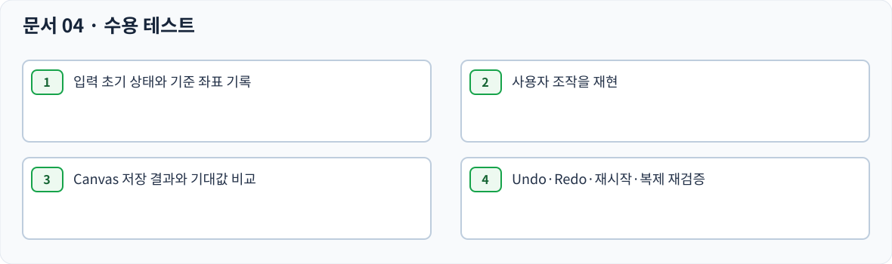

이 문서의 모든 테스트는 **실행 전** 상태이다. 그림이 있다고 실제 플러그인 동작이 검증된 것은 아니다. T06/T38은 SWAP-01 확정 사례를 기준으로 테스트한다. **테스트 결과는 미실행**이며 구현 통과를 뜻하지 않는다.

### T01 · Ctrl+방향키로 빈 공간에 카드 생성

- **초기/입력:** Ctrl+방향키로 빈 공간에 카드 생성
- **관찰 가능한 완료조건:** 설정 기본 크기·Canvas 100px 간격, 새 카드 선택, 자동 편집 없음
- **연결 요구사항:** CM-001, CM-002, CM-004, CM-005, CM-006, CM-007, CM-008
- **실행 상태:** 미실행

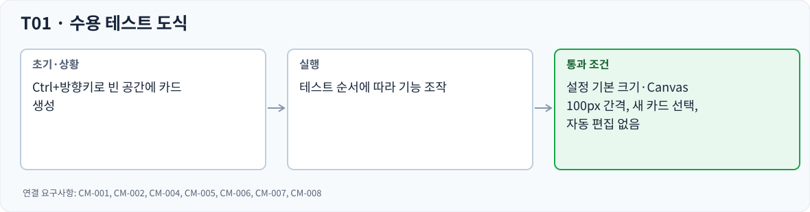

### T02 · Ctrl+방향키 생성 중 충돌·연결·연쇄 이동

- **초기/입력:** Ctrl+방향키 생성 중 충돌·연결·연쇄 이동
- **관찰 가능한 완료조건:** 기준 A 고정, 영향 대상 동반 이동, 연결선 보존
- **연결 요구사항:** CM-001, CM-003, CM-015, CM-016, CM-017, CM-018, CM-019, CM-020, CM-021
- **실행 상태:** 미실행

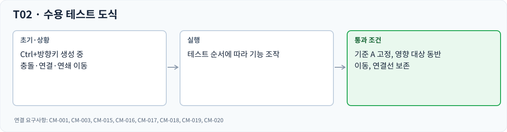

### T03 · 카드 생성과 밀어내기 Undo/Redo

- **초기/입력:** 카드 생성과 밀어내기 Undo/Redo
- **관찰 가능한 완료조건:** Undo 한 번에 생성/밀어내기 전부 복원, Redo 재적용
- **연결 요구사항:** CM-022, CM-107, CM-108, CM-109, CM-110, CM-113, CM-114
- **실행 상태:** 미실행

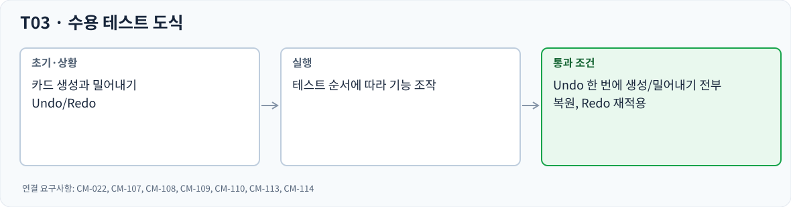

### T04 · Tab 삽입 공간 충분

- **초기/입력:** Tab 삽입 공간 충분
- **관찰 가능한 완료조건:** 새 카드 삽입, 아래 기존 카드 이동 없음
- **연결 요구사항:** CM-009, CM-010, CM-012, CM-013
- **실행 상태:** 미실행

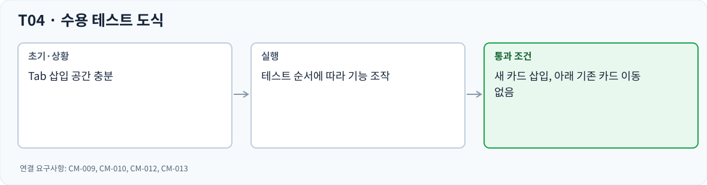

### T05 · Tab 삽입 공간 일부 부족

- **초기/입력:** Tab 삽입 공간 일부 부족
- **관찰 가능한 완료조건:** 부족분만큼 아래 카드 이동, 기존 간격 유지
- **연결 요구사항:** CM-009, CM-014
- **실행 상태:** 미실행

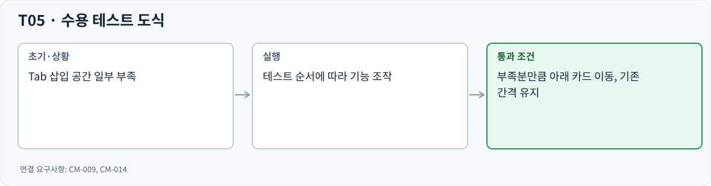

### T06 · 위치 교환 후보 둘·크기 다름

- **초기/입력:** 위치 교환 후보 둘·크기 다름
- **관찰 가능한 완료조건:** X 오차 기본 40px 안에서 세로 최단 후보를 고르고, 원래 카드 크기·연결·선택 상태와 기존 간격을 유지해 좌표 보정. 예시 E(100,100,h80), C(120,280,h160) → C(100,100), E(120,360), 간격100px.
- **연결 요구사항:** CM-023, CM-024, CM-025, CM-027
- **실행 상태:** 미실행

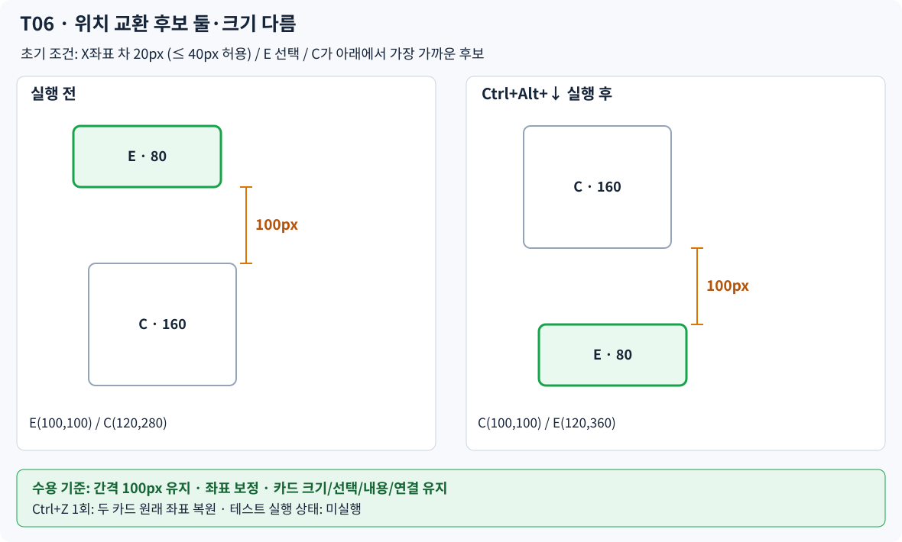

### T07 · 위치 교환 후보 없음

- **초기/입력:** 위치 교환 후보 없음
- **관찰 가능한 완료조건:** 무동작·무알림
- **연결 요구사항:** CM-026, CM-028
- **실행 상태:** 미실행

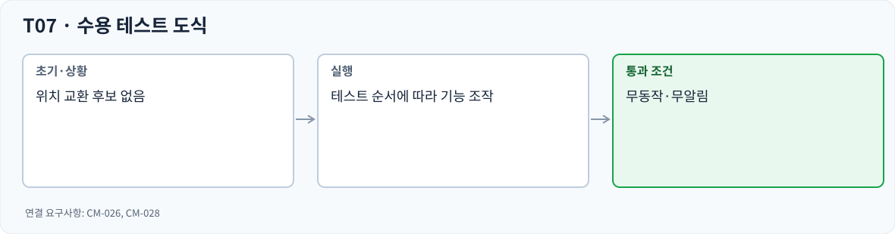

### T08 · 교환 후 Undo

- **초기/입력:** 교환 후 Undo
- **관찰 가능한 완료조건:** 두 카드 위치 모두 원상 복원
- **연결 요구사항:** CM-029, CM-030
- **실행 상태:** 미실행

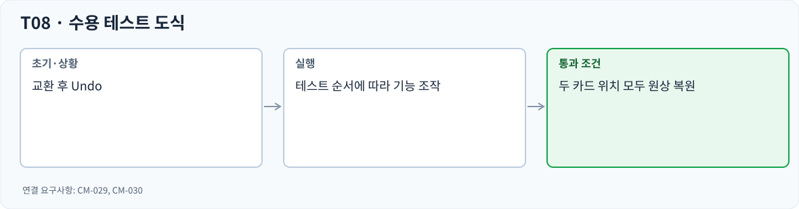

### T09 · 단일 카드 수동 크기 조절

- **초기/입력:** 단일 카드 수동 크기 조절
- **관찰 가능한 완료조건:** ±20px, 좌상단 고정, 겹침 허용
- **연결 요구사항:** CM-031, CM-032, CM-033, CM-034, CM-035, CM-036
- **실행 상태:** 미실행

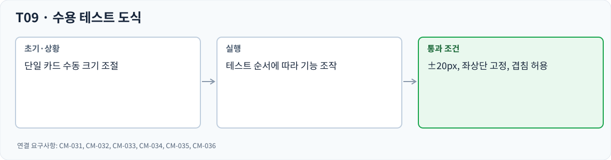

### T10 · 수동 크기 키 길게 누름

- **초기/입력:** 수동 크기 키 길게 누름
- **관찰 가능한 완료조건:** 반복 조절, 해제 시 정지, Undo 한 번
- **연결 요구사항:** CM-037, CM-038
- **실행 상태:** 미실행

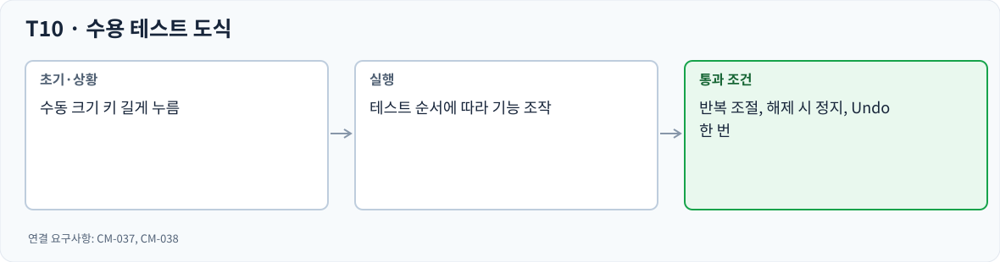

### T11 · Auto Resize ON 편집 종료

- **초기/입력:** Auto Resize ON 편집 종료
- **관찰 가능한 완료조건:** 변경 없어도 내용 기준 가로/세로, 주변 이동 없음
- **연결 요구사항:** CM-039, CM-040, CM-041, CM-042, CM-043, CM-044, CM-045, CM-046, CM-050
- **실행 상태:** 미실행

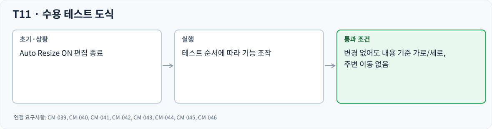

### T12 · Auto Resize 크기 Undo

- **초기/입력:** Auto Resize 크기 Undo
- **관찰 가능한 완료조건:** 첫 Undo는 크기만 복원, 텍스트 유지, ON 유지
- **연결 요구사항:** CM-048, CM-049
- **실행 상태:** 미실행

### T13 · Alt 탐색 기본

- **초기/입력:** Alt 탐색 기본
- **관찰 가능한 완료조건:** 방향 최단 카드 선택, 중앙, Zoom 유지, 250ms
- **연결 요구사항:** CM-052, CM-053, CM-054, CM-055, CM-056, CM-057, CM-058
- **실행 상태:** 미실행

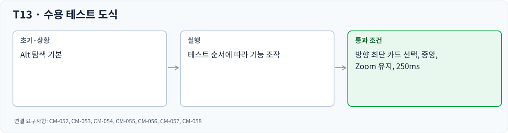

### T14 · 탐색 이동 도중 다음 입력

- **초기/입력:** 탐색 이동 도중 다음 입력
- **관찰 가능한 완료조건:** 이전 애니메이션 취소, 새 대상 중앙 정렬
- **연결 요구사항:** CM-059
- **실행 상태:** 미실행

### T15 · 탐색 길게·편집 중·다중 선택

- **초기/입력:** 탐색 길게·편집 중·다중 선택
- **관찰 가능한 완료조건:** 길게 1회, 편집·다중 선택에서 미작동
- **연결 요구사항:** CM-051, CM-060, CM-061
- **실행 상태:** 미실행

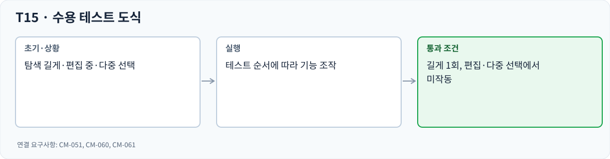

### T16 · Waypoint 등록·재입력·덮어쓰기

- **초기/입력:** Waypoint 등록·재입력·덮어쓰기
- **관찰 가능한 완료조건:** 같은 대상 해제, 다른 대상 덮어쓰기·이름 재생성
- **연결 요구사항:** CM-064, CM-065, CM-068, CM-069, CM-071, CM-072, CM-074
- **실행 상태:** 미실행

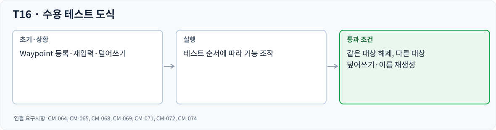

### T17 · Waypoint Undo/Redo

- **초기/입력:** Waypoint Undo/Redo
- **관찰 가능한 완료조건:** 등록·덮어쓰기·해제·이름 변경 이전 상태 복원
- **연결 요구사항:** CM-070
- **실행 상태:** 미실행

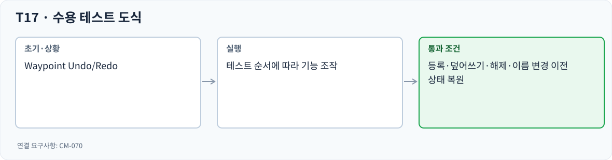

### T18 · 카드 위치 이동 후 Waypoint 호출

- **초기/입력:** 카드 위치 이동 후 Waypoint 호출
- **관찰 가능한 완료조건:** 현재 카드 위치·Zoom 유지
- **연결 요구사항:** CM-062, CM-067, CM-081, CM-082, CM-083
- **실행 상태:** 미실행

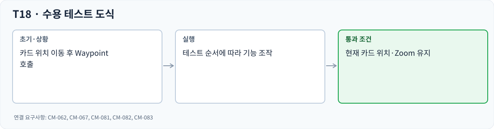

### T19 · 카메라 Waypoint 호출

- **초기/입력:** 카메라 Waypoint 호출
- **관찰 가능한 완료조건:** 등록 화면 위치와 Zoom 복원
- **연결 요구사항:** CM-063, CM-066, CM-073
- **실행 상태:** 미실행

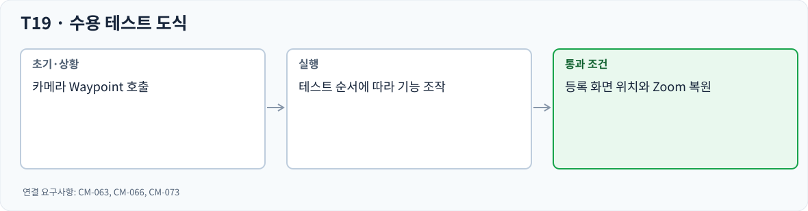

### T20 · Canvas 복제·rename·move

- **초기/입력:** Canvas 복제·rename·move
- **관찰 가능한 완료조건:** 복제 시 별도 카드 참조, 경로 변경 후 유지
- **연결 요구사항:** CM-077, CM-079, CM-080, CM-125
- **실행 상태:** 미실행

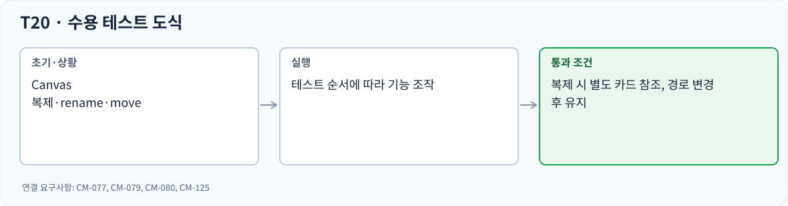

### T21 · Waypoint 카드 삭제 후 Undo

- **초기/입력:** Waypoint 카드 삭제 후 Undo
- **관찰 가능한 완료조건:** 카드와 Waypoint 복원
- **연결 요구사항:** CM-075, CM-076
- **실행 상태:** 미실행

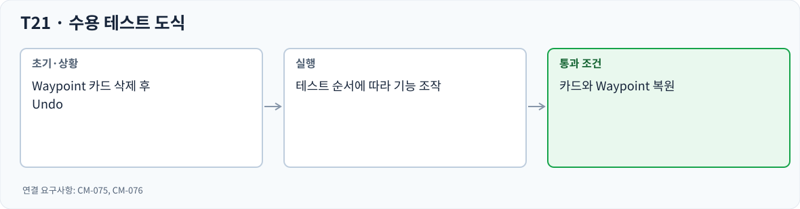

### T22 · Manager 팝업 열기·크기·상태

- **초기/입력:** Manager 팝업 열기·크기·상태
- **관찰 가능한 완료조건:** 커서 인접/경계 처리/외곽 드래그/크기 복원
- **연결 요구사항:** CM-084, CM-085, CM-086, CM-087, CM-088, CM-089, CM-090, CM-091, CM-092
- **실행 상태:** 미실행

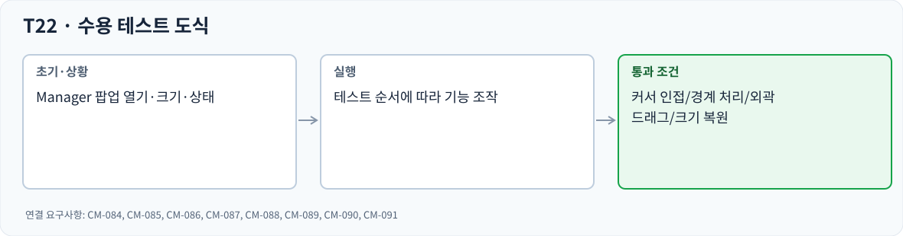

### T23 · Manager 이름 편집

- **초기/입력:** Manager 이름 편집
- **관찰 가능한 완료조건:** Enter 저장, Esc 취소, 외부 클릭 취소+닫기
- **연결 요구사항:** CM-094, CM-095
- **실행 상태:** 미실행

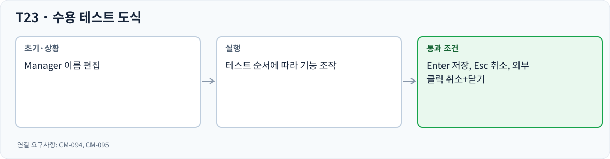

### T24 · Manager 클릭 이동·삭제

- **초기/입력:** Manager 클릭 이동·삭제
- **관찰 가능한 완료조건:** 항목 이동 후 닫기, 삭제는 등록만
- **연결 요구사항:** CM-093, CM-096
- **실행 상태:** 미실행

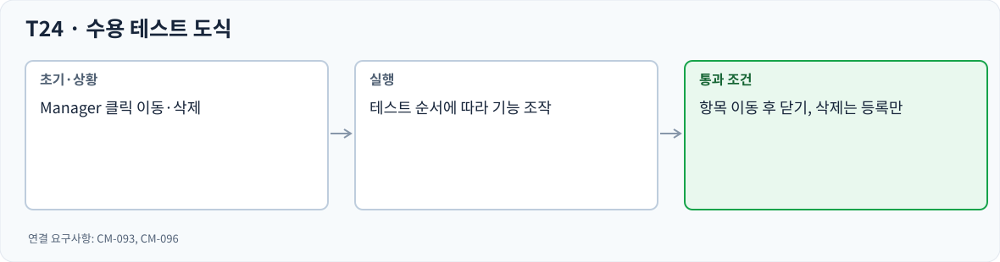

### T25 · 다중 색상 적용·Undo

- **초기/입력:** 다중 색상 적용·Undo
- **관찰 가능한 완료조건:** 지원 Item 일괄 적용, Undo 한 번에 각 원색 복원
- **연결 요구사항:** CM-097, CM-098, CM-104, CM-106
- **실행 상태:** 미실행

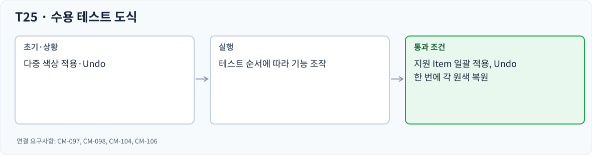

### T26 · 사용자 색상 저장·삭제

- **초기/입력:** 사용자 색상 저장·삭제
- **관찰 가능한 완료조건:** 중복 없는 공유 목록, 삭제 후 원본 색상 유지
- **연결 요구사항:** CM-099, CM-100, CM-101, CM-102, CM-103, CM-105
- **실행 상태:** 미실행

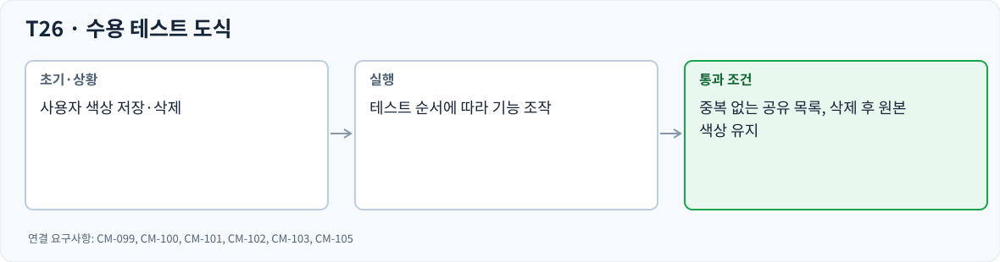

### T27 · 설정 백업·정상 복원

- **초기/입력:** 설정 백업·정상 복원
- **관찰 가능한 완료조건:** 설정만 포함, 경로 직접 선택, 승인 후 전체 교체
- **연결 요구사항:** CM-121, CM-122, CM-123
- **실행 상태:** 미실행

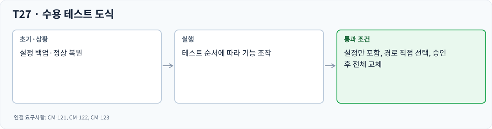

### T28 · 손상된 설정 백업 복원

- **초기/입력:** 손상된 설정 백업 복원
- **관찰 가능한 완료조건:** 전체 중단, 기존 설정과 Canvas/Waypoint/색상 보존
- **연결 요구사항:** CM-124
- **실행 상태:** 미실행

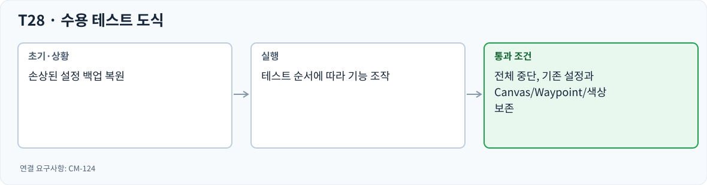

### T29 · 재시작·비활성화 후 데이터

- **초기/입력:** 재시작·비활성화 후 데이터
- **관찰 가능한 완료조건:** Waypoint·설정·색상 복원, Undo 기록은 재시작 시 초기화
- **연결 요구사항:** CM-047, CM-078, CM-111, CM-117, CM-119
- **실행 상태:** 미실행

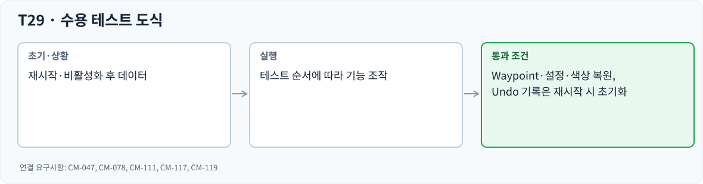

### T30 · 플러그인 제거·재설치

- **초기/입력:** 플러그인 제거·재설치
- **관찰 가능한 완료조건:** 전용 데이터 복원 요구, 기술 검증 결과 기록
- **연결 요구사항:** CM-117, CM-118, CM-120
- **실행 상태:** 미실행

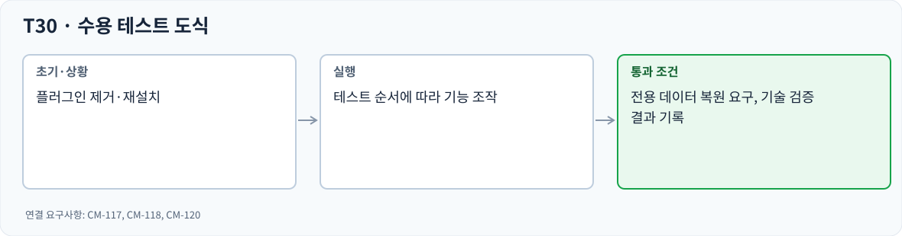

### T31 · 대형 Canvas 성능·안전

- **초기/입력:** 대형 Canvas 성능·안전
- **관찰 가능한 완료조건:** Pan/Zoom/Drag/연쇄 이동 후 노드 누락·파일 손상 없는지 측정
- **연결 요구사항:** 수동 검토 필요
- **실행 상태:** 미실행

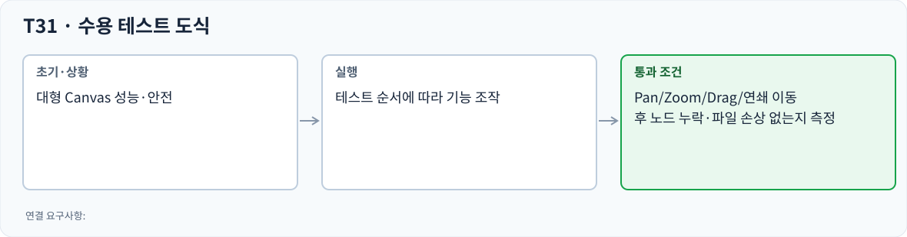

### T32 · 테마·단축키·기본 기능

- **초기/입력:** 테마·단축키·기본 기능
- **관찰 가능한 완료조건:** Light/Dark/Resize/키 충돌과 Canvas 기본 동작 검사
- **연결 요구사항:** CM-112, CM-115, CM-116
- **실행 상태:** 미실행

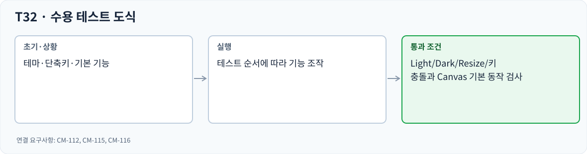

### T33 · Tab 연결 생성 / 일반 생성 비교

- **초기/입력:** Tab 연결 생성 / 일반 생성 비교
- **관찰 가능한 완료조건:** 공통 삽입 동작, 모드별 연결선 유무 확인. 연결 기준 근거 부족 표시
- **연결 요구사항:** CM-011, CM-126
- **실행 상태:** 미실행

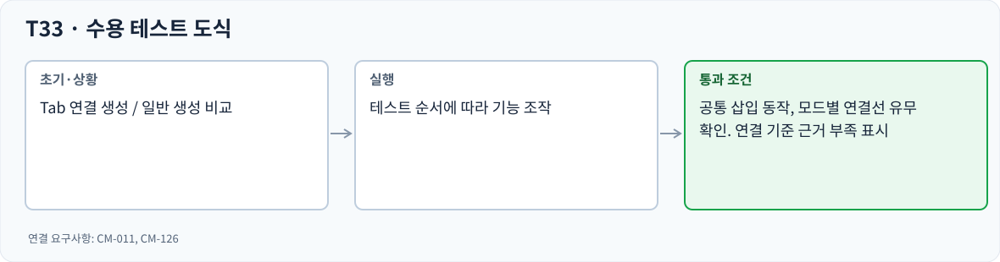

### T34 · Ctrl+Space 편집 전환

- **초기/입력:** Ctrl+Space 편집 전환
- **관찰 가능한 완료조건:** 선택 상태 → 편집 → 조작 상태 전환, 입력 손실 없음
- **연결 요구사항:** CM-127
- **실행 상태:** 미실행

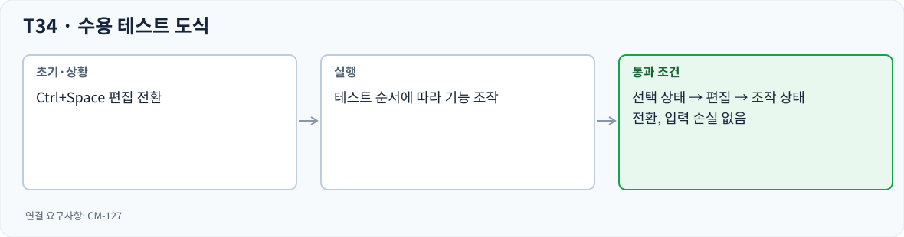

### T35 · 색상 단축키 변경

- **초기/입력:** 색상 단축키 변경
- **관찰 가능한 완료조건:** 사용자가 설정한 다른 키로 색상 팔레트 개폐
- **연결 요구사항:** CM-128
- **실행 상태:** 미실행

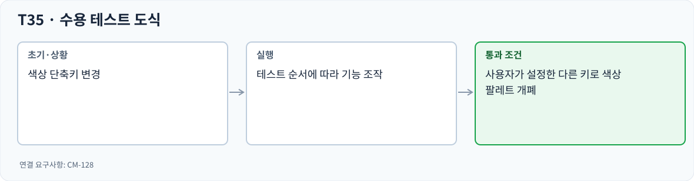

### T36 · 생성 모드 Context Menu

- **초기/입력:** 생성 모드 Context Menu
- **관찰 가능한 완료조건:** Ctrl 약 1초 후 작은 메뉴, ↑/↓ 모드 선택
- **연결 요구사항:** 수동 검토 필요
- **실행 상태:** 미실행

### T37 · 생성 후 입력 / 연결 Undo

- **초기/입력:** 생성 후 입력 / 연결 Undo
- **관찰 가능한 완료조건:** 생성 후 비편집, 생성+연결선+밀어내기 Undo 1회
- **연결 요구사항:** 수동 검토 필요
- **실행 상태:** 미실행

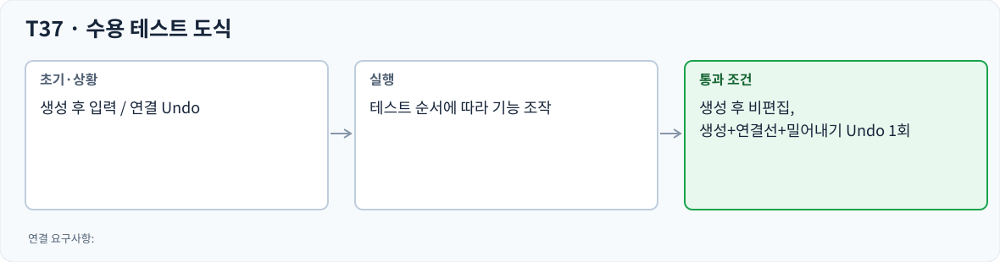

### T38 · 서로 다른 높이 카드 위치 교환

- **초기/입력:** 서로 다른 높이 카드 위치 교환
- **관찰 가능한 완료조건:** 확정 기대값: E(100,100,h80), C(120,280,h160), 간격100px → Ctrl+Alt+↓ → C(100,100,h160), E(120,360,h80), 간격100px. Ctrl+Z 1회로 이전 위치 복원.
- **연결 요구사항:** CM-023, CM-024, CM-025, CM-026, CM-029, CM-030
- **실행 상태:** 미실행

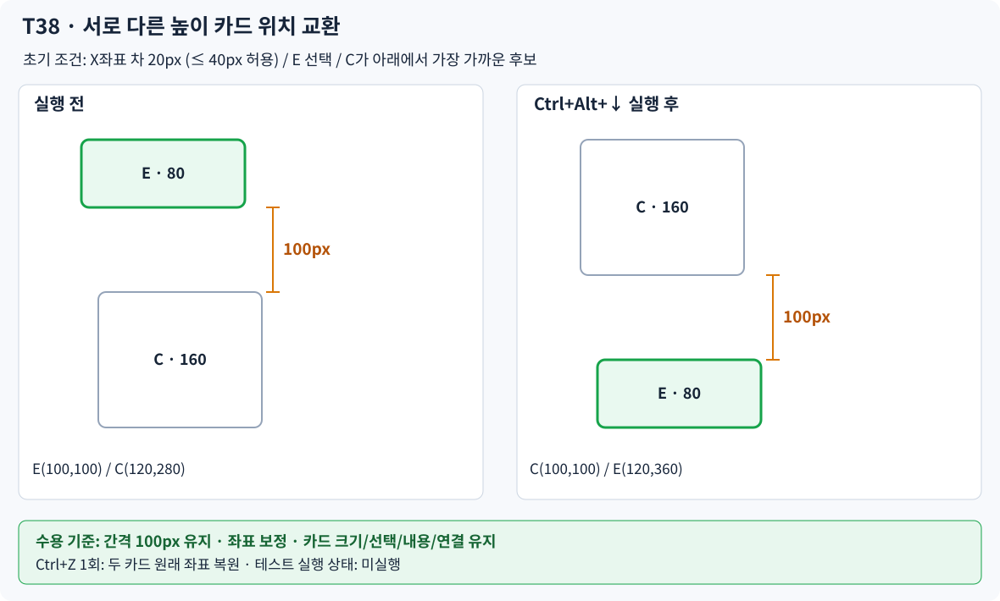

### T39 · Waypoint Manager 크기 조절 경계

- **초기/입력:** Waypoint Manager 크기 조절 경계
- **관찰 가능한 완료조건:** 외곽 8개 방향 드래그, 크기 저장, 화면 밖 차단
- **연결 요구사항:** 수동 검토 필요
- **실행 상태:** 미실행

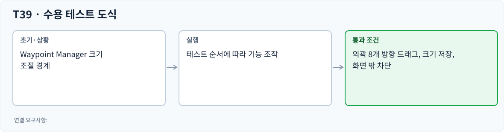

### T40 · 생성 기준 카드에 다중 연결 공유 카드

- **초기/입력:** 생성 기준 카드에 다중 연결 공유 카드
- **관찰 가능한 완료조건:** 공유 연결 카드 C는 고정, 기준 A도 고정
- **연결 요구사항:** 수동 검토 필요
- **실행 상태:** 미실행

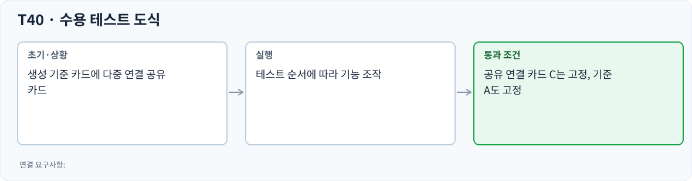

### T41 · 여러 Canvas 간 Undo 독립성

- **초기/입력:** 여러 Canvas 간 Undo 독립성
- **관찰 가능한 완료조건:** 현재 Canvas 작업만 취소, 다른 Canvas 상태 불변
- **연결 요구사항:** 수동 검토 필요
- **실행 상태:** 미실행

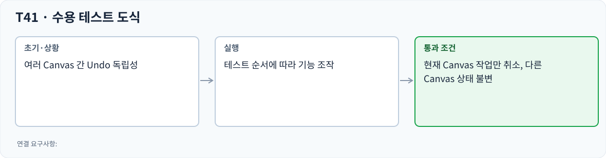

### T42 · 설정 복원 시 플러그인 데이터 분리

- **초기/입력:** 설정 복원 시 플러그인 데이터 분리
- **관찰 가능한 완료조건:** Waypoint 및 색상 목록 원본·플러그인 상태 변화 없음
- **연결 요구사항:** 수동 검토 필요
- **실행 상태:** 미실행

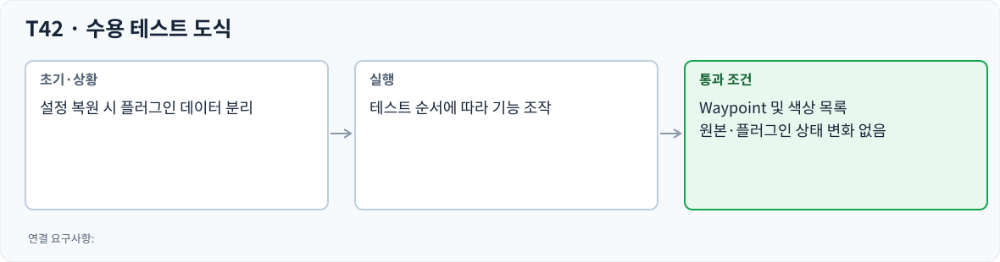

Critical/High: Vault 원본 손상, Undo 불일치, 부분 저장, 잘못된 Waypoint 참조, 설정 복원 중 부분 변경은 완료로 처리하지 않는다.

## T01~T37 실행 상황 전후 시각화

### T01 · Ctrl+방향키로 빈 공간에 카드 생성 (사례 도식)

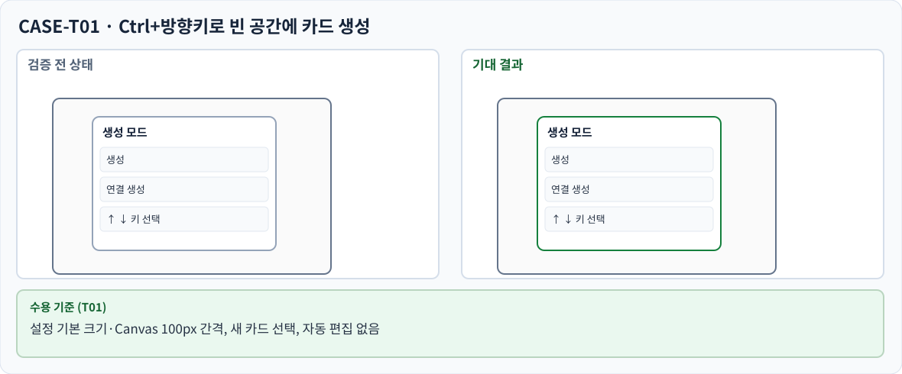

### T02 · Ctrl+방향키 생성 중 충돌·연결·연쇄 이동 (사례 도식)

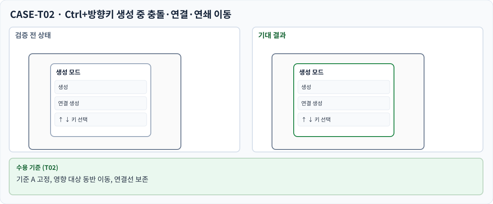

### T03 · 카드 생성과 밀어내기 Undo/Redo (사례 도식)

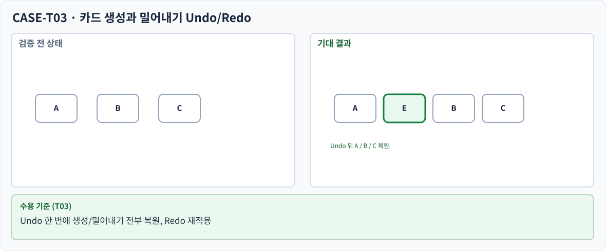

### T04 · Tab 삽입 공간 충분 (사례 도식)

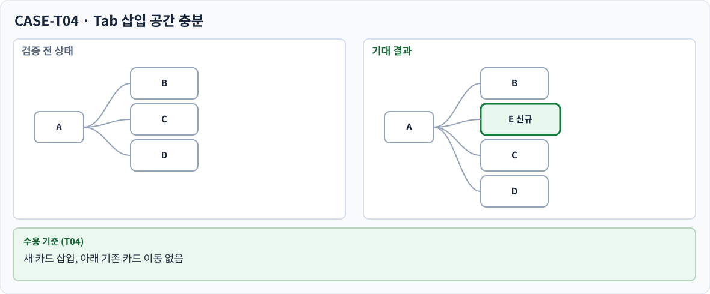

### T05 · Tab 삽입 공간 일부 부족 (사례 도식)

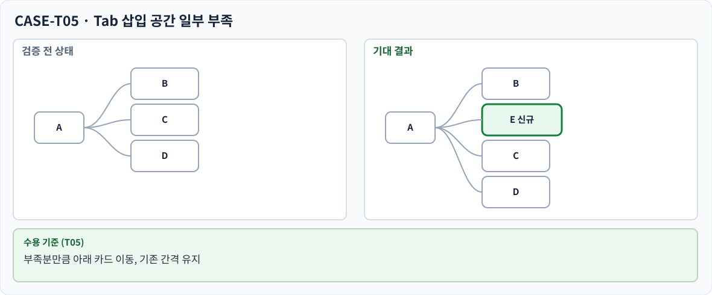

### T06 · 위치 교환 후보 둘·크기 다름 (사례 도식)

### T07 · 위치 교환 후보 없음 (사례 도식)

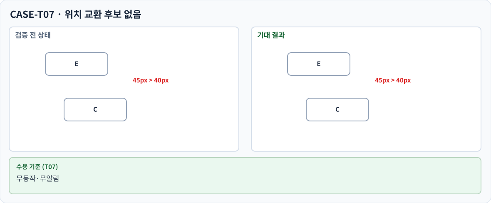

### T08 · 교환 후 Undo (사례 도식)

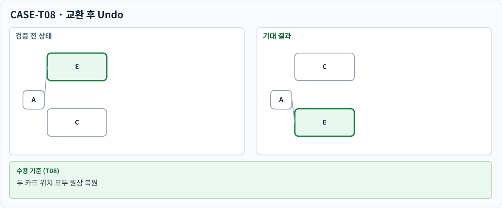

### T09 · 단일 카드 수동 크기 조절 (사례 도식)

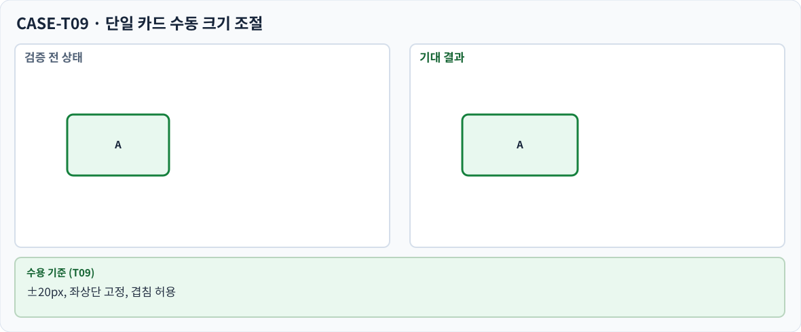

### T10 · 수동 크기 키 길게 누름 (사례 도식)

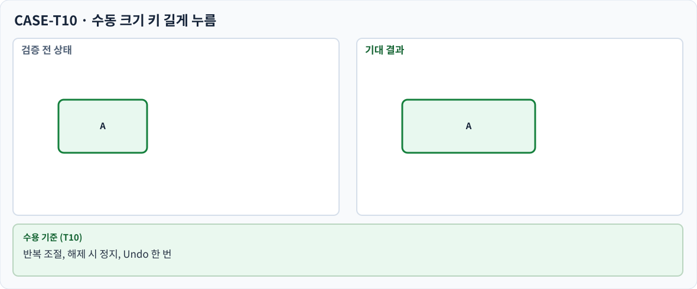

### T11 · Auto Resize ON 편집 종료 (사례 도식)

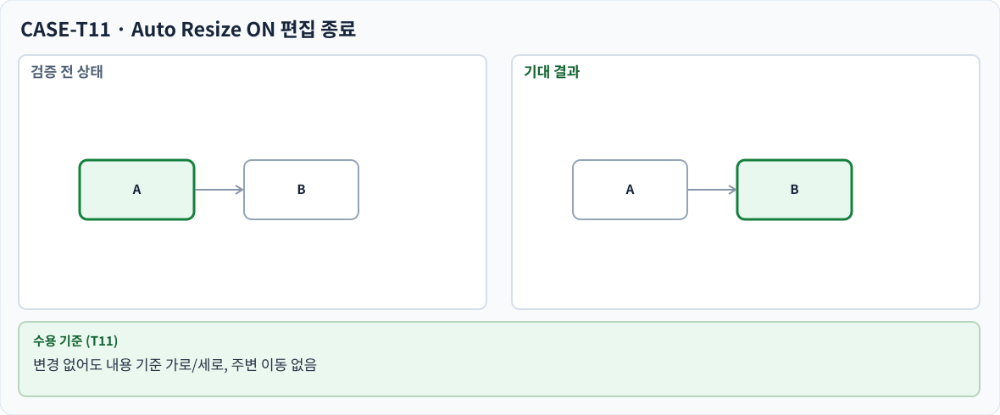

### T12 · Auto Resize 크기 Undo (사례 도식)

### T13 · Alt 탐색 기본 (사례 도식)

### T14 · 탐색 이동 도중 다음 입력 (사례 도식)

### T15 · 탐색 길게·편집 중·다중 선택 (사례 도식)

### T16 · Waypoint 등록·재입력·덮어쓰기 (사례 도식)

### T17 · Waypoint Undo/Redo (사례 도식)

### T18 · 카드 위치 이동 후 Waypoint 호출 (사례 도식)

### T19 · 카메라 Waypoint 호출 (사례 도식)

### T20 · Canvas 복제·rename·move (사례 도식)

### T21 · Waypoint 카드 삭제 후 Undo (사례 도식)

### T22 · Manager 팝업 열기·크기·상태 (사례 도식)

### T23 · Manager 이름 편집 (사례 도식)

### T24 · Manager 클릭 이동·삭제 (사례 도식)

### T25 · 다중 색상 적용·Undo (사례 도식)

### T26 · 사용자 색상 저장·삭제 (사례 도식)

### T27 · 설정 백업·정상 복원 (사례 도식)

### T28 · 손상된 설정 백업 복원 (사례 도식)

### T29 · 재시작·비활성화 후 데이터 (사례 도식)

### T30 · 플러그인 제거·재설치 (사례 도식)

### T31 · 대형 Canvas 성능·안전 (사례 도식)

### T32 · 테마·단축키·기본 기능 (사례 도식)

### T33 · Tab 연결 생성 / 일반 생성 비교 (사례 도식)

### T34 · Ctrl+Space 편집 전환 (사례 도식)

### T35 · 색상 단축키 변경 (사례 도식)

### T36 · 생성 모드 Context Menu (사례 도식)

### T37 · 생성 후 입력 / 연결 Undo (사례 도식)

