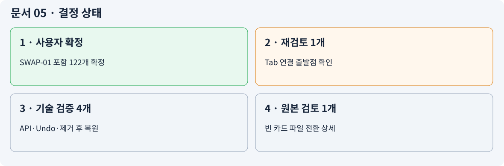
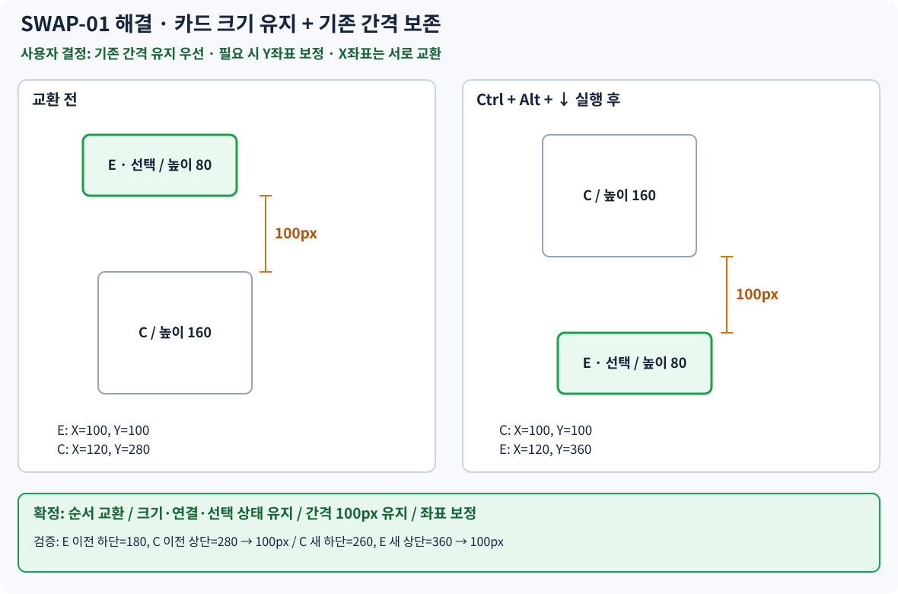

# 05 — PLANNING STATE · 확정/재검토/위험

> 문서 상태: 사용자 검수용. 구현 완료 아님. `SWAP-01`은 사용자 최종 결정으로 해결됐다. 크기가 다른 카드도 간격 보존을 우선한다.

## 상태 개요

| 상태 | 건수 | 의미 |
|---|---:|---|
| 확정 | 122 | 사용자 대화에서 동작 확정 |
| 재검토 | 1 | 연결 출발점 정합성의 원본 검토 필요 |
| 기술 검증 | 4 | 최종 구현을 위해 확인/검증 필요 |
| 원본 검토 | 1 | 최종 구현을 위해 확인/검증 필요 |

## 중요 재검토 사항

**SWAP-01 (P0 · 해결/확정):** 사용자가 크기 다른 카드의 위치 교환에서 **기존 간격 유지 우선, 필요한 만큼 좌표 보정**을 최종 확정했다. CM-024/025, T06/T38, SVG/HTML에 반영 완료. 단순 X·Y 좌표 원값 맞교환을 강제하지 않는다.

## 그 밖의 미확정·검증 사항

- **CM-011 [재검토]** Tab 연결 모드: 연결 출발점 판정에 별도 계층 정보를 임의 도입 금지 [도식](diagrams/CM-011.svg)
- **CM-050 [기술 검증]** 복수 카드 개별 조절: 단일 편집 종료 트리거와 다중 선택 지원을 임의로 병합하지 말 것 [도식](diagrams/CM-050.svg)
- **CM-116 [기술 검증]** Undo 후 선택 상태: 상태를 임의로 확정하지 말 것 [도식](diagrams/CM-116.svg)
- **CM-120 [기술 검증]** 제거 후 재설치 보존 요구: 제거 후 재설치에도 플러그인 전용 데이터 보존을 요구한다. 실제 제거 정책·저장 위치는 Codex가 검증해야 한다. [도식](diagrams/CM-120.svg)
- **CM-125 [기술 검증]** 외부 rename/move 검증: Canvas 외부 파일 관리자 복제·이동까지 Waypoint 참조가 유지되는지는 검증 전 보장하지 않는다. [도식](diagrams/CM-125.svg)
- **CM-126 [원본 검토]** 빈 카드 파일 전환: 파일 전환의 저장/Undo/누락 여부는 추가 자료 대조 [도식](diagrams/CM-126.svg)

## 범위 제외

Alt 탐색 자동 Zoom/Shift+2 Fit, Auto Resize 일회성 명령, 색상 팔레트 HEX 입력과 기본색 복원 전용 항목, 설정 백업에 Waypoint/색상목록/원본 Canvas 포함, Undo 이력 영구 저장, 임의 부모·자식 데이터 계층, 새로운 생성 단축키 임의 제안.

## 주요 위험과 Codex 위임

- Obsidian Canvas 공식 API 및 비공식 의존성 검증, Undo/Redo 통합 가능성: High
- 플러그인 제거 후 데이터 독립 보존 및 복원 실현: High
- 대량 연쇄 이동·순환 연결·다중 충돌 처리의 부분 변경 방지: High
- 다른 파일 관리자에서 Canvas 복제 시 Waypoint 참조 재설정: High
- 기존 Obsidian 단축키 충돌과 모바일/버전 범위: 검증 필요

## SWAP-01 변경 이력

| 항목 | 최종 사용자 결정 | 영향받는 문서 |
|---|---|---|
| SWAP-01 | 위치 교환은 기존 간격 보존 우선. 높이가 다르면 X좌표는 상호 교환, Y좌표는 순서 변경과 간격을 맞춰 보정한다. | CM-024, CM-025, T06, T38, SVG, HTML, Codex Handoff |

단순한 X·Y 원좌표 맞교환으로 간격을 변화시키는 예전 대안은 **채택하지 않는다.** 이 결정이 실제 Obsidian에서 구현 가능한지는 Codex 기술 검증 대상으로 남는다.
