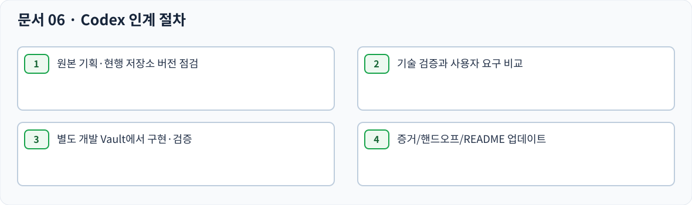

# 06 — CODEX HANDOFF · 구현 전 확인 사항

> 문서 상태: 사용자 검수용. 구현 완료 아님. `SWAP-01`은 사용자 최종 결정으로 해결됐다. 크기가 다른 카드도 간격 보존을 우선한다.

## Codex 현재 목표

확정 기획을 바탕으로 Obsidian Canvas 확장 기능을 구현한다. **SWAP-01은 사용자 결정으로 해결됐으며 기존 간격 유지가 우선**이다. 데이터 손실이 없는 별도 테스트 Vault에서 실제 검증한다.

## 정확한 작업 순서

1. 최초 `PROJECT_INSTRUCTIONS.md`와 본 팩을 대조한다(현재 자료에서 누락, 지침 제목 창작 금지).
2. 기존 저장소·manifest·현행 버전·기능·릴리즈 상태를 확인한다.
3. `01_PRODUCT_SPEC.md`·요구사항 ID·SVG·`04_ACCEPTANCE_TESTS.md` 간 교차검증한다.
4. `SWAP-01`은 확정: 높이 다른 카드의 위치를 교환할 때 X는 서로 교환하고, Y는 순서 변경 및 **기존 카드 간격 유지**를 위해 보정한다. 단순 X·Y 원좌표 교환으로 간격을 바꾸지 않는다.
5. 공식 Canvas API 범위, Windows/Obsidian 키 충돌, 기본 Undo 동작 및 파일 수명주기 제약을 검증한다.
6. 제약이 사용자 경험을 바꾸면 임의 대안 구현 전에 영향과 선택지를 보고한다.
7. 별도 테스트 Vault에서 시나리오별 Canvas 파일 diff, 실행 기록, 스크린샷, Undo/Redo 일관성을 증거로 남긴다.
8. README/HANDOFF.md/버전과 실제 구현·릴리즈 증거를 동기화한다.

## SWAP-01 구현 기대값 (사용자 확정)

E=(X100,Y100,높이80), C=(X120,Y280,높이160), 기존 간격100px → E 선택 후 `Ctrl+Alt+↓` → **C=(X100,Y100), E=(X120,Y360)**. 두 카드의 원래 높이·내용·연결선·선택 상태 유지, 간격100px 유지. `Ctrl+Z` 1회로 두 카드 좌표 복원. 다른 카드가 존재할 경우에도 기존 간격·겹침 방지 요구를 훼손하지 않는다. 구체 충돌 처리 구현은 테스트를 통해 검증한다.

## 절대 보존할 조건

- Canvas 좌표 간격 기본 100px, 수동 크기 기본 20px, 위치 교환 왼쪽 X 허용차 기본 40px.
- Alt 탐색 시 Zoom 변경 금지, 중앙 정렬, 기본 250ms.
- Canvas 원본 카드·위치·연결선·실제 색상 및 Waypoint 참조 보호.
- 생성·밀어내기 / 교환 / 다중 색상 변경 등은 한 번의 논리 Undo 작업.
- Settings 백업은 설정값만. Waypoint·사용자 색상 목록은 백업 제외.
- 세부 근거가 없으면 새 키·숨겨진 계층·대체 기능을 임의 추가하지 않는다.

## 인계 필수 링크

- [전체 HTML 검수 시안](interactive-preview.html)
- [요구사항 ID ↔ SVG ↔ 테스트 매핑](diagram-manifest.json)
- [SWAP-01 확정 좌표·간격 도식](diagrams/SWAP-01_RESOLVED.svg)
- [기술/문서/렌더링 검증 보고서](VERIFICATION_REPORT.md)

## 구현 완료 판정 금지 조건

Critical/High 결함, 한글 파일 경로 손상, 원본 Vault 파일의 의도치 않은 덮어쓰기, 연결선 손실, Undo/Redo 불일치, 설정 백업 복원 시 부분 변경, 재시작 후 Waypoint 손실이 확인되면 완료 선언 금지.

