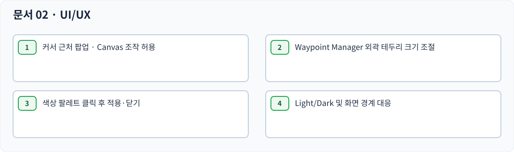

> **0.3.2 최신 정정:** [추가 사용자 검수 수정](FEEDBACK_0.3.2.md)이 Alt 탐색·화면 이동/줌 단축키·편집 확대/줄 따라가기·번호 배지의 최신 기준이다. 기존 도식과 다르면 이 정정을 우선한다.

> **2026-10-20 / 0.3.1 최신 정정:** [누적 사용자 피드백](FEEDBACK_0.3.1.md)을 우선한다. 생성 밀어내기는 제거했고, Auto Resize는 현재 너비 이내에서 축소·줄바꿈한다. 생성 포커스·Undo 선택·키보드 카메라·편집 확대·무선택 Alt를 반영했다. 아래 과거 SVG의 밀어내기/가로 확장 그림은 현재 동작 검증 자료가 아니다.

> 최신 정정: [개발 준비 기준](DEVELOPMENT_BASELINE.md). 기존 전후 예시·도식과 충돌하면 최신 동작 문장과 개발 준비 기준을 우선한다. 제품 구현·검증 완료를 뜻하지 않는다.

# 02 — UI / UX · 화면 및 조작

> 문서 상태: 사용자 검수용. 구현 완료 아님. `SWAP-01`은 사용자 최종 결정으로 해결됐다. 크기가 다른 카드도 간격 보존을 우선한다.

## 공통 인터페이스 원칙

Canvas 조작을 덮어쓰는 비모달 UI만 요구된 범위에서 사용한다. 기본 Obsidian 테마 Light/Dark에 대응하며 단축키 충돌은 개발 환경 검증 대상이다. 생성 메뉴와 Waypoint Manager·색상 팔레트는 서로 다른 UI이다. UI 시안은 확정된 조작과 참고용 시각 스타일을 구분한다.

## 01. 생성·삽입

- **CM-001 생성 모드 선택 (확정):** Ctrl을 약 1초 누르면 작은 생성 Context Menu가 열리고 상하 방향키로 생성/연결 생성 중 선택한다. [SVG](diagrams/CM-001.svg)
- **CM-002 일반 생성 (확정):** 일반 생성은 새 카드만 만든다. 연결선을 추가하지 않는다. [SVG](diagrams/CM-002.svg)
- **CM-003 연결 생성 (확정):** 연결 생성은 새 카드와 연결선을 함께 만든다. [SVG](diagrams/CM-003.svg)
- **CM-004 방향 생성 (확정):** — Ctrl+↑/↓/←/→를 입력하면 해당 방향으로 카드를 생성한다. 오른쪽 생성 시 두 카드의 세로 가운데를 맞춘다. Tab 왼쪽 정렬은 유지한다. [SVG](diagrams/CM-004.svg)
- **CM-005 생성 기본 간격 (확정):** 카드 기본 간격은 Canvas 좌표 100px이며 사용자가 Settings에서 수정 가능하다. 화면 Zoom과 혼동하지 않는다. [SVG](diagrams/CM-005.svg)
- **CM-006 새 카드 기본 크기 (확정):** — Tab과 Ctrl+방향키 모두 플러그인 설정의 기본 카드 가로·세로 크기를 사용한다. 최초 설정값은 Obsidian 기본 카드 크기로 시작하며 이후 사용자 설정값을 적용한다. 이전 카드의 크기를 복사하지 않는다. [SVG](diagrams/CM-006.svg)
- **CM-007 생성 후 선택 (확정):** 생성 즉시 새 카드를 선택하고 기존 선택은 해제한다. [SVG](diagrams/CM-007.svg)
- **CM-008 생성 후 편집 모드 (확정):** 새 카드 생성 즉시 텍스트 편집 모드로 진입하지 않는다. Ctrl+Space는 편집/조작 모드 전환이다. [SVG](diagrams/CM-008.svg)
- **CM-009 Tab 형제 삽입 (확정):** Tab은 현재 선택된 카드 바로 아래에 같은 줄 계열의 새 카드를 삽입하고 자동 선택한다. 별도의 부모·자식 데이터 구조를 만들지 않는다. [SVG](diagrams/CM-009.svg)
- **CM-010 Tab 비연결 모드 (확정):** 일반 생성 모드의 Tab은 연결선 없이 동일한 아래쪽 삽입 동작을 실행한다. [SVG](diagrams/CM-010.svg)
- **CM-011 Tab 연결 모드 (확정):** — 연결 생성 모드의 Tab도 같은 위치에 삽입하고 선택한 연결 출발점 하나와 연결한다. Tab 약 1초 유지로 출발점 메뉴를 열고 ↑/↓로 선택한 뒤 Tab 해제로 출발점만 저장하고 닫는다. 이때 카드는 만들지 않으며 다음 짧은 Tab에서 생성한다. 다시 메뉴로 변경하기 전까지 출발점을 유지한다. 수동 선택 전 복수 후보는 왼쪽 우선, 같은 X에서는 위쪽 우선이다. 출발점 없는 카드에 새 연결 규칙을 임의로 추가하지 않는다. [SVG](diagrams/CM-011.svg)
- **CM-012 Tab 왼쪽 정렬 (확정):** Tab으로 추가한 카드의 왼쪽 모서리는 선택된 카드의 왼쪽 모서리와 정렬된다. [SVG](diagrams/CM-012.svg)
- **CM-013 Tab 빈 공간 활용 (확정):** Tab 삽입 위치에 충분한 빈 공간이 있으면 기존 카드의 좌표를 바꾸지 않는다. [SVG](diagrams/CM-013.svg)
- **CM-014 Tab 부족분만 이동 (확정):** Tab 삽입에 공간이 부족하면 부족한 거리만큼 아래 연속 카드 전체를 이동한다. 이동 카드들의 기존 간격을 보존한다. [SVG](diagrams/CM-014.svg)
- **CM-015 방향 생성 충돌 (확정):** Ctrl+방향키 생성 위치에 카드가 있으면 지정한 방향으로 밀고 빈 공간을 만든다. 기준 카드는 고정한다. [SVG](diagrams/CM-015.svg)
- **CM-016 연속 카드 밀어내기 (확정):** 새 카드 생성으로 연속 배치 카드가 충돌하면 이동 방향의 연속 카드들을 함께 밀고, 기존 순서를 유지한다. [SVG](diagrams/CM-016.svg)
- **CM-017 연결된 카드 동반 이동 (확정):** 밀려나는 카드와 연결된 다른 카드도 연결선 방향이나 단계에 무관하게 이동한다. [SVG](diagrams/CM-017.svg)
- **CM-018 연쇄 충돌 전파 (확정):** 이동 중 다른 카드 X와 충돌하면 X도 같은 방향으로 밀고, X에 연결된 카드들도 함께 이동한다. [SVG](diagrams/CM-018.svg)
- **CM-019 연결선 없는 카드 동일 처리 (확정):** 연결선 유무는 카드 충돌·밀어내기 기본 규칙을 바꾸지 않는다. [SVG](diagrams/CM-019.svg)
- **CM-020 기준 카드 고정 (확정):** 생성 기준 카드 A가 밀리는 카드와 연결되어 있더라도 A는 이동시키지 않는다. [SVG](diagrams/CM-020.svg)
- **CM-021 공유 연결 카드 예외 (확정):** A와 B 모두에 연결된 C가 있고 A를 기준으로 B가 밀리는 경우, C는 기존 위치에 남는다. [SVG](diagrams/CM-021.svg)
- **CM-022 생성 Undo 그룹 (확정):** 신규 카드 생성과 그에 따른 모든 이동·연결선은 한 번의 Undo 작업으로 취급한다. [SVG](diagrams/CM-022.svg)

## 02. 위치 교환

- **CM-023 교환 키·단일 선택 (확정):** Ctrl+Alt+↑/↓는 단일 카드 선택에서만 위치 교환을 실행한다. [SVG](diagrams/CM-023.svg)
- **CM-024 X좌표 교환·세로 순서 변경 (확정):** 두 카드의 왼쪽 X좌표를 교환한다. Y는 단순 맞교환 대신 기존 세로 간격이 보존되도록 보정한다. [SVG](diagrams/CM-024.svg)
- **CM-025 크기·기존 간격 유지 (확정):** — 크기가 다른 카드의 위치 교환 시 높이·너비 유지, 원래 카드 사이의 간격 유지가 우선이다. Y좌표를 필요한 만큼 보정한다. 주변 제3 카드와 겹쳐도 교환하며 주변 카드를 밀거나 교환을 취소하지 않는다. [SVG](diagrams/CM-025.svg)
- **CM-026 X 허용 오차 (확정):** 두 카드의 왼쪽 모서리 X좌표 차이가 기본 40px 이하여야 교환할 수 있다. 설정에서 변경 가능하다. [SVG](diagrams/CM-026.svg)
- **CM-027 후보 선택 순서 (확정):** 유효 X 범위 안에서 이동 방향으로 세로상 가장 가까운 후보를 선택한다. [SVG](diagrams/CM-027.svg)
- **CM-028 대상 없음 (확정):** 교환할 카드가 없으면 아무 움직임도 안내도 없다. [SVG](diagrams/CM-028.svg)
- **CM-029 크기·내용·연결 보존 (확정):** 교환은 카드 내용·크기·연결 대상을 바꾸지 않으며 연결선은 해당 카드 위치를 따라간다. [SVG](diagrams/CM-029.svg)
- **CM-030 교환 Undo 그룹 (확정):** 위치 교환은 Ctrl+Z 한 번으로 두 카드의 직전 위치를 모두 복원한다. [SVG](diagrams/CM-030.svg)

## 03. 수동 크기

- **CM-031 방향별 크기 변경 (확정):** Ctrl+Shift+→/←로 너비 증가/감소, Ctrl+Shift+↓/↑로 높이 증가/감소. [SVG](diagrams/CM-031.svg)
- **CM-032 고정 단위 (확정):** 크기 조절 단위 기본 20px은 Settings에서 수정할 수 있다. [SVG](diagrams/CM-032.svg)
- **CM-033 단일 선택만 (확정):** 수동 크기 변경은 카드 하나만 선택되었을 때만 실행한다. [SVG](diagrams/CM-033.svg)
- **CM-034 왼쪽 위 고정 (확정):** 크기 조절 시 카드의 왼쪽 위 모서리 좌표를 바꾸지 않는다. [SVG](diagrams/CM-034.svg)
- **CM-035 겹침 허용 (확정):** 수동으로 카드를 확대하면서 다른 카드와 겹쳐도 밀어내지 않는다. [SVG](diagrams/CM-035.svg)
- **CM-036 Obsidian 최소값 (확정):** 플러그인에서 카드 최소 크기를 새로 제한하지 않고 Obsidian 기본 제한을 사용한다. [SVG](diagrams/CM-036.svg)
- **CM-037 연속 조절 (확정):** Ctrl+Shift+방향키를 길게 누르면 반복 조절하고 키를 놓으면 멈춘다. [SVG](diagrams/CM-037.svg)
- **CM-038 연속 Undo (확정):** 하나의 길게 누르기 전체를 Ctrl+Z 한 번으로 조절 전 크기로 복구한다. [SVG](diagrams/CM-038.svg)

## 04. Auto Resize

- **CM-039 ON/OFF 토글 (확정):** Auto Resize는 ON/OFF 모드만 제공하며 일회성 크기 맞춤 명령은 제공하지 않는다. [SVG](diagrams/CM-039.svg)
- **CM-040 기본 단축키 (확정):** Auto Resize 토글 기본 단축키 Ctrl+Shift+R, Obsidian 설정에서 변경 가능. 사용자가 기존 단축키 제안을 "확정하고"라고 승인한 대화 기록에 근거. [SVG](diagrams/CM-040.svg)
- **CM-041 편집 종료 트리거 (확정):** — ON 상태에서 편집 종료 시 짧은 글은 너비를 줄이고 긴 글은 현재 너비에서 줄바꿈한다. 높이는 내용에 맞춰 늘리거나 줄인다. 가로 확장은 하지 않는다. 편집 중 조절하지 않으며 다른 카드를 밀지 않는다. [SVG](diagrams/CM-041.svg)
- **CM-042 편집 중 크기 유지 (확정):** 입력 중에는 카드 크기를 수시로 조절하지 않고 수동 변경 상태를 유지한다. [SVG](diagrams/CM-042.svg)
- **CM-043 텍스트 변경 없어도 동작 (확정):** ON 상태라면 실제 텍스트를 수정하지 않고 편집을 종료해도 Auto Resize를 실행한다. [SVG](diagrams/CM-043.svg)
- **CM-044 좌상단 고정·겹침 (확정):** Auto Resize는 좌상단 좌표 고정, 다른 카드와 겹쳐도 주변을 밀지 않는다. [SVG](diagrams/CM-044.svg)
- **CM-045 ON 전환 시 기존 카드 유지 (확정):** Auto Resize를 ON으로 바꾼 즉시 기존 모든 카드 크기를 재계산하지 않는다. [SVG](diagrams/CM-045.svg)
- **CM-046 전체 Canvas 동일 상태 (확정):** Auto Resize ON/OFF 상태는 Canvas마다 나누지 않고 전체 Canvas에 공유한다. [SVG](diagrams/CM-046.svg)
- **CM-047 재실행 후 상태 복원 (확정):** 마지막 Auto Resize ON/OFF 값을 저장하고 Obsidian을 재시작해도 유지한다. [SVG](diagrams/CM-047.svg)
- **CM-048 크기 Undo가 텍스트 유지 (확정):** Auto Resize 직후 Undo 첫 회는 크기 변경만 복원하고 편집된 텍스트는 유지한다. [SVG](diagrams/CM-048.svg)
- **CM-049 Auto Resize Undo 후 ON 유지 (확정):** Auto Resize 크기를 취소해도 ON 상태는 유지되며 다음 편집 종료 시 재적용한다. [SVG](diagrams/CM-049.svg)
- **CM-050 복수 카드 일괄 조절 (사용자 범위 제외):** 일괄 맞춤은 구현하지 않는다. 개별 카드 편집 종료 Auto Resize는 유지한다. 연결된 과거 도식은 기록용이다. [SVG](diagrams/CM-050.svg)

## 05. Alt 탐색

- **CM-051 단일 선택만 (확정):** Alt+방향키 탐색은 선택된 카드가 하나일 때만 동작한다. [SVG](diagrams/CM-051.svg)
- **CM-052 방향 최단거리 (확정):** — 선택된 카드의 입력 방향에서 카드 가장자리 사이 거리가 가장 가까운 카드를 탐색한다. 카드 중심 사이 거리를 기준으로 사용하지 않는다. [SVG](diagrams/CM-052.svg)
- **CM-053 동거리 중심선 (확정):** 거리가 동일한 후보들 중 입력 방향 중심선에 더 가까운 카드를 선택한다. [SVG](diagrams/CM-053.svg)
- **CM-054 연결 무관·Group 제외 (확정):** 연결선이 없더라도 카드 탐색 가능하고 Group은 대상에서 제외한다. [SVG](diagrams/CM-054.svg)
- **CM-055 탐색 대상 없음 (확정):** 해당 방향에 카드가 없으면 현재 선택을 유지하며 아무 동작하지 않는다. [SVG](diagrams/CM-055.svg)
- **CM-056 화면 중앙 정렬 (확정):** 목표 카드가 현재 화면 안에 보여도 항상 그 카드를 화면 중앙에 맞춘다. [SVG](diagrams/CM-056.svg)
- **CM-057 Zoom 불변 (확정):** Alt 탐색에서 화면은 이동하지만 확대 배율은 변경하지 않는다. Shift+2 Zoom 동작은 사용하지 않는다. [SVG](diagrams/CM-057.svg)
- **CM-058 화면 이동 250ms (확정):** 부드러운 중앙 이동 기본 시간 250ms, 설정에서 변경 가능하다. [SVG](diagrams/CM-058.svg)
- **CM-059 이동 중 재입력 (확정):** 이동 애니메이션 도중 새 탐색 명령이 들어오면 기존 이동을 중단하고 새 대상으로 이동한다. [SVG](diagrams/CM-059.svg)
- **CM-060 키 길게 누름 단발 (확정):** Alt+방향키를 계속 누르고 있어도 한 번만 탐색하며 재탐색은 키를 놓았다 눌러야 한다. [SVG](diagrams/CM-060.svg)
- **CM-061 편집 중 차단 (확정):** 텍스트 편집 중 Alt+방향키 카드 탐색을 실행하지 않는다. [SVG](diagrams/CM-061.svg)

## 06. Waypoint

- **CM-062 카드 Waypoint (확정):** — 카드 Waypoint는 지정 카드의 현재 위치를 추적하며 호출 시 화면 중앙에 배치하고 해당 카드를 선택한다. 현재 Zoom은 유지하며 자동 Zoom을 추가하지 않는다. [SVG](diagrams/CM-062.svg)
- **CM-063 카메라 Waypoint (확정):** 카메라 Waypoint는 등록 당시 Canvas 화면 위치와 Zoom을 저장하고 호출하면 복원한다. [SVG](diagrams/CM-063.svg)
- **CM-064 번호 공유 (확정):** 카드/카메라 Waypoint는 숫자패드 번호를 공유하며 한 번호에 하나만 등록한다. [SVG](diagrams/CM-064.svg)
- **CM-065 카드 등록 키 (확정):** Ctrl+숫자패드 1~9로 카드 Waypoint를 등록하거나 같은 대상 재입력 시 해제한다. [SVG](diagrams/CM-065.svg)
- **CM-066 카메라 등록 키 (확정):** Ctrl+Shift+숫자패드 1~9로 현재 카메라 위치·Zoom Waypoint를 등록한다. [SVG](diagrams/CM-066.svg)
- **CM-067 등록 번호 호출 (확정):** — 숫자패드 1~9만 누르면 해당 Canvas의 등록 Waypoint로 이동한다. 카드 Waypoint는 도착 카드를 선택하고 현재 Zoom을 유지한다. 카메라 Waypoint는 저장된 화면 위치와 Zoom을 복원한다. [SVG](diagrams/CM-067.svg)
- **CM-068 같은 대상 재입력 해제 (확정):** 이미 1번에 A가 등록되어 있을 때 A에서 Ctrl+Num1을 다시 누르면 1번을 해제한다. [SVG](diagrams/CM-068.svg)
- **CM-069 다른 대상 덮어쓰기 (확정):** 1번에 A 등록 후 B에서 Ctrl+Num1을 누르면 A의 등록·배지가 사라지고 B의 정보로 덮어쓴다. [SVG](diagrams/CM-069.svg)
- **CM-070 덮어쓰기 Undo (확정):** Waypoint 덮어쓰기는 Ctrl+Z로 기존 대상과 이름 등 등록 정보를 복원할 수 있다. [SVG](diagrams/CM-070.svg)
- **CM-071 텍스트 이름 자동 생성 (확정):** 카드 Waypoint의 기본 이름은 등록 당시 텍스트 카드 첫 줄로 만들고 이후 내용이 변해도 자동 갱신하지 않는다. [SVG](diagrams/CM-071.svg)
- **CM-072 빈·파일 이름 (확정):** 빈 텍스트 카드 등록 이름은 카드 N, Markdown/이미지/Canvas 파일 카드 이름은 파일명이다. [SVG](diagrams/CM-072.svg)
- **CM-073 카메라 이름 (확정):** 카메라 Waypoint 기본 이름은 카메라 Waypoint N 형태로 생성한다. [SVG](diagrams/CM-073.svg)
- **CM-074 덮어쓰기 이름 초기화 (확정):** 다른 대상에 번호를 덮어쓰면 기존 사용자 지정 이름을 버리고 새 이름을 자동 생성한다. [SVG](diagrams/CM-074.svg)
- **CM-075 카드 삭제와 등록 해제 (확정):** Waypoint 등록 카드가 삭제되면 등록도 자동 해제한다. [SVG](diagrams/CM-075.svg)
- **CM-076 카드 삭제 Undo 복원 (확정):** 등록 카드 삭제를 Ctrl+Z로 되돌리면 카드와 등록된 Waypoint를 함께 복원한다. [SVG](diagrams/CM-076.svg)
- **CM-077 Canvas별 독립 등록 (확정):** Waypoint는 Canvas마다 독립 관리하고 서로 같은 번호를 사용해도 충돌하지 않는다. [SVG](diagrams/CM-077.svg)
- **CM-078 영구 저장 (확정):** Waypoint는 Obsidian 재시작 뒤에도 유지되며 다시 해당 Canvas에서 호출 가능하다. [SVG](diagrams/CM-078.svg)
- **CM-079 Canvas 복제 (확정):** Canvas를 복제하면 Waypoint도 복제되고 카드 참조는 복사본 해당 카드로 재매핑된다. [SVG](diagrams/CM-079.svg)
- **CM-080 Canvas rename/move (확정):** Canvas 파일명이나 폴더 경로가 변경되어도 Waypoint 등록을 유지한다. [SVG](diagrams/CM-080.svg)
- **CM-081 카드 위치 이동 (확정):** Waypoint를 등록한 카드가 다른 위치로 옮겨져도 같은 카드를 따라간다. [SVG](diagrams/CM-081.svg)
- **CM-082 번호 배지 위치 (확정):** 등록한 Waypoint 번호는 카드 왼쪽 위에 항상 표시하며 카드 Zoom과 관계없이 화면상 크기가 같다. [SVG](diagrams/CM-082.svg)
- **CM-083 배지 겹침 처리 (확정):** 여러 Waypoint 배지가 겹쳐도 각 카드의 왼쪽 위 위치를 자동 조정하지 않는다. [SVG](diagrams/CM-083.svg)

## 07. Waypoint Manager

- **CM-084 팝업 토글 키 (확정):** Ctrl+Alt+W로 Waypoint Manager를 열고 동일 키로 닫으며 사용자 단축키 변경 가능하다. [SVG](diagrams/CM-084.svg)
- **CM-085 커서 위치 (확정):** Waypoint Manager는 현재 마우스 커서 근처에 열리고 Canvas 위에 떠 있지만 Canvas 작업을 막지 않는다. [SVG](diagrams/CM-085.svg)
- **CM-086 화면 경계 (확정):** 화면 가장자리에 커서가 있으면 팝업이 잘리지 않도록 자동으로 화면 안쪽으로 위치를 조정한다. [SVG](diagrams/CM-086.svg)
- **CM-087 팝업 외부 클릭 (확정):** Waypoint Manager 밖을 클릭하면 즉시 팝업이 닫힌다. [SVG](diagrams/CM-087.svg)
- **CM-088 Canvas 전환 (확정):** Canvas 파일을 전환하면 열린 Manager가 자동으로 닫힌다. [SVG](diagrams/CM-088.svg)
- **CM-089 외곽 드래그 크기 조절 (확정):** 상하좌우 외곽 테두리와 네 모서리 자체를 잡아 팝업의 크기를 마우스로 조절한다. 별도 버튼 아님. [SVG](diagrams/CM-089.svg)
- **CM-090 마지막 크기 복원 (확정):** 팝업의 마지막 크기를 저장하고 닫았다 열거나 앱 재실행 후 복원한다. [SVG](diagrams/CM-090.svg)
- **CM-091 항목만 목록 표시 (확정):** Waypoint Manager는 등록된 번호만 오름차순으로 보여주며 미등록 번호는 표시하지 않는다. [SVG](diagrams/CM-091.svg)
- **CM-092 팝업 높이·스크롤 (확정):** 소형 기본 팝업이며 항목이 많아지면 최대 높이 안에서 내부 스크롤한다. 정확한 초기 px는 미확정. [SVG](diagrams/CM-092.svg)
- **CM-093 목록 클릭 이동 (확정):** Manager 목록 항목을 클릭하면 해당 Waypoint로 이동하고 팝업은 자동 닫힌다. [SVG](diagrams/CM-093.svg)
- **CM-094 인라인 이름 편집 (확정):** 이름을 목록에서 바로 편집하며 Enter는 저장, Esc는 취소한다. [SVG](diagrams/CM-094.svg)
- **CM-095 이름 편집 외부 클릭 (확정):** 이름 편집 중 팝업 외부를 클릭하면 입력 내용을 취소하고 팝업을 닫는다. [SVG](diagrams/CM-095.svg)
- **CM-096 목록 삭제 (확정):** Manager 목록 삭제 아이콘 클릭 시 확인 없이 Waypoint 등록만 제거하고 원본 카드는 유지한다. [SVG](diagrams/CM-096.svg)

## 08. 색상 팔레트

- **CM-097 색상 팔레트 토글 (확정):** Ctrl+Alt+C로 색상 팔레트를 커서 근처에 열고 다시 입력하면 닫는다. 사용자 단축키 변경 가능하다. [SVG](diagrams/CM-097.svg)
- **CM-098 다중 Item 색상 (확정):** 색상 변경을 지원하는 모든 선택 Canvas Item에 하나의 선택 색상을 일괄 적용하고 팔레트를 닫는다. [SVG](diagrams/CM-098.svg)
- **CM-099 기본+사용자 색상 (확정):** Obsidian 기본 색상과 사용자가 등록한 색상 모두를 같은 팝업에서 선택할 수 있다. [SVG](diagrams/CM-099.svg)
- **CM-100 사용자 색상 추가 (확정):** 시각적 Color Picker에서 색상을 선택하면 별도 저장 버튼 없이 즉시 팔레트에 저장한다. HEX 직접 입력 UI 없음. [SVG](diagrams/CM-100.svg)
- **CM-101 동일 색상 중복 금지 (확정):** 동일 사용자 색상은 목록에 한 번만 저장한다. [SVG](diagrams/CM-101.svg)
- **CM-102 Canvas 전체 공유 (확정):** 사용자가 추가한 색상 목록은 Canvas마다 별도로 저장하지 않고 전 Canvas에서 사용한다. [SVG](diagrams/CM-102.svg)
- **CM-103 색상 칩 삭제 (확정):** 사용자 색상 칩을 우클릭하면 저장 목록에서 삭제할 수 있으나 이미 색칠된 Canvas 카드는 변하지 않는다. [SVG](diagrams/CM-103.svg)
- **CM-104 선택 없이 취소 (확정):** Esc·팝업 밖 클릭·단축키 재입력으로 닫되 색상을 선택하지 않았다면 카드 색상을 변경하지 않는다. [SVG](diagrams/CM-104.svg)
- **CM-105 기본 색상 복원 항목 제외 (확정):** 기본 색상 복원용 별도 메뉴 항목은 추가하지 않고 Obsidian 기존 기능을 사용한다. [SVG](diagrams/CM-105.svg)
- **CM-106 일괄 색상 Undo (확정):** 다른 기존 색상을 갖는 카드 여러 개를 일괄 변경한 경우 Undo 한 번으로 개별 원래 색상을 모두 복원한다. [SVG](diagrams/CM-106.svg)

## 11. 원본 이미지 추가 기능 검토

- **CM-126 빈 카드 파일 전환 (확정):** — 빈 카드에서 Markdown·Canvas·Image 파일을 선택하며 이미지 Panel 사용 요구를 유지한다. 파일 선택 취소 시 기존 빈 카드를 그대로 유지한다. 파일 카드 전환 후 Undo하면 원래 위치·크기·연결선을 가진 빈 카드로 복원한다. 내부 ID 처리 방식은 연결·참조·Undo 보존을 위한 기술 검증 대상으로 구분한다. [SVG](diagrams/CM-126.svg)
- **CM-127 입력 상태 전환 (확정):** Ctrl+Space로 텍스트 편집과 카드 조작 상태를 전환한다. Obsidian 기본 동작과 충돌 여부는 기술 검증 대상. [SVG](diagrams/CM-127.svg)
- **CM-128 색상 단축키 설정 (확정):** 원본 이미지에는 색상 단축키를 사용자가 설정할 수 있다는 표시가 있다. Ctrl+Alt+C 기본 팝업 단축키와 구분해 운영한다. [SVG](diagrams/CM-128.svg)

## 사용자 화면에서 직접 시험하는 검수 시안

[전체 HTML 시안 열기](interactive-preview.html) — 브라우저에 SVG를 인라인 포함하며, Canvas 플러그인이 아닌 검수용 시뮬레이션임.

