> **0.3.2 최신 정정:** [추가 사용자 검수 수정](FEEDBACK_0.3.2.md)이 Alt 탐색·화면 이동/줌 단축키·편집 확대/줄 따라가기·번호 배지의 최신 기준이다. 기존 도식과 다르면 이 정정을 우선한다.

> **2026-10-20 / 0.3.1 최신 정정:** [누적 사용자 피드백](FEEDBACK_0.3.1.md)을 우선한다. 생성 밀어내기는 제거했고, Auto Resize는 현재 너비 이내에서 축소·줄바꿈한다. 생성 포커스·Undo 선택·키보드 카메라·편집 확대·무선택 Alt를 반영했다. 아래 과거 SVG의 밀어내기/가로 확장 그림은 현재 동작 검증 자료가 아니다.

> 최신 추가 수용 기준은 [개발 준비 기준](DEVELOPMENT_BASELINE.md)의 추가 수용 기준 표를 함께 적용한다. 기존 예시와 충돌하면 최신 기준을 우선한다. 전체 제품 테스트는 미수행이다.

# 04 — 수용 테스트 · 개정본

원래 T01~T42를 유지하고 파일 전환 T43을 추가했다. 전부 제품 미실행이다. 각 요구사항 행은 별도 초기 상태에서 시험한다. 미확정 기대값은 결정 전 보류하며 추측해 통과시키지 않는다.

### T01 · Ctrl+방향키로 빈 공간에 카드 생성

- 실행 상태: 미실행
- 완료 조건: 설정 기본 크기·Canvas 100px 간격, 새 카드 선택, 자동 편집 없음
- 요구사항: CM-001, CM-002, CM-004, CM-005, CM-006, CM-007, CM-008

| 요구사항 | 준비 상태 | 누르는 것·조작 | 확인할 결과 |
|---|---|---|---|
| CM-001 | 선택된 카드 1개 | Ctrl 약 1초 + 메뉴 ↑/↓ | Ctrl 해제로 확정·닫기 / 모드 지속·Canvas 공유·재실행 유지 |
| CM-002 | A 선택 | 일반 생성 · Ctrl+→ | A 옆에 B 신규 카드, 연결선 없음 |
| CM-004 | A 선택 | Ctrl+방향키 | 입력 방향으로 B 생성 |
| CM-005 | A 카드 | Ctrl+→ / Tab | A와 B의 지정 간격 100 Canvas px |
| CM-006 | A는 수동 확대한 카드 | 생성 | B는 설정된 기본 카드 크기 |
| CM-007 | A 선택 | 새 카드 B 생성 | B 선택 / A 선택 해제 |
| CM-008 | B 생성 직후 | Ctrl+Space | 편집 모드 진입 / 재입력 시 조작 모드 |

1. 시험 전 Canvas와 전용 데이터를 저장·기록한다.
2. 위 행을 각각 실행하고 카드·연결·선택·편집·화면·저장을 비교한다.
3. 변경 작업은 Undo/Redo 및 재시작 전후를 해당 확정 규칙과 대조한다.
4. 미수행·실패·판정 불가를 따로 기록한다.

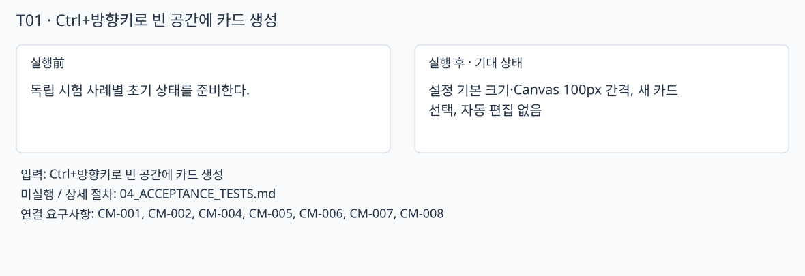

### T02 · Ctrl+방향키 생성 중 충돌·연결·연쇄 이동

- 실행 상태: 미실행
- 완료 조건: 기준 A 고정, 영향 대상 동반 이동, 연결선 보존
- 요구사항: CM-001, CM-003, CM-015, CM-016, CM-017, CM-018, CM-019, CM-020, CM-021

| 요구사항 | 준비 상태 | 누르는 것·조작 | 확인할 결과 |
|---|---|---|---|
| CM-001 | 선택된 카드 1개 | Ctrl 약 1초 + 메뉴 ↑/↓ | Ctrl 해제로 확정·닫기 / 모드 지속·Canvas 공유·재실행 유지 |
| CM-003 | A 선택 | 연결 생성 · Ctrl+→ | A–B 연결과 B 신규 카드 |
| CM-015 | A B C 가로 배치 | A에서 Ctrl+→ | A E B C / A 좌표 유지 |
| CM-016 | A B C D | A에서 Ctrl+→ | A E B C D |
| CM-017 | B–D 연결 / A E 추가 예정 | A에서 Ctrl+→ | B 이동, D도 함께 이동 |
| CM-018 | B–D 이동 경로에 X–X1 | A에서 E 생성 | B·D·X·X1 동반 이동 |
| CM-019 | A, B, C 연결선 없음 | A에서 Ctrl+→ | E 생성 및 B·C 이동 |
| CM-020 | A–B 연결 / A 선택 | A에서 Ctrl+→ | A 위치 고정, B 이동 |
| CM-021 | A–B, A–C, B–C | A에서 E 생성, B 이동 | C 기존 좌표 유지 |

1. 시험 전 Canvas와 전용 데이터를 저장·기록한다.
2. 위 행을 각각 실행하고 카드·연결·선택·편집·화면·저장을 비교한다.
3. 변경 작업은 Undo/Redo 및 재시작 전후를 해당 확정 규칙과 대조한다.
4. 미수행·실패·판정 불가를 따로 기록한다.

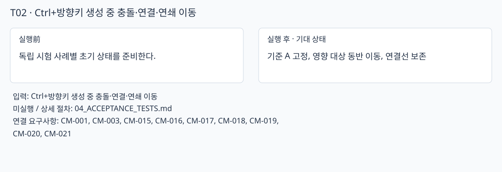

### T03 · 카드 생성과 밀어내기 Undo/Redo

- 실행 상태: 미실행
- 완료 조건: Undo 한 번에 생성/밀어내기 전부 복원, Redo 재적용
- 요구사항: CM-022, CM-107, CM-108, CM-109, CM-110, CM-113, CM-114

| 요구사항 | 준비 상태 | 누르는 것·조작 | 확인할 결과 |
|---|---|---|---|
| CM-022 | A B C | Ctrl+→ 로 E 생성, B·C 이동 | Ctrl+Z 한 번: A B C 복원 |
| CM-107 | 작업 적용 | Ctrl+Z / Ctrl+Shift+Z | 취소 / 다시 적용 |
| CM-108 | 생성 → 크기 → 색상 | Ctrl+Z 연속 | 색상 → 크기 → 생성 취소 |
| CM-109 | 생성·크기·색상 취소됨 | Ctrl+Shift+Z 연속 | 생성 → 크기 → 색상 |
| CM-110 | 크기 Undo 상태 | 새 색상 변경 | 이전 크기 Redo 불가 |
| CM-113 | A,B,C 동시 선택 | → 이동 후 Ctrl+Z | A,B,C 원위치 |
| CM-114 | A,B 선택 | → 길게 → Ctrl+Z | 누름 전 위치 복원 |

1. 시험 전 Canvas와 전용 데이터를 저장·기록한다.
2. 위 행을 각각 실행하고 카드·연결·선택·편집·화면·저장을 비교한다.
3. 변경 작업은 Undo/Redo 및 재시작 전후를 해당 확정 규칙과 대조한다.
4. 미수행·실패·판정 불가를 따로 기록한다.

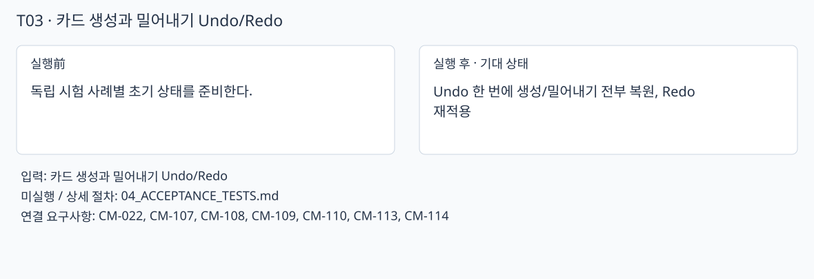

### T04 · Tab 삽입 공간 충분

- 실행 상태: 미실행
- 완료 조건: 새 카드 삽입, 아래 기존 카드 이동 없음
- 요구사항: CM-009, CM-010, CM-012, CM-013

| 요구사항 | 준비 상태 | 누르는 것·조작 | 확인할 결과 |
|---|---|---|---|
| CM-009 | A–B, A–C, A–D / B 선택 | Tab | A–B, A–E(선택), A–C, A–D |
| CM-010 | B 선택 / 일반 생성 | Tab | E를 B 아래 삽입, E의 연결선 없음 |
| CM-012 | B와 C의 너비가 다름 | B 선택 후 Tab | E 왼쪽 끝은 B와 동일 |
| CM-013 | B와 C 사이 빈 공간 충분 | B에서 Tab | E만 빈 공간에 삽입, C·D 그대로 |

1. 시험 전 Canvas와 전용 데이터를 저장·기록한다.
2. 위 행을 각각 실행하고 카드·연결·선택·편집·화면·저장을 비교한다.
3. 변경 작업은 Undo/Redo 및 재시작 전후를 해당 확정 규칙과 대조한다.
4. 미수행·실패·판정 불가를 따로 기록한다.

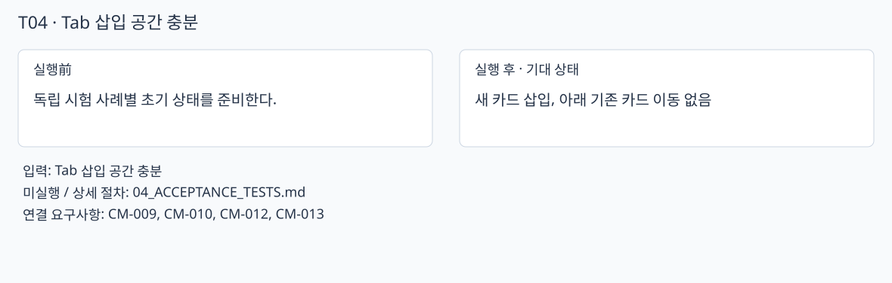

### T05 · Tab 삽입 공간 일부 부족

- 실행 상태: 미실행
- 완료 조건: 부족분만큼 아래 카드 이동, 기존 간격 유지
- 요구사항: CM-009, CM-014

| 요구사항 | 준비 상태 | 누르는 것·조작 | 확인할 결과 |
|---|---|---|---|
| CM-009 | A–B, A–C, A–D / B 선택 | Tab | A–B, A–E(선택), A–C, A–D |
| CM-014 | 빈 공간 60px / 필요 공간 100px | B에서 Tab | C·D를 40px 아래 이동 |

1. 시험 전 Canvas와 전용 데이터를 저장·기록한다.
2. 위 행을 각각 실행하고 카드·연결·선택·편집·화면·저장을 비교한다.
3. 변경 작업은 Undo/Redo 및 재시작 전후를 해당 확정 규칙과 대조한다.
4. 미수행·실패·판정 불가를 따로 기록한다.

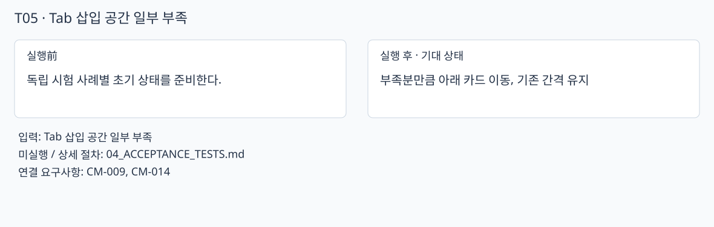

### T06 · 위치 교환 후보 둘·크기 다름

- 실행 상태: 미실행
- 완료 조건: 유효 X 차 40px 이내 세로 최단 후보 C 선택. E(X100,Y100,h80), C(X120,Y280,h160) → C(X100,Y100,h160), E(X120,Y360,h80); 기존 간격100px 보존.
- 요구사항: CM-023, CM-024, CM-025, CM-027

| 요구사항 | 준비 상태 | 누르는 것·조작 | 확인할 결과 |
|---|---|---|---|
| CM-023 | E 선택 / 아래 C | Ctrl+Alt+↓ | E와 C 세로 순서 교환 |
| CM-024 | E(X100,Y100,h80), C(X120,Y280,h160), 간격100px | Ctrl+Alt+↓ | C(X100,Y100,h160), E(X120,Y360,h80), 간격100px |
| CM-025 | E(Y100,h80), C(Y280,h160), 간격100px | Ctrl+Alt+↓ | C(Y100,h160), E(Y360,h80), 간격100px |
| CM-027 | E 아래 C, D 모두 40px 내 | Ctrl+Alt+↓ | 세로로 가까운 C 선택 |

1. 시험 전 Canvas와 전용 데이터를 저장·기록한다.
2. 위 행을 각각 실행하고 카드·연결·선택·편집·화면·저장을 비교한다.
3. 변경 작업은 Undo/Redo 및 재시작 전후를 해당 확정 규칙과 대조한다.
4. 미수행·실패·판정 불가를 따로 기록한다.

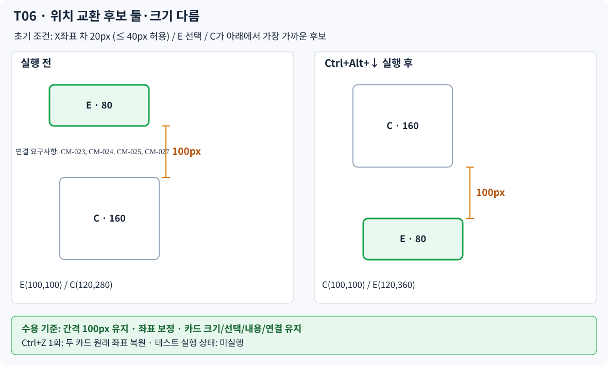

### T07 · 위치 교환 후보 없음

- 실행 상태: 미실행
- 완료 조건: 무동작·무알림
- 요구사항: CM-026, CM-028

| 요구사항 | 준비 상태 | 누르는 것·조작 | 확인할 결과 |
|---|---|---|---|
| CM-026 | E X100 / C X145 | Ctrl+Alt+↓ | 45px 차이 → 교환 불가 |
| CM-028 | E 아래 후보 없음 | Ctrl+Alt+↓ | E 위치/선택 유지 |

1. 시험 전 Canvas와 전용 데이터를 저장·기록한다.
2. 위 행을 각각 실행하고 카드·연결·선택·편집·화면·저장을 비교한다.
3. 변경 작업은 Undo/Redo 및 재시작 전후를 해당 확정 규칙과 대조한다.
4. 미수행·실패·판정 불가를 따로 기록한다.

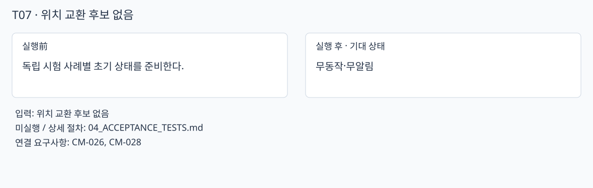

### T08 · 교환 후 Undo

- 실행 상태: 미실행
- 완료 조건: 두 카드 위치 모두 원상 복원
- 요구사항: CM-029, CM-030

| 요구사항 | 준비 상태 | 누르는 것·조작 | 확인할 결과 |
|---|---|---|---|
| CM-029 | A–E 연결 / C는 별도 | E와 C 교환 | A–E 연결 그대로 |
| CM-030 | E 위 / C 아래 | Ctrl+Alt+↓ 후 Ctrl+Z | E 위 / C 아래 |

1. 시험 전 Canvas와 전용 데이터를 저장·기록한다.
2. 위 행을 각각 실행하고 카드·연결·선택·편집·화면·저장을 비교한다.
3. 변경 작업은 Undo/Redo 및 재시작 전후를 해당 확정 규칙과 대조한다.
4. 미수행·실패·판정 불가를 따로 기록한다.

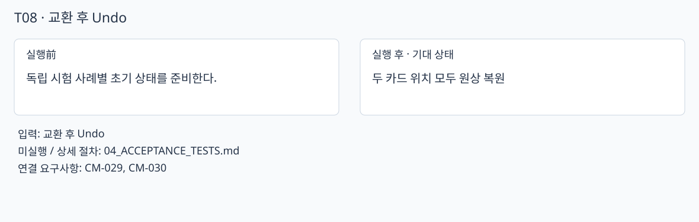

### T09 · 단일 카드 수동 크기 조절

- 실행 상태: 미실행
- 완료 조건: ±20px, 좌상단 고정, 겹침 허용
- 요구사항: CM-031, CM-032, CM-033, CM-034, CM-035, CM-036

| 요구사항 | 준비 상태 | 누르는 것·조작 | 확인할 결과 |
|---|---|---|---|
| CM-031 | 너비200 높이100 | Ctrl+Shift+→ | 너비220 높이100 |
| CM-032 | 너비200 | Ctrl+Shift+→ 1회 | 너비220 (+20) |
| CM-033 | A와 B 동시 선택 | Ctrl+Shift+→ | 모두 크기 유지 |
| CM-034 | A X100,Y100 W200 | Ctrl+Shift+→ | X100,Y100 W220 |
| CM-035 | A 옆 B | A 너비 증가 | A와 B 겹침, B 원위치 |
| CM-036 | 작은 카드 | Ctrl+Shift+← 반복 | 기본 Obsidian 최소 한계 적용 |

1. 시험 전 Canvas와 전용 데이터를 저장·기록한다.
2. 위 행을 각각 실행하고 카드·연결·선택·편집·화면·저장을 비교한다.
3. 변경 작업은 Undo/Redo 및 재시작 전후를 해당 확정 규칙과 대조한다.
4. 미수행·실패·판정 불가를 따로 기록한다.

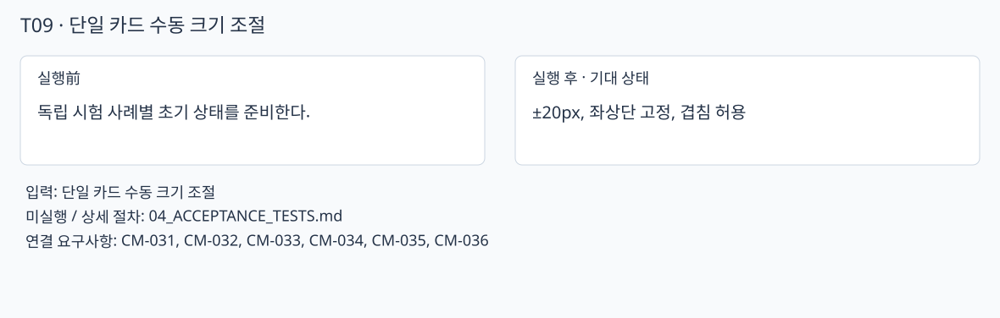

### T10 · 수동 크기 키 길게 누름

- 실행 상태: 미실행
- 완료 조건: 반복 조절, 해제 시 정지, Undo 한 번
- 요구사항: CM-037, CM-038

| 요구사항 | 준비 상태 | 누르는 것·조작 | 확인할 결과 |
|---|---|---|---|
| CM-037 | 너비200 | Ctrl+Shift+→ 길게 누름 | 220→240→260 ... / 키 해제 중단 |
| CM-038 | 너비200 | 키 길게 → 너비260 → Undo | 너비200 |

1. 시험 전 Canvas와 전용 데이터를 저장·기록한다.
2. 위 행을 각각 실행하고 카드·연결·선택·편집·화면·저장을 비교한다.
3. 변경 작업은 Undo/Redo 및 재시작 전후를 해당 확정 규칙과 대조한다.
4. 미수행·실패·판정 불가를 따로 기록한다.

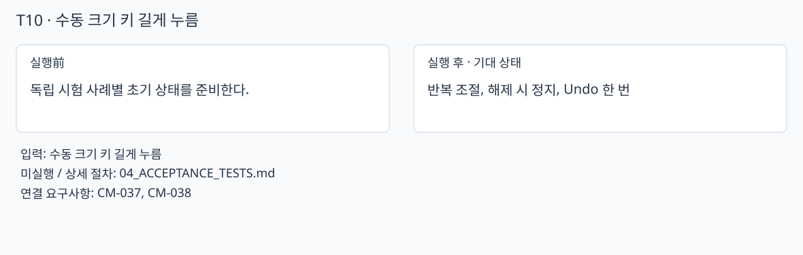

### T11 · Auto Resize ON 편집 종료

- 실행 상태: 미실행
- 완료 조건: 변경 없어도 내용 기준 가로/세로, 주변 이동 없음
- 요구사항: CM-039, CM-040, CM-041, CM-042, CM-043, CM-044, CM-045, CM-046, CM-050

| 요구사항 | 준비 상태 | 누르는 것·조작 | 확인할 결과 |
|---|---|---|---|
| CM-039 | Auto Resize OFF | 설정/단축키로 ON | Auto Resize ON |
| CM-040 | Auto Resize OFF | Ctrl+Shift+R | Auto Resize ON |
| CM-041 | 카드 내용과 크기 불일치 | 편집 종료 | 가로·세로 내용에 맞춤 |
| CM-042 | 편집 중 높이160 | 텍스트 입력 | 높이160 유지, 편집 종료시 Auto Resize |
| CM-043 | 내용 변경 없음 | 편집 시작 → 편집 종료 | 현재 내용으로 크기 맞춤 |
| CM-044 | A 옆 B | A 편집 종료 | A 크기 변경, B 고정 |
| CM-045 | 기존 카드 100개, OFF | ON 토글 | 기존 카드 크기 그대로 |
| CM-046 | 작업.canvas OFF / 공부.canvas OFF | 작업.canvas ON | 모든 Canvas ON |
| CM-050 | 내용이 다른 카드 A,B 선택 | 사용자 범위 제외 | 일괄 조절 없음, 개별 편집 종료 동작 유지 |

1. 시험 전 Canvas와 전용 데이터를 저장·기록한다.
2. 위 행을 각각 실행하고 카드·연결·선택·편집·화면·저장을 비교한다.
3. 변경 작업은 Undo/Redo 및 재시작 전후를 해당 확정 규칙과 대조한다.
4. 미수행·실패·판정 불가를 따로 기록한다.

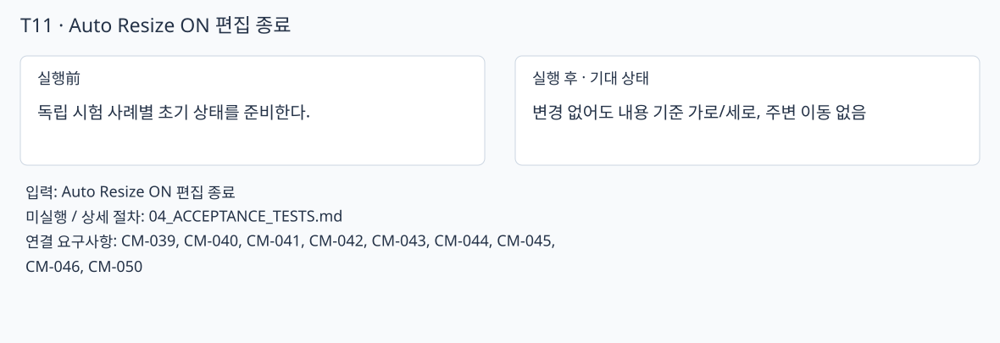

### T12 · Auto Resize 크기 Undo

- 실행 상태: 미실행
- 완료 조건: 첫 Undo는 크기만 복원, 텍스트 유지, ON 유지
- 요구사항: CM-048, CM-049

| 요구사항 | 준비 상태 | 누르는 것·조작 | 확인할 결과 |
|---|---|---|---|
| CM-048 | 텍스트 수정 + 자동 크기 맞춤 | Ctrl+Z 1회 | 텍스트 유지 / 기존 크기 복원 |
| CM-049 | Auto Resize ON / 크기 취소 | 다음 편집 종료 | 내용 맞춤 다시 실행 |

1. 시험 전 Canvas와 전용 데이터를 저장·기록한다.
2. 위 행을 각각 실행하고 카드·연결·선택·편집·화면·저장을 비교한다.
3. 변경 작업은 Undo/Redo 및 재시작 전후를 해당 확정 규칙과 대조한다.
4. 미수행·실패·판정 불가를 따로 기록한다.

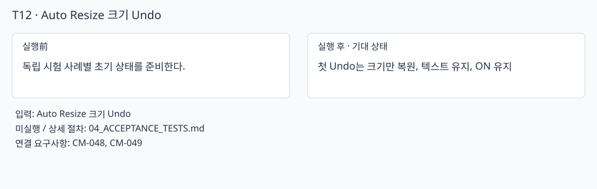

### T13 · Alt 탐색 기본

- 실행 상태: 미실행
- 완료 조건: 방향 최단 카드 선택, 중앙, Zoom 유지, 250ms
- 요구사항: CM-052, CM-053, CM-054, CM-055, CM-056, CM-057, CM-058

| 요구사항 | 준비 상태 | 누르는 것·조작 | 확인할 결과 |
|---|---|---|---|
| CM-052 | A 왼쪽 / B 가까이 / C 멀리 | Alt+→ | B 선택 |
| CM-053 | B,C 동일 거리 / B 중심선 가까움 | Alt+→ | B 선택 |
| CM-054 | A 오른쪽 Group, B 카드 | Alt+→ | B 선택 |
| CM-055 | A 오른쪽 빈 공간 | Alt+→ | A 선택 유지 |
| CM-056 | B가 화면 오른쪽 가장자리 | Alt+→ | B 화면 가운데 |
| CM-057 | 현재 Canvas Zoom 40% | Alt+→ | Zoom 40% 유지 |
| CM-058 | A 선택 | Alt+→ | 250ms 이동 후 B 중심 |

1. 시험 전 Canvas와 전용 데이터를 저장·기록한다.
2. 위 행을 각각 실행하고 카드·연결·선택·편집·화면·저장을 비교한다.
3. 변경 작업은 Undo/Redo 및 재시작 전후를 해당 확정 규칙과 대조한다.
4. 미수행·실패·판정 불가를 따로 기록한다.

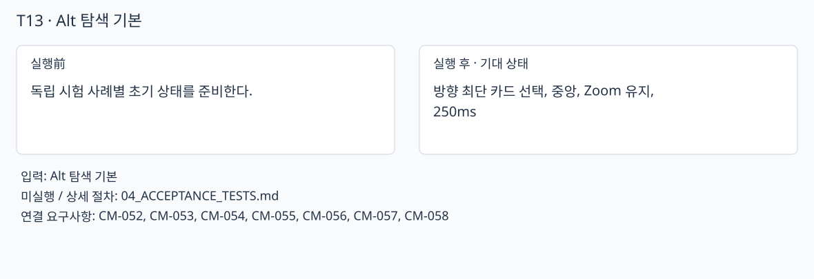

### T14 · 탐색 이동 도중 다음 입력

- 실행 상태: 미실행
- 완료 조건: 이전 애니메이션 취소, 새 대상 중앙 정렬
- 요구사항: CM-059

| 요구사항 | 준비 상태 | 누르는 것·조작 | 확인할 결과 |
|---|---|---|---|
| CM-059 | B로 이동 중 | Alt+→ 재입력 | B 중단 후 C로 이동 |

1. 시험 전 Canvas와 전용 데이터를 저장·기록한다.
2. 위 행을 각각 실행하고 카드·연결·선택·편집·화면·저장을 비교한다.
3. 변경 작업은 Undo/Redo 및 재시작 전후를 해당 확정 규칙과 대조한다.
4. 미수행·실패·판정 불가를 따로 기록한다.

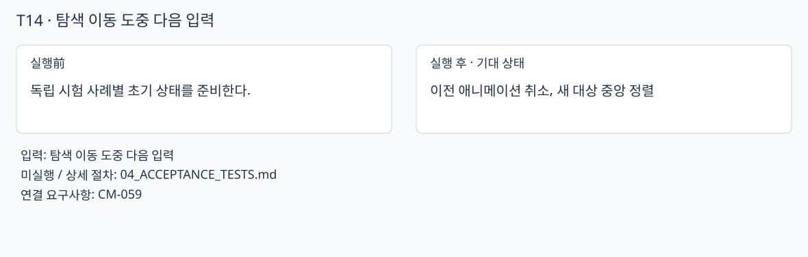

### T15 · 탐색 길게·편집 중·다중 선택

- 실행 상태: 미실행
- 완료 조건: 길게 1회, 편집·다중 선택에서 미작동
- 요구사항: CM-051, CM-060, CM-061

| 요구사항 | 준비 상태 | 누르는 것·조작 | 확인할 결과 |
|---|---|---|---|
| CM-051 | A,B 다중 선택 | Alt+→ | 선택 변경 없음 |
| CM-060 | A 선택 | Alt+→ 유지 | B까지만 이동 |
| CM-061 | A 텍스트 편집 중 | Alt+→ | 카드 탐색 없음 |

1. 시험 전 Canvas와 전용 데이터를 저장·기록한다.
2. 위 행을 각각 실행하고 카드·연결·선택·편집·화면·저장을 비교한다.
3. 변경 작업은 Undo/Redo 및 재시작 전후를 해당 확정 규칙과 대조한다.
4. 미수행·실패·판정 불가를 따로 기록한다.

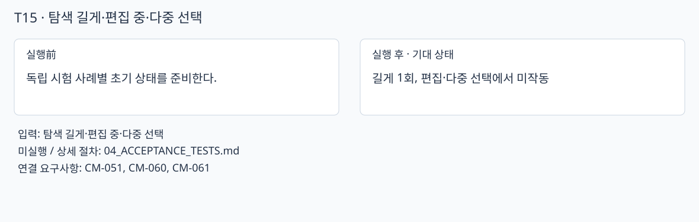

### T16 · Waypoint 등록·재입력·덮어쓰기

- 실행 상태: 미실행
- 완료 조건: 같은 대상 해제, 다른 대상 덮어쓰기·이름 재생성
- 요구사항: CM-064, CM-065, CM-068, CM-069, CM-071, CM-072, CM-074

| 요구사항 | 준비 상태 | 누르는 것·조작 | 확인할 결과 |
|---|---|---|---|
| CM-064 | 1번 카드 A | 1번 카메라 등록 | 1번은 카메라로 대체 |
| CM-065 | A 선택 / 1번 비어 있음 | Ctrl+Num1 | 1번에 A 등록 |
| CM-068 | 1번 A 등록 | A 선택 후 Ctrl+Num1 | 1번 미등록 |
| CM-069 | 1번 카드 A | B 선택 후 Ctrl+Num1 | 1번 카드 B, A 배지 제거 |
| CM-071 | 카드 첫 줄 "세계관" | Ctrl+Num1 | 1번 이름 "세계관" |
| CM-072 | 빈 카드 / image.png | Waypoint 등록 | 카드 N / image.png |
| CM-074 | 1번 "주인공 설정" | B로 덮어쓰기 | B의 이름으로 변경 |

1. 시험 전 Canvas와 전용 데이터를 저장·기록한다.
2. 위 행을 각각 실행하고 카드·연결·선택·편집·화면·저장을 비교한다.
3. 변경 작업은 Undo/Redo 및 재시작 전후를 해당 확정 규칙과 대조한다.
4. 미수행·실패·판정 불가를 따로 기록한다.

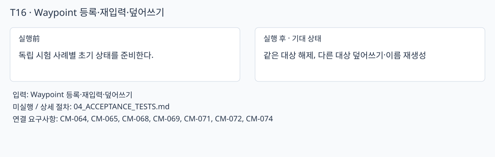

### T17 · Waypoint Undo/Redo

- 실행 상태: 미실행
- 완료 조건: 등록·덮어쓰기·해제·이름 변경 이전 상태 복원
- 요구사항: CM-065, CM-068, CM-069, CM-070, CM-074, CM-094, CM-096

| 요구사항 | 준비 상태 | 누르는 것·조작 | 확인할 결과 |
|---|---|---|---|
| CM-065 | A 선택 / 1번 비어 있음 | Ctrl+Num1 | 1번에 A 등록 |
| CM-068 | 1번 A 등록 | A 선택 후 Ctrl+Num1 | 1번 미등록 |
| CM-069 | 1번 카드 A | B 선택 후 Ctrl+Num1 | 1번 카드 B, A 배지 제거 |
| CM-070 | 1번 카드 A | B 덮어쓰기 후 Ctrl+Z | 1번 카드 A와 이름 복원 |
| CM-074 | 1번 "주인공 설정" | B로 덮어쓰기 | B의 이름으로 변경 |
| CM-094 | 이름 "세계관" | 수정 후 Enter / Esc | Enter=새 이름 / Esc=옛 이름 |
| CM-096 | 1번 A 등록 | 휴지통 클릭 | 1번만 해제 / 카드 A 유지 |

1. 시험 전 Canvas와 전용 데이터를 저장·기록한다.
2. 위 행을 각각 실행하고 카드·연결·선택·편집·화면·저장을 비교한다.
3. 변경 작업은 Undo/Redo 및 재시작 전후를 해당 확정 규칙과 대조한다.
4. 미수행·실패·판정 불가를 따로 기록한다.

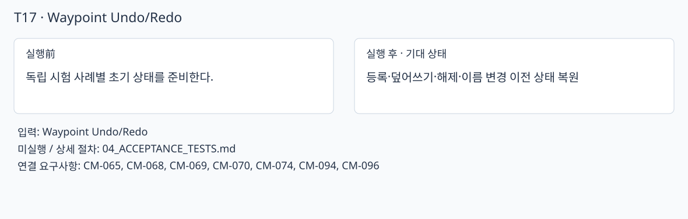

### T18 · 카드 위치 이동 후 Waypoint 호출

- 실행 상태: 미실행
- 완료 조건: 현재 카드 위치·Zoom 유지
- 요구사항: CM-062, CM-067, CM-081, CM-082, CM-083

| 요구사항 | 준비 상태 | 누르는 것·조작 | 확인할 결과 |
|---|---|---|---|
| CM-062 | 카드 A 등록 후 이동 | Num1 | A의 새 위치로 / Zoom 유지 |
| CM-067 | 1번 카드 A 등록 | Num1 | 카드 A 중앙 이동 |
| CM-081 | A 위치 P / 1번 등록 | 카드 A를 Q로 이동 | Num1 → Q로 이동 |
| CM-082 | A 카드 / 1번 등록 | Zoom 40% → 80% | 배지 화면 크기 일정 |
| CM-083 | A,B 카드 아주 근접 | Canvas 축소 | 배지 서로 겹쳐도 고정 |

1. 시험 전 Canvas와 전용 데이터를 저장·기록한다.
2. 위 행을 각각 실행하고 카드·연결·선택·편집·화면·저장을 비교한다.
3. 변경 작업은 Undo/Redo 및 재시작 전후를 해당 확정 규칙과 대조한다.
4. 미수행·실패·판정 불가를 따로 기록한다.

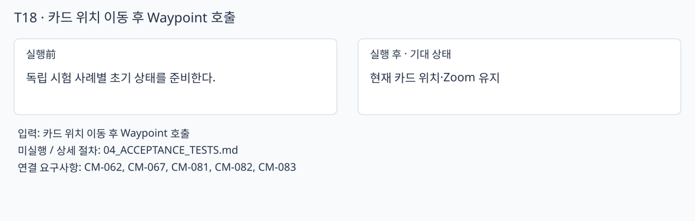

### T19 · 카메라 Waypoint 호출

- 실행 상태: 미실행
- 완료 조건: 등록 화면 위치와 Zoom 복원
- 요구사항: CM-063, CM-066, CM-073

| 요구사항 | 준비 상태 | 누르는 것·조작 | 확인할 결과 |
|---|---|---|---|
| CM-063 | 화면 위치 P / Zoom60% 저장 | Num2 | 위치 P / Zoom60% 복원 |
| CM-066 | 현재 화면 Zoom60% | Ctrl+Shift+Num2 | 2번에 카메라 저장 |
| CM-073 | Num2 비어 있음 | Ctrl+Shift+Num2 | 카메라 Waypoint 2 |

1. 시험 전 Canvas와 전용 데이터를 저장·기록한다.
2. 위 행을 각각 실행하고 카드·연결·선택·편집·화면·저장을 비교한다.
3. 변경 작업은 Undo/Redo 및 재시작 전후를 해당 확정 규칙과 대조한다.
4. 미수행·실패·판정 불가를 따로 기록한다.

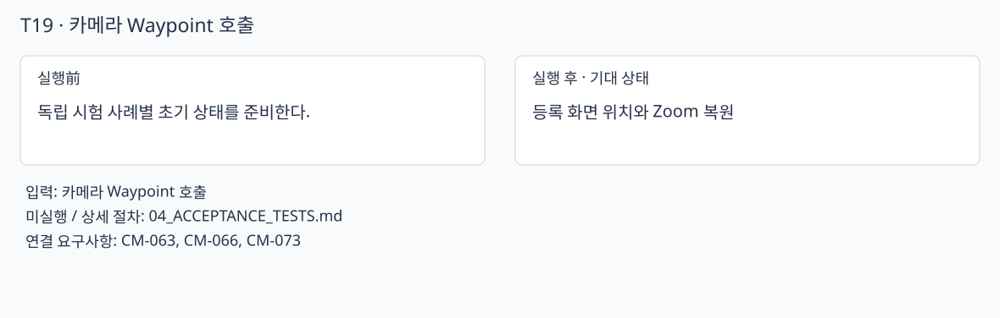

### T20 · Canvas 복제·rename·move

- 실행 상태: 미실행
- 완료 조건: 복제 시 별도 카드 참조, 경로 변경 후 유지
- 요구사항: CM-077, CM-079, CM-080, CM-125

| 요구사항 | 준비 상태 | 누르는 것·조작 | 확인할 결과 |
|---|---|---|---|
| CM-077 | 작업.canvas 1번 A | 공부.canvas 1번 B 등록 | 작업 1번 A 유지 / 공부 1번 B |
| CM-079 | 작업.canvas 1번 A | Canvas 복제 | 복사본 1번 복제 A / 독립 |
| CM-080 | 작업.canvas 1번 A | 이름 변경 / 폴더 이동 | 등록 유지 |
| CM-125 | 외부에서 Canvas 조작 | 복제/이동 | 지원 가능 범위 확인 전 미보장 |

1. 시험 전 Canvas와 전용 데이터를 저장·기록한다.
2. 위 행을 각각 실행하고 카드·연결·선택·편집·화면·저장을 비교한다.
3. 변경 작업은 Undo/Redo 및 재시작 전후를 해당 확정 규칙과 대조한다.
4. 미수행·실패·판정 불가를 따로 기록한다.

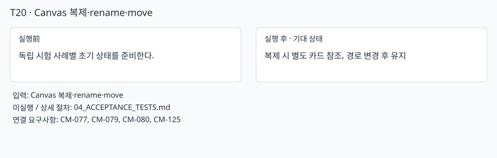

### T21 · Waypoint 카드 삭제 후 Undo

- 실행 상태: 미실행
- 완료 조건: 카드와 Waypoint 복원
- 요구사항: CM-075, CM-076

| 요구사항 | 준비 상태 | 누르는 것·조작 | 확인할 결과 |
|---|---|---|---|
| CM-075 | 카드 A, 1번 등록 | 카드 A 삭제 | 1번 등록 해제 |
| CM-076 | 카드 A 삭제 / 1번 해제 | Ctrl+Z | A와 1번 등록 복원 |

1. 시험 전 Canvas와 전용 데이터를 저장·기록한다.
2. 위 행을 각각 실행하고 카드·연결·선택·편집·화면·저장을 비교한다.
3. 변경 작업은 Undo/Redo 및 재시작 전후를 해당 확정 규칙과 대조한다.
4. 미수행·실패·판정 불가를 따로 기록한다.

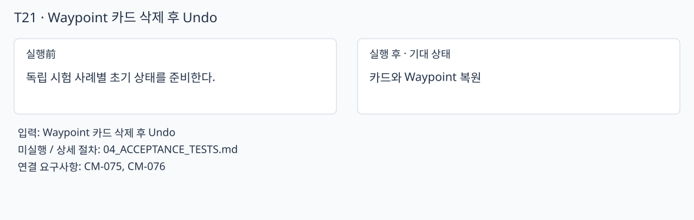

### T22 · Manager 팝업 열기·크기·상태

- 실행 상태: 미실행
- 완료 조건: 커서 인접/경계 처리/외곽 드래그/크기 복원
- 요구사항: CM-084, CM-085, CM-086, CM-087, CM-088, CM-089, CM-090, CM-091, CM-092

| 요구사항 | 준비 상태 | 누르는 것·조작 | 확인할 결과 |
|---|---|---|---|
| CM-084 | 팝업 닫힘 | Ctrl+Alt+W | 팝업 열림 / 재입력으로 닫힘 |
| CM-085 | Canvas와 커서 | Ctrl+Alt+W | 커서 근처 비모달 팝업 |
| CM-086 | 커서 화면 오른쪽 아래 | 팝업 열기 | 전체 팝업 화면 안에 표시 |
| CM-087 | Manager 열림 | 팝업 바깥 클릭 | Manager 닫힘 |
| CM-088 | 작업.canvas Manager 열림 | 공부.canvas로 전환 | Manager 닫힘 |
| CM-089 | 소형 팝업 | 외곽 테두리 드래그 | 너비·높이 변경 |
| CM-090 | 팝업 사용자 확대 | 팝업 닫기 / 다시 열기 | 같은 크기로 복원 |
| CM-091 | 1,3,5 등록 | Manager 열기 | 1·3·5만 표시 |
| CM-092 | Waypoint 다수 등록 | Manager 열기 | 소형 팝업 + 목록 스크롤 |

1. 시험 전 Canvas와 전용 데이터를 저장·기록한다.
2. 위 행을 각각 실행하고 카드·연결·선택·편집·화면·저장을 비교한다.
3. 변경 작업은 Undo/Redo 및 재시작 전후를 해당 확정 규칙과 대조한다.
4. 미수행·실패·판정 불가를 따로 기록한다.

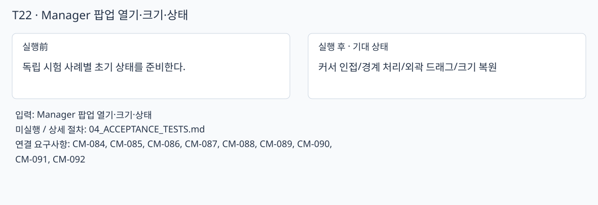

### T23 · Manager 이름 편집

- 실행 상태: 미실행
- 완료 조건: Enter 저장, Esc 취소, 외부 클릭 취소+닫기
- 요구사항: CM-094, CM-095

| 요구사항 | 준비 상태 | 누르는 것·조작 | 확인할 결과 |
|---|---|---|---|
| CM-094 | 이름 "세계관" | 수정 후 Enter / Esc | Enter=새 이름 / Esc=옛 이름 |
| CM-095 | 미저장 이름 "플롯" | 팝업 바깥 클릭 | 기존 이름 유지 + 팝업 닫힘 |

1. 시험 전 Canvas와 전용 데이터를 저장·기록한다.
2. 위 행을 각각 실행하고 카드·연결·선택·편집·화면·저장을 비교한다.
3. 변경 작업은 Undo/Redo 및 재시작 전후를 해당 확정 규칙과 대조한다.
4. 미수행·실패·판정 불가를 따로 기록한다.

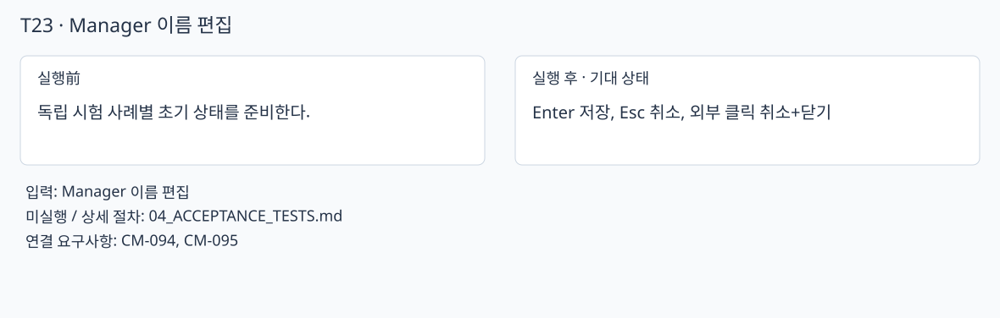

### T24 · Manager 클릭 이동·삭제

- 실행 상태: 미실행
- 완료 조건: 항목 이동 후 닫기, 삭제는 등록만
- 요구사항: CM-093, CM-096

| 요구사항 | 준비 상태 | 누르는 것·조작 | 확인할 결과 |
|---|---|---|---|
| CM-093 | 1번 A 등록, Manager 열림 | 1번 행 클릭 | A로 이동 / Manager 닫힘 |
| CM-096 | 1번 A 등록 | 휴지통 클릭 | 1번만 해제 / 카드 A 유지 |

1. 시험 전 Canvas와 전용 데이터를 저장·기록한다.
2. 위 행을 각각 실행하고 카드·연결·선택·편집·화면·저장을 비교한다.
3. 변경 작업은 Undo/Redo 및 재시작 전후를 해당 확정 규칙과 대조한다.
4. 미수행·실패·판정 불가를 따로 기록한다.

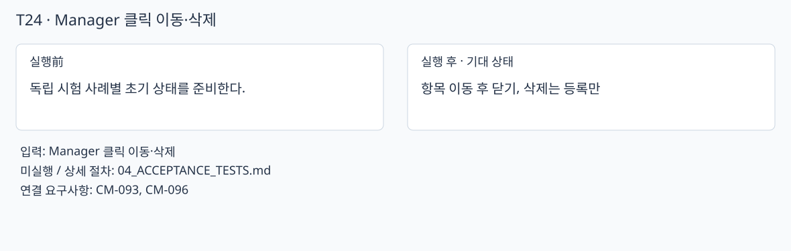

### T25 · 다중 색상 적용·Undo

- 실행 상태: 미실행
- 완료 조건: 지원 Item 일괄 적용, Undo 한 번에 각 원색 복원
- 요구사항: CM-097, CM-098, CM-104, CM-106

| 요구사항 | 준비 상태 | 누르는 것·조작 | 확인할 결과 |
|---|---|---|---|
| CM-097 | 카드 선택 | Ctrl+Alt+C | 커서 근처 팔레트 |
| CM-098 | A 빨강 / B 파랑 / C 노랑 | 초록 색상 클릭 | A·B·C 초록색 / 팔레트 닫힘 |
| CM-104 | A 빨강 | 팔레트 열기 → Esc | A 빨강 그대로 |
| CM-106 | A 빨강 / B 파랑 | 둘 다 초록 → Ctrl+Z | A 빨강 / B 파랑 |

1. 시험 전 Canvas와 전용 데이터를 저장·기록한다.
2. 위 행을 각각 실행하고 카드·연결·선택·편집·화면·저장을 비교한다.
3. 변경 작업은 Undo/Redo 및 재시작 전후를 해당 확정 규칙과 대조한다.
4. 미수행·실패·판정 불가를 따로 기록한다.

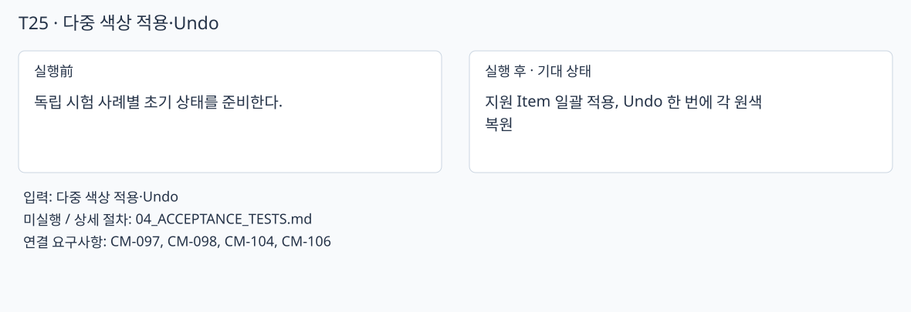

### T26 · 사용자 색상 저장·삭제

- 실행 상태: 미실행
- 완료 조건: 중복 없는 공유 목록, 삭제 후 원본 색상 유지
- 요구사항: CM-099, CM-100, CM-101, CM-102, CM-103, CM-105

| 요구사항 | 준비 상태 | 누르는 것·조작 | 확인할 결과 |
|---|---|---|---|
| CM-099 | 기본 색상 6칩 | 사용자 색상 등록 | 기본+사용자 색상 목록 |
| CM-100 | 사용자 색상 없음 | Color Picker에서 분홍 선택 | 분홍 칩 즉시 추가 |
| CM-101 | 분홍 칩 1개 | 같은 분홍 다시 선택 | 분홍 칩 여전히 1개 |
| CM-102 | 작업.canvas 분홍 추가 | 공부.canvas 열기 | 분홍 칩 그대로 |
| CM-103 | A 분홍 / 팔레트 분홍칩 | 칩 우클릭 삭제 | A는 분홍 / 팔레트 칩 제거 |
| CM-105 | 팔레트에 기본 색상 존재 | 원래 색상으로 복원 | 별도의 리셋 버튼 없음 |

1. 시험 전 Canvas와 전용 데이터를 저장·기록한다.
2. 위 행을 각각 실행하고 카드·연결·선택·편집·화면·저장을 비교한다.
3. 변경 작업은 Undo/Redo 및 재시작 전후를 해당 확정 규칙과 대조한다.
4. 미수행·실패·판정 불가를 따로 기록한다.

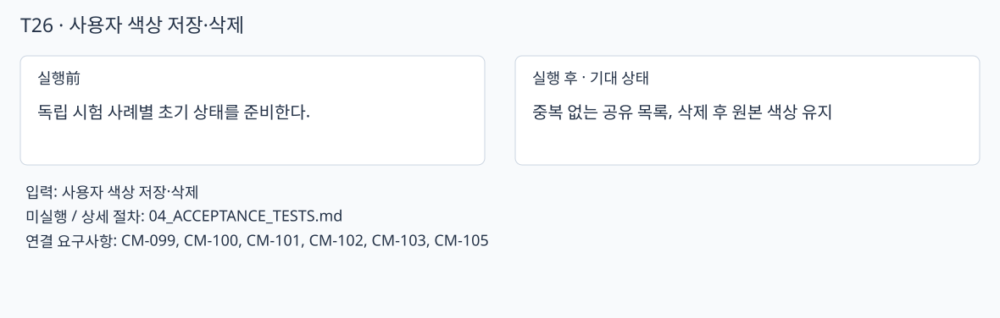

### T27 · 설정 백업·정상 복원

- 실행 상태: 미실행
- 완료 조건: 설정만 포함, 경로 직접 선택, 승인 후 전체 교체
- 요구사항: CM-121, CM-122, CM-123

| 요구사항 | 준비 상태 | 누르는 것·조작 | 확인할 결과 |
|---|---|---|---|
| CM-121 | Settings / Waypoint / 색상 목록 | Settings 백업 | 설정만 파일에 포함 |
| CM-122 | 설정 화면 | 백업 클릭 | Windows 저장창 표시 |
| CM-123 | 현재 설정 B / 백업 A | 파일 선택 → 확인 | 승인: 설정 A / 취소: B 유지 |

1. 시험 전 Canvas와 전용 데이터를 저장·기록한다.
2. 위 행을 각각 실행하고 카드·연결·선택·편집·화면·저장을 비교한다.
3. 변경 작업은 Undo/Redo 및 재시작 전후를 해당 확정 규칙과 대조한다.
4. 미수행·실패·판정 불가를 따로 기록한다.

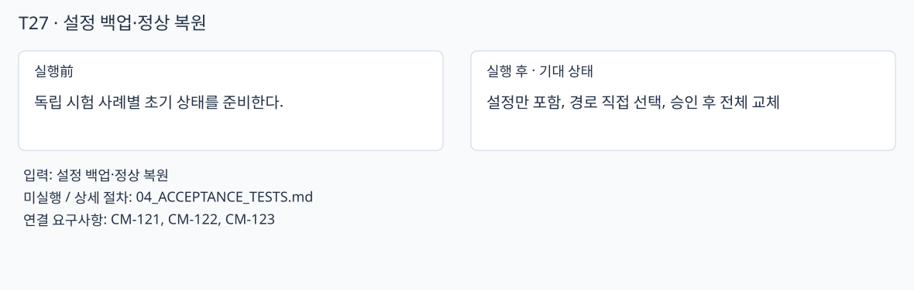

### T28 · 손상된 설정 백업 복원

- 실행 상태: 미실행
- 완료 조건: 전체 중단, 기존 설정과 Canvas/Waypoint/색상 보존
- 요구사항: CM-124

| 요구사항 | 준비 상태 | 누르는 것·조작 | 확인할 결과 |
|---|---|---|---|
| CM-124 | 현재 설정 B | 손상된 백업 열기 | B 유지 / 복원 중단 / 오류 알림 |

1. 시험 전 Canvas와 전용 데이터를 저장·기록한다.
2. 위 행을 각각 실행하고 카드·연결·선택·편집·화면·저장을 비교한다.
3. 변경 작업은 Undo/Redo 및 재시작 전후를 해당 확정 규칙과 대조한다.
4. 미수행·실패·판정 불가를 따로 기록한다.

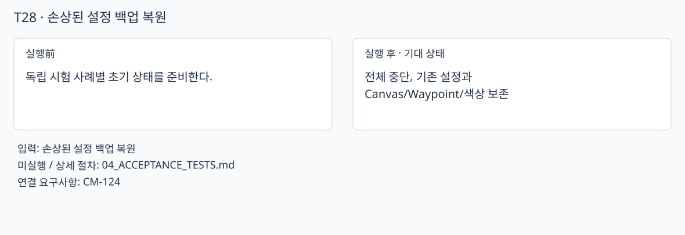

### T29 · 재시작·비활성화 후 데이터

- 실행 상태: 미실행
- 완료 조건: Waypoint·설정·색상 복원, Undo 기록은 재시작 시 초기화
- 요구사항: CM-047, CM-078, CM-111, CM-117, CM-119

| 요구사항 | 준비 상태 | 누르는 것·조작 | 확인할 결과 |
|---|---|---|---|
| CM-047 | Auto Resize ON | Obsidian 재시작 | Auto Resize ON |
| CM-078 | 작업.canvas 1번 A | Obsidian 재시작 | 1번 A 복원 |
| CM-111 | 작업.canvas A / 공부.canvas B | 공부.canvas Ctrl+Z | B 취소 / A 유지 |
| CM-117 | Canvas 카드 색상 적용 | 플러그인 비활성화/제거 | 원본 카드/색상 유지 |
| CM-119 | 데이터 저장됨 | 플러그인 OFF→ON | 데이터 복원 |

1. 시험 전 Canvas와 전용 데이터를 저장·기록한다.
2. 위 행을 각각 실행하고 카드·연결·선택·편집·화면·저장을 비교한다.
3. 변경 작업은 Undo/Redo 및 재시작 전후를 해당 확정 규칙과 대조한다.
4. 미수행·실패·판정 불가를 따로 기록한다.

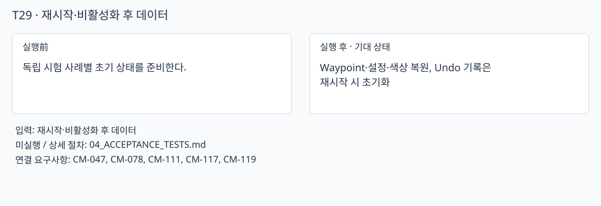

### T30 · 플러그인 제거·재설치

- 실행 상태: 미실행
- 완료 조건: 전용 데이터 복원 요구, 기술 검증 결과 기록
- 요구사항: CM-117, CM-118, CM-120

| 요구사항 | 준비 상태 | 누르는 것·조작 | 확인할 결과 |
|---|---|---|---|
| CM-117 | Canvas 카드 색상 적용 | 플러그인 비활성화/제거 | 원본 카드/색상 유지 |
| CM-118 | Canvas 원본 + Plugin Data | 사용자 색상 저장 | 팔레트 목록과 카드색 별도 |
| CM-120 | Waypoint·설정 보유 | 플러그인 제거→재설치 | 복원 요구 / 기술 미검증 |

1. 시험 전 Canvas와 전용 데이터를 저장·기록한다.
2. 위 행을 각각 실행하고 카드·연결·선택·편집·화면·저장을 비교한다.
3. 변경 작업은 Undo/Redo 및 재시작 전후를 해당 확정 규칙과 대조한다.
4. 미수행·실패·판정 불가를 따로 기록한다.

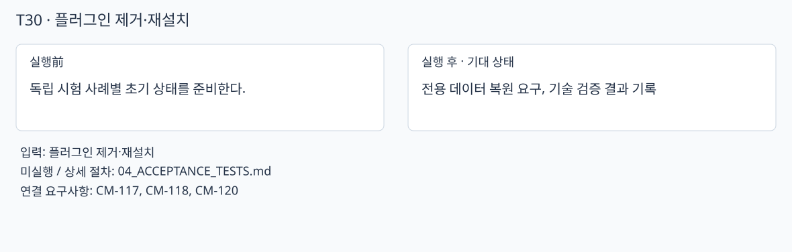

### T31 · 대형 Canvas 성능·안전

- 실행 상태: 미실행
- 완료 조건: Pan/Zoom/Drag/연쇄 이동 후 노드 누락·파일 손상 없는지 측정
- 요구사항: CM-015, CM-016, CM-017, CM-018, CM-019, CM-020, CM-021, CM-022, CM-117

| 요구사항 | 준비 상태 | 누르는 것·조작 | 확인할 결과 |
|---|---|---|---|
| CM-015 | A B C 가로 배치 | A에서 Ctrl+→ | A E B C / A 좌표 유지 |
| CM-016 | A B C D | A에서 Ctrl+→ | A E B C D |
| CM-017 | B–D 연결 / A E 추가 예정 | A에서 Ctrl+→ | B 이동, D도 함께 이동 |
| CM-018 | B–D 이동 경로에 X–X1 | A에서 E 생성 | B·D·X·X1 동반 이동 |
| CM-019 | A, B, C 연결선 없음 | A에서 Ctrl+→ | E 생성 및 B·C 이동 |
| CM-020 | A–B 연결 / A 선택 | A에서 Ctrl+→ | A 위치 고정, B 이동 |
| CM-021 | A–B, A–C, B–C | A에서 E 생성, B 이동 | C 기존 좌표 유지 |
| CM-022 | A B C | Ctrl+→ 로 E 생성, B·C 이동 | Ctrl+Z 한 번: A B C 복원 |
| CM-117 | Canvas 카드 색상 적용 | 플러그인 비활성화/제거 | 원본 카드/색상 유지 |

1. 시험 전 Canvas와 전용 데이터를 저장·기록한다.
2. 위 행을 각각 실행하고 카드·연결·선택·편집·화면·저장을 비교한다.
3. 변경 작업은 Undo/Redo 및 재시작 전후를 해당 확정 규칙과 대조한다.
4. 미수행·실패·판정 불가를 따로 기록한다.

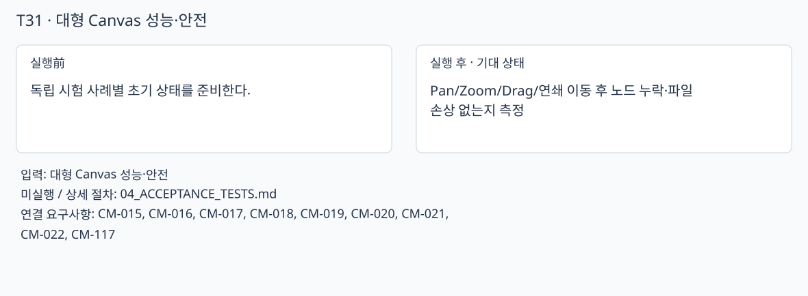

### T32 · 테마·단축키·기본 기능

- 실행 상태: 미실행
- 완료 조건: Light/Dark/Resize/키 충돌과 Canvas 기본 동작 검사
- 요구사항: CM-112, CM-115, CM-116

| 요구사항 | 준비 상태 | 누르는 것·조작 | 확인할 결과 |
|---|---|---|---|
| CM-112 | 작업 누적 | Ctrl+Z | Obsidian 기본 한계 적용 |
| CM-115 | Canvas 카드 선택 | 일반 방향키 | 기본 Canvas 이동 동작 |
| CM-116 | A,B 선택 후 이동 | Ctrl+Z | 위치 복원 / 선택 여부 미확정 |

1. 시험 전 Canvas와 전용 데이터를 저장·기록한다.
2. 위 행을 각각 실행하고 카드·연결·선택·편집·화면·저장을 비교한다.
3. 변경 작업은 Undo/Redo 및 재시작 전후를 해당 확정 규칙과 대조한다.
4. 미수행·실패·판정 불가를 따로 기록한다.

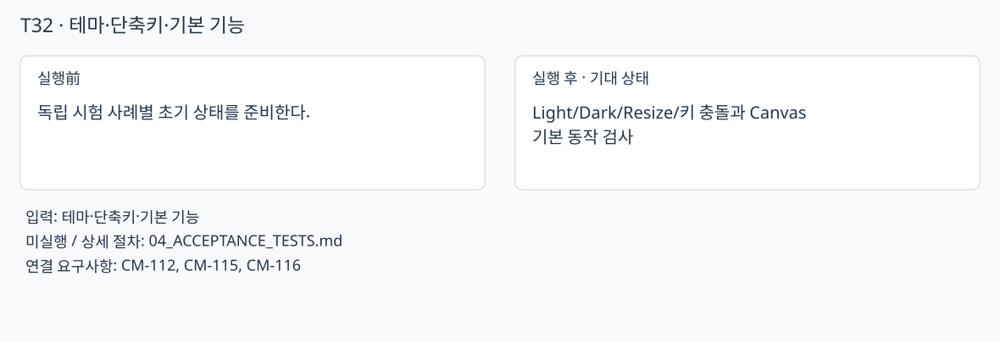

### T33 · Tab 연결 생성 / 일반 생성 비교

- 실행 상태: 미실행
- 완료 조건: 동일 배치에서 일반 생성은 선 없음, 연결 생성의 출발점 A 하나인 사례는 A–E. 복수·출발점 없음은 결정 전 별도 보류.
- 요구사항: CM-009, CM-010, CM-011, CM-012, CM-013, CM-014

| 요구사항 | 준비 상태 | 누르는 것·조작 | 확인할 결과 |
|---|---|---|---|
| CM-009 | A–B, A–C, A–D / B 선택 | Tab | A–B, A–E(선택), A–C, A–D |
| CM-010 | B 선택 / 일반 생성 | Tab | E를 B 아래 삽입, E의 연결선 없음 |
| CM-011 | A–B·A–C / B 선택 | 연결 생성 / Tab | 출발점 A 하나인 사례: B 아래 E 삽입 / A–E 연결 |
| CM-012 | B와 C의 너비가 다름 | B 선택 후 Tab | E 왼쪽 끝은 B와 동일 |
| CM-013 | B와 C 사이 빈 공간 충분 | B에서 Tab | E만 빈 공간에 삽입, C·D 그대로 |
| CM-014 | 빈 공간 60px / 필요 공간 100px | B에서 Tab | C·D를 40px 아래 이동 |

1. 시험 전 Canvas와 전용 데이터를 저장·기록한다.
2. 위 행을 각각 실행하고 카드·연결·선택·편집·화면·저장을 비교한다.
3. 변경 작업은 Undo/Redo 및 재시작 전후를 해당 확정 규칙과 대조한다.
4. 미수행·실패·판정 불가를 따로 기록한다.

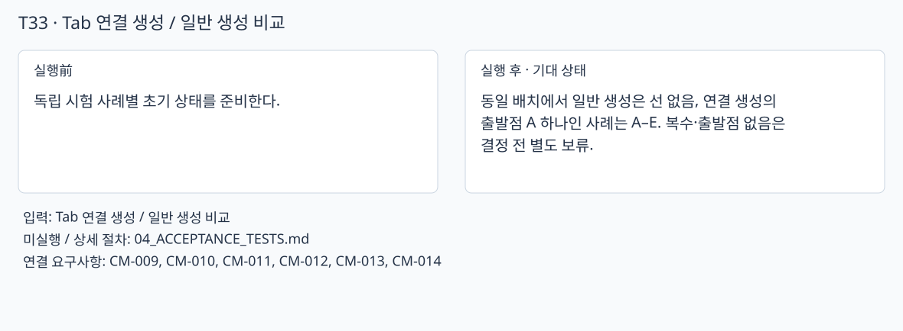

### T34 · Ctrl+Space 편집 전환

- 실행 상태: 미실행
- 완료 조건: 선택 상태 → 편집 → 조작 상태 전환, 입력 손실 없음
- 요구사항: CM-127

| 요구사항 | 준비 상태 | 누르는 것·조작 | 확인할 결과 |
|---|---|---|---|
| CM-127 | 카드 선택 | Ctrl+Space | 텍스트 편집 시작 / 다음 입력 시 종료 |

1. 시험 전 Canvas와 전용 데이터를 저장·기록한다.
2. 위 행을 각각 실행하고 카드·연결·선택·편집·화면·저장을 비교한다.
3. 변경 작업은 Undo/Redo 및 재시작 전후를 해당 확정 규칙과 대조한다.
4. 미수행·실패·판정 불가를 따로 기록한다.

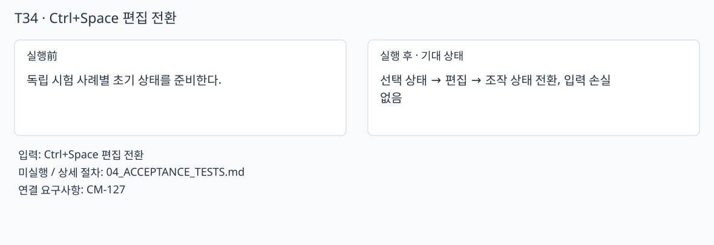

### T35 · 색상 단축키 변경

- 실행 상태: 미실행
- 완료 조건: 사용자가 설정한 다른 키로 색상 팔레트 개폐
- 요구사항: CM-128

| 요구사항 | 준비 상태 | 누르는 것·조작 | 확인할 결과 |
|---|---|---|---|
| CM-128 | 팔레트 사용 | Obsidian 단축키 설정 | 변경된 키 적용 |

1. 시험 전 Canvas와 전용 데이터를 저장·기록한다.
2. 위 행을 각각 실행하고 카드·연결·선택·편집·화면·저장을 비교한다.
3. 변경 작업은 Undo/Redo 및 재시작 전후를 해당 확정 규칙과 대조한다.
4. 미수행·실패·판정 불가를 따로 기록한다.

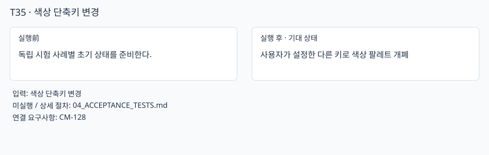

### T36 · 생성 모드 Context Menu

- 실행 상태: 미실행
- 완료 조건: Ctrl 약 1초 후 작은 메뉴, ↑/↓ 모드 선택
- 요구사항: CM-001

| 요구사항 | 준비 상태 | 누르는 것·조작 | 확인할 결과 |
|---|---|---|---|
| CM-001 | 선택된 카드 1개 | Ctrl 약 1초 + 메뉴 ↑/↓ | Ctrl 해제로 확정·닫기 / 모드 지속·Canvas 공유·재실행 유지 |

1. 시험 전 Canvas와 전용 데이터를 저장·기록한다.
2. 위 행을 각각 실행하고 카드·연결·선택·편집·화면·저장을 비교한다.
3. 변경 작업은 Undo/Redo 및 재시작 전후를 해당 확정 규칙과 대조한다.
4. 미수행·실패·판정 불가를 따로 기록한다.

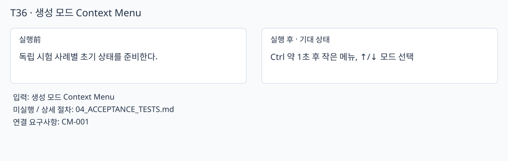

### T37 · 생성 후 입력 / 연결 Undo

- 실행 상태: 미실행
- 완료 조건: 생성 후 비편집, 생성+연결선+밀어내기 Undo 1회
- 요구사항: CM-003, CM-007, CM-008, CM-022, CM-127

| 요구사항 | 준비 상태 | 누르는 것·조작 | 확인할 결과 |
|---|---|---|---|
| CM-003 | A 선택 | 연결 생성 · Ctrl+→ | A–B 연결과 B 신규 카드 |
| CM-007 | A 선택 | 새 카드 B 생성 | B 선택 / A 선택 해제 |
| CM-008 | B 생성 직후 | Ctrl+Space | 편집 모드 진입 / 재입력 시 조작 모드 |
| CM-022 | A B C | Ctrl+→ 로 E 생성, B·C 이동 | Ctrl+Z 한 번: A B C 복원 |
| CM-127 | 카드 선택 | Ctrl+Space | 텍스트 편집 시작 / 다음 입력 시 종료 |

1. 시험 전 Canvas와 전용 데이터를 저장·기록한다.
2. 위 행을 각각 실행하고 카드·연결·선택·편집·화면·저장을 비교한다.
3. 변경 작업은 Undo/Redo 및 재시작 전후를 해당 확정 규칙과 대조한다.
4. 미수행·실패·판정 불가를 따로 기록한다.

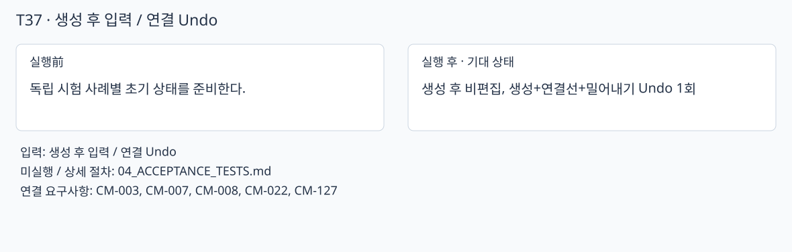

### T38 · 서로 다른 높이 카드 위치 교환

- 실행 상태: 미실행
- 완료 조건: 서로 다른 높이 80/160 카드 간격100px 보존, X좌표 교환, Y좌표 보정(교환 후 C Y100, E Y360). Undo 1회 원상 복원.
- 요구사항: CM-023, CM-024, CM-025, CM-026, CM-029, CM-030

| 요구사항 | 준비 상태 | 누르는 것·조작 | 확인할 결과 |
|---|---|---|---|
| CM-023 | E 선택 / 아래 C | Ctrl+Alt+↓ | E와 C 세로 순서 교환 |
| CM-024 | E(X100,Y100,h80), C(X120,Y280,h160), 간격100px | Ctrl+Alt+↓ | C(X100,Y100,h160), E(X120,Y360,h80), 간격100px |
| CM-025 | E(Y100,h80), C(Y280,h160), 간격100px | Ctrl+Alt+↓ | C(Y100,h160), E(Y360,h80), 간격100px |
| CM-026 | E X100 / C X145 | Ctrl+Alt+↓ | 45px 차이 → 교환 불가 |
| CM-029 | A–E 연결 / C는 별도 | E와 C 교환 | A–E 연결 그대로 |
| CM-030 | E 위 / C 아래 | Ctrl+Alt+↓ 후 Ctrl+Z | E 위 / C 아래 |

1. 시험 전 Canvas와 전용 데이터를 저장·기록한다.
2. 위 행을 각각 실행하고 카드·연결·선택·편집·화면·저장을 비교한다.
3. 변경 작업은 Undo/Redo 및 재시작 전후를 해당 확정 규칙과 대조한다.
4. 미수행·실패·판정 불가를 따로 기록한다.

### T39 · Waypoint Manager 크기 조절 경계

- 실행 상태: 미실행
- 완료 조건: 외곽 8개 방향 드래그, 크기 저장, 화면 밖 차단
- 요구사항: CM-086, CM-089, CM-090, CM-092

| 요구사항 | 준비 상태 | 누르는 것·조작 | 확인할 결과 |
|---|---|---|---|
| CM-086 | 커서 화면 오른쪽 아래 | 팝업 열기 | 전체 팝업 화면 안에 표시 |
| CM-089 | 소형 팝업 | 외곽 테두리 드래그 | 너비·높이 변경 |
| CM-090 | 팝업 사용자 확대 | 팝업 닫기 / 다시 열기 | 같은 크기로 복원 |
| CM-092 | Waypoint 다수 등록 | Manager 열기 | 소형 팝업 + 목록 스크롤 |

1. 시험 전 Canvas와 전용 데이터를 저장·기록한다.
2. 위 행을 각각 실행하고 카드·연결·선택·편집·화면·저장을 비교한다.
3. 변경 작업은 Undo/Redo 및 재시작 전후를 해당 확정 규칙과 대조한다.
4. 미수행·실패·판정 불가를 따로 기록한다.

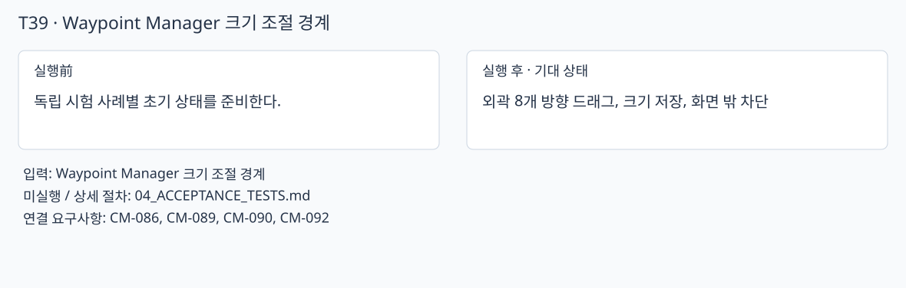

### T40 · 생성 기준 카드에 다중 연결 공유 카드

- 실행 상태: 미실행
- 완료 조건: 공유 연결 카드 C는 고정, 기준 A도 고정
- 요구사항: CM-020, CM-021

| 요구사항 | 준비 상태 | 누르는 것·조작 | 확인할 결과 |
|---|---|---|---|
| CM-020 | A–B 연결 / A 선택 | A에서 Ctrl+→ | A 위치 고정, B 이동 |
| CM-021 | A–B, A–C, B–C | A에서 E 생성, B 이동 | C 기존 좌표 유지 |

1. 시험 전 Canvas와 전용 데이터를 저장·기록한다.
2. 위 행을 각각 실행하고 카드·연결·선택·편집·화면·저장을 비교한다.
3. 변경 작업은 Undo/Redo 및 재시작 전후를 해당 확정 규칙과 대조한다.
4. 미수행·실패·판정 불가를 따로 기록한다.

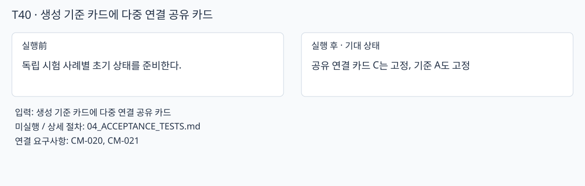

### T41 · 여러 Canvas 간 Undo 독립성

- 실행 상태: 미실행
- 완료 조건: 현재 Canvas 작업만 취소, 다른 Canvas 상태 불변
- 요구사항: CM-111

| 요구사항 | 준비 상태 | 누르는 것·조작 | 확인할 결과 |
|---|---|---|---|
| CM-111 | 작업.canvas A / 공부.canvas B | 공부.canvas Ctrl+Z | B 취소 / A 유지 |

1. 시험 전 Canvas와 전용 데이터를 저장·기록한다.
2. 위 행을 각각 실행하고 카드·연결·선택·편집·화면·저장을 비교한다.
3. 변경 작업은 Undo/Redo 및 재시작 전후를 해당 확정 규칙과 대조한다.
4. 미수행·실패·판정 불가를 따로 기록한다.

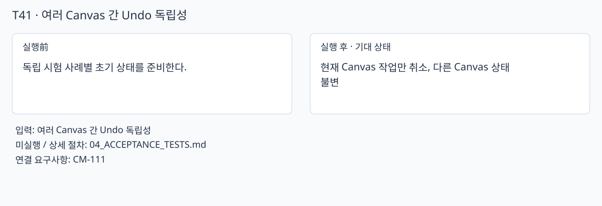

### T42 · 설정 복원 시 플러그인 데이터 분리

- 실행 상태: 미실행
- 완료 조건: Waypoint 및 색상 목록 원본·플러그인 상태 변화 없음
- 요구사항: CM-118, CM-121, CM-123, CM-124

| 요구사항 | 준비 상태 | 누르는 것·조작 | 확인할 결과 |
|---|---|---|---|
| CM-118 | Canvas 원본 + Plugin Data | 사용자 색상 저장 | 팔레트 목록과 카드색 별도 |
| CM-121 | Settings / Waypoint / 색상 목록 | Settings 백업 | 설정만 파일에 포함 |
| CM-123 | 현재 설정 B / 백업 A | 파일 선택 → 확인 | 승인: 설정 A / 취소: B 유지 |
| CM-124 | 현재 설정 B | 손상된 백업 열기 | B 유지 / 복원 중단 / 오류 알림 |

1. 시험 전 Canvas와 전용 데이터를 저장·기록한다.
2. 위 행을 각각 실행하고 카드·연결·선택·편집·화면·저장을 비교한다.
3. 변경 작업은 Undo/Redo 및 재시작 전후를 해당 확정 규칙과 대조한다.
4. 미수행·실패·판정 불가를 따로 기록한다.

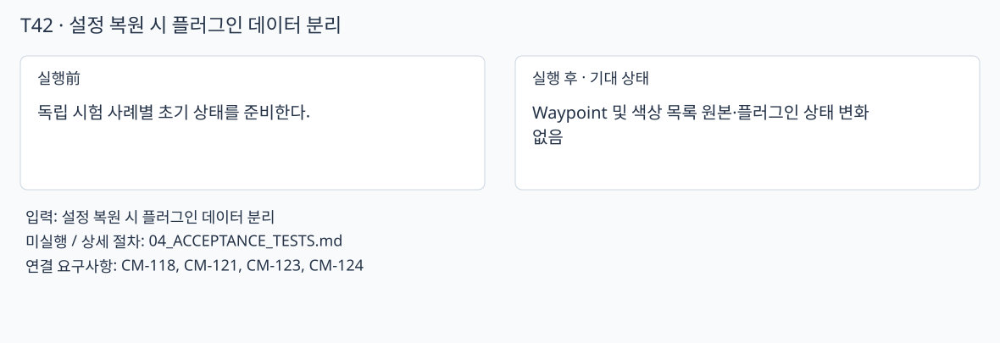

### T43 · 빈 카드 파일 전환·취소·Undo

- 실행 상태: 미실행
- 완료 조건: 원본 파일 선택 요구 확인. 전환 결과·이미지 Panel·취소·Undo 기대값은 사용자 결정 전 보류.
- 요구사항: CM-126

| 요구사항 | 준비 상태 | 누르는 것·조작 | 확인할 결과 |
|---|---|---|---|
| CM-126 | 빈 Canvas 카드 | 파일 선택 열기 | MD / Canvas / Image로 전환 요구 |

1. 시험 전 Canvas와 전용 데이터를 저장·기록한다.
2. 위 행을 각각 실행하고 카드·연결·선택·편집·화면·저장을 비교한다.
3. 변경 작업은 Undo/Redo 및 재시작 전후를 해당 확정 규칙과 대조한다.
4. 미수행·실패·판정 불가를 따로 기록한다.

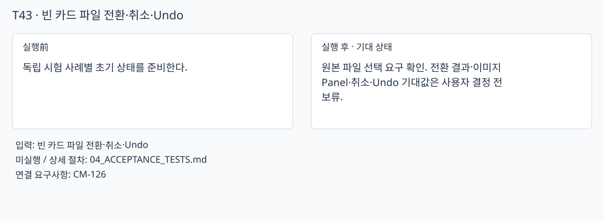

## 보완 시험 조건

- T31: 100/500/1,000카드와 연결·순환 사례에서 저장 전후 ID/개수·연결·좌표를 비교하고 Pan/Zoom/Drag/연쇄 생성의 시간과 메모리를 기록한다. 수치는 시험 입력이며 제품 제한·승인 성능 목표가 아니다.
- T17: 등록·해제·덮어쓰기·이름 변경을 각각 Undo/Redo해 대상과 이름을 비교한다.
- T36: Ctrl 약 1초 → ↑/↓ → Ctrl 해제 확정·닫기, 연속 생성, Canvas 전환, 재시작 후 마지막 모드를 확인한다. 별도 취소 키를 추가하지 않는다.
- CM-014: 새 높이 h=80, 간격 g=100, B 하단=100, C 상단=360이면 E는 Y200~280이며 C 필요 상단=380. C/D를 20만 이동한다. C/D 기존 간격은 유지한다. 이 숫자는 시험 입력이며 기본 카드 크기 결정이 아니다.
- CM-050/116/120/125: 기술 검증과 제품 수용 결과를 구분한다.
- T43: 파일 선택 진입 요구만 원본 근거가 있다. 실제 전환·Panel·취소·Undo 기대값이 결정되기 전 전체 통과하지 않는다.

### T01 상황별 도식

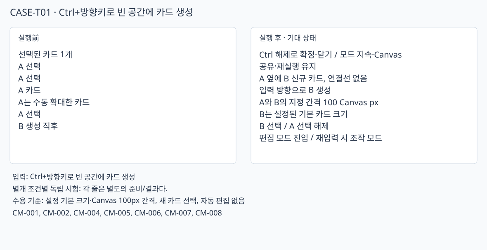

### T02 상황별 도식

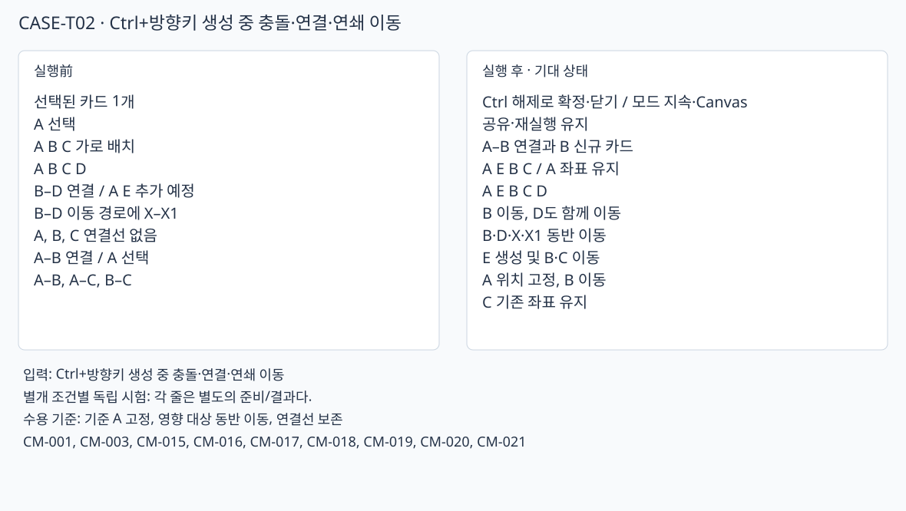

### T03 상황별 도식

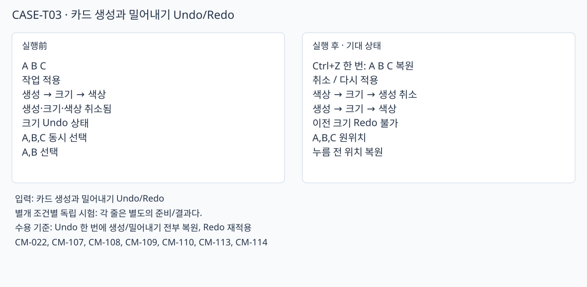

### T04 상황별 도식

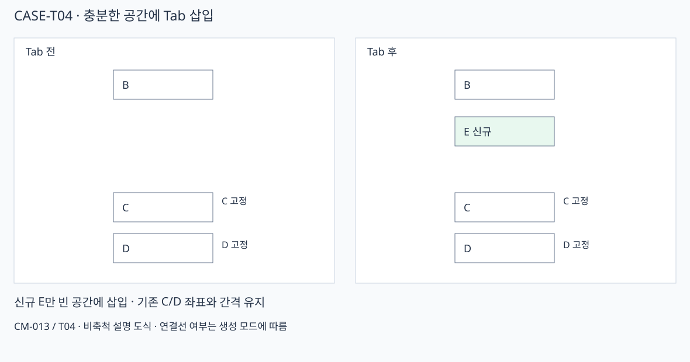

### T05 상황별 도식

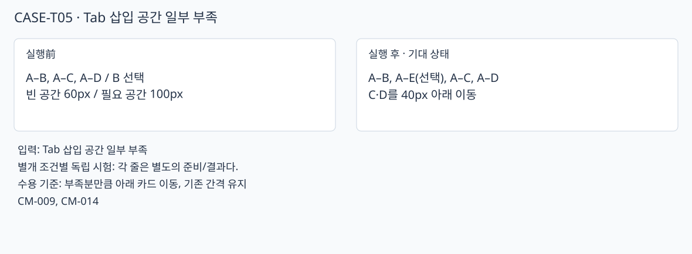

### T06 상황별 도식

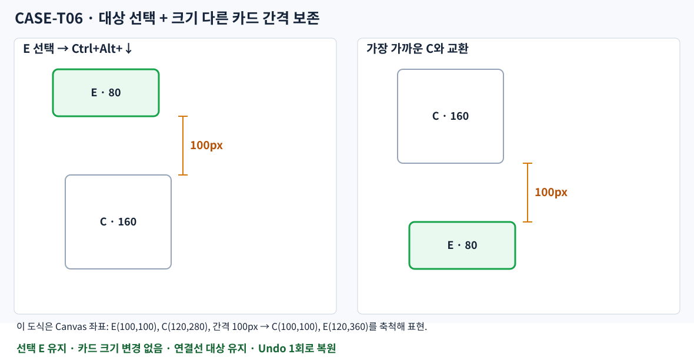

### T07 상황별 도식

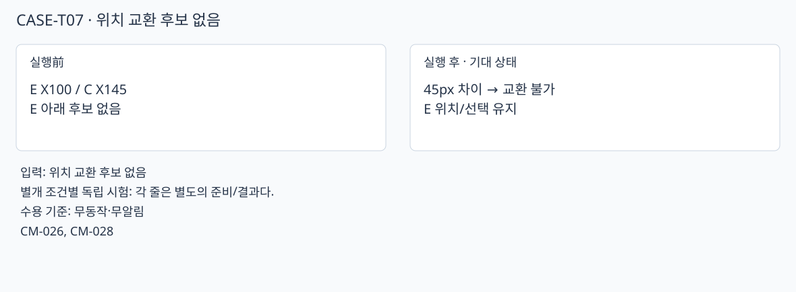

### T08 상황별 도식

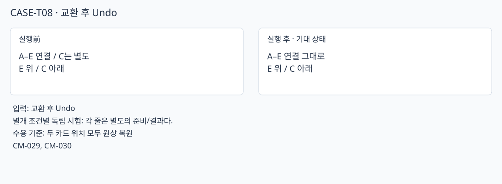

### T09 상황별 도식

### T10 상황별 도식

### T11 상황별 도식

### T12 상황별 도식

### T13 상황별 도식

### T14 상황별 도식

### T15 상황별 도식

### T16 상황별 도식

### T17 상황별 도식

### T18 상황별 도식

### T19 상황별 도식

### T20 상황별 도식

### T21 상황별 도식

### T22 상황별 도식

### T23 상황별 도식

### T24 상황별 도식

### T25 상황별 도식

### T26 상황별 도식

### T27 상황별 도식

### T28 상황별 도식

### T29 상황별 도식

### T30 상황별 도식

### T31 상황별 도식

### T32 상황별 도식

### T33 상황별 도식

### T34 상황별 도식

### T35 상황별 도식

### T36 상황별 도식

### T37 상황별 도식

