# 승인 UI 기준

사용자가 각 시안을 확인하고 승인했다. 2026-10-14 원본과 동일한 PNG 11개를 프로젝트에 보관했다. approved-ui/manifest.json에 원본 파일명과 SHA-256을 기록한다. 이미지는 구현할 외형 기준이며 실제 앱 검증 결과가 아니다.

## 적용 원칙

영어 UI, 작은 창, 얇은 테두리, 절제된 모서리·그림자·선택 강조를 사용한다. 이미지의 배치·형태가 기준이며 확대 이미지의 픽셀 수를 앱 크기로 사용하지 않는다. 라이트·다크는 같은 구조에 Obsidian 테마 색상을 적용한다. 생성·출발점 메뉴만 중앙 정렬이다. 생성 이미지의 배경 문구·샘플 파일·장식은 기능이 아니다.

최신 동작은 DEVELOPMENT_BASELINE.md와 기능 명세, 외형은 이 문서를 따른다. 기존 HTML·SVG는 과거 참고 자료이며 UI를 다시 선택하도록 요청하지 않는다.

## 1. 생성 메뉴

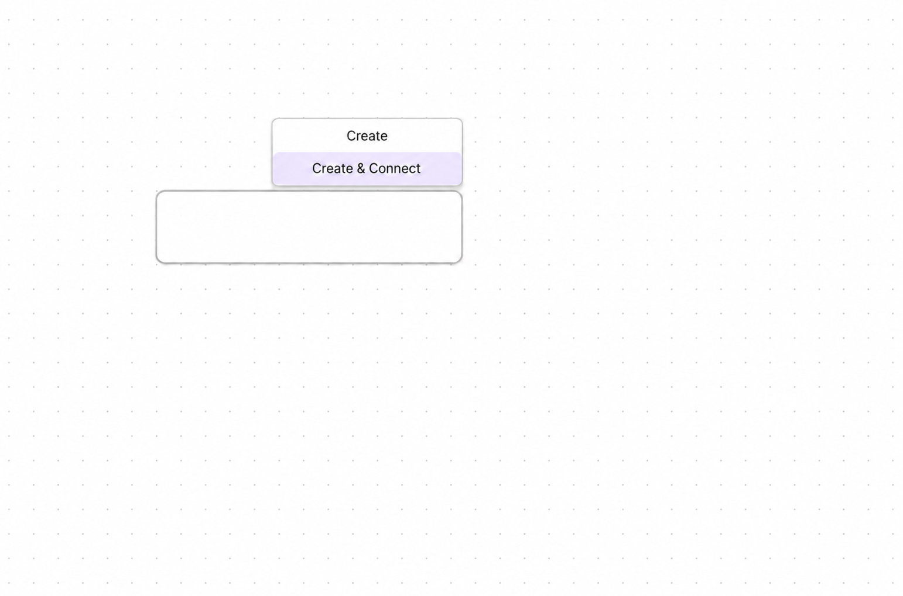

카드 우측 상단 바깥의 작은 메뉴. 오른쪽 끝을 카드와 맞춘다. Create / Create & Connect, 각 행 중앙 정렬, 선택 행 연한 강조. Ctrl 약 1초·↑/↓·Ctrl 해제 확정.

## 2. 연결 출발점 메뉴

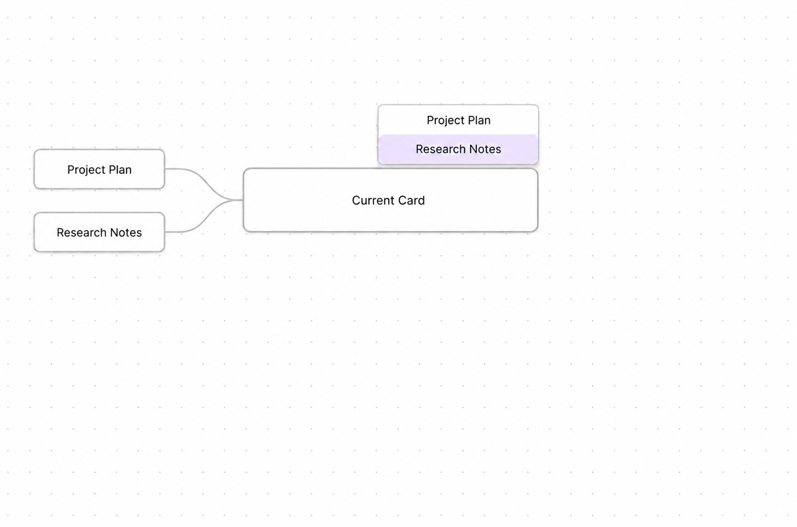

같은 위치·외형·중앙 정렬로 실제 후보 이름 표시. Tab 약 1초·↑/↓·Tab 해제는 출발점만 저장. 다음 짧은 Tab에서 생성. 예시 영어 이름은 고정 항목이 아니다.

## 3. Waypoint 배지

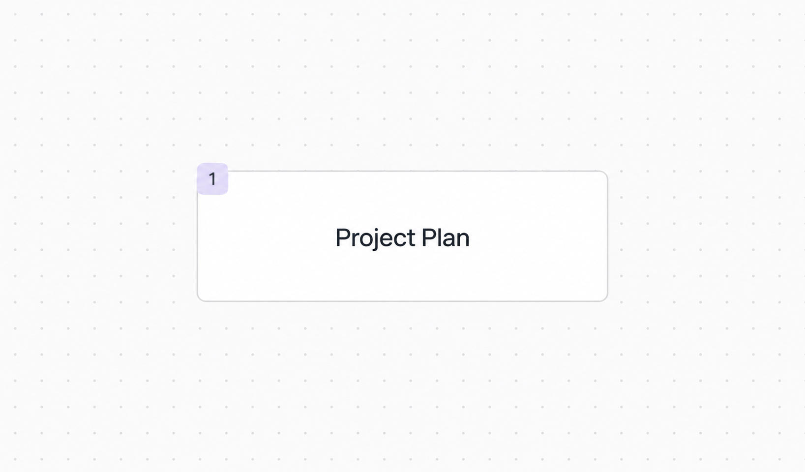

카드 왼쪽 위 작은 둥근 사각형 번호. Zoom과 관계없이 화면상 크기 유지.

## 4. Waypoint 관리창

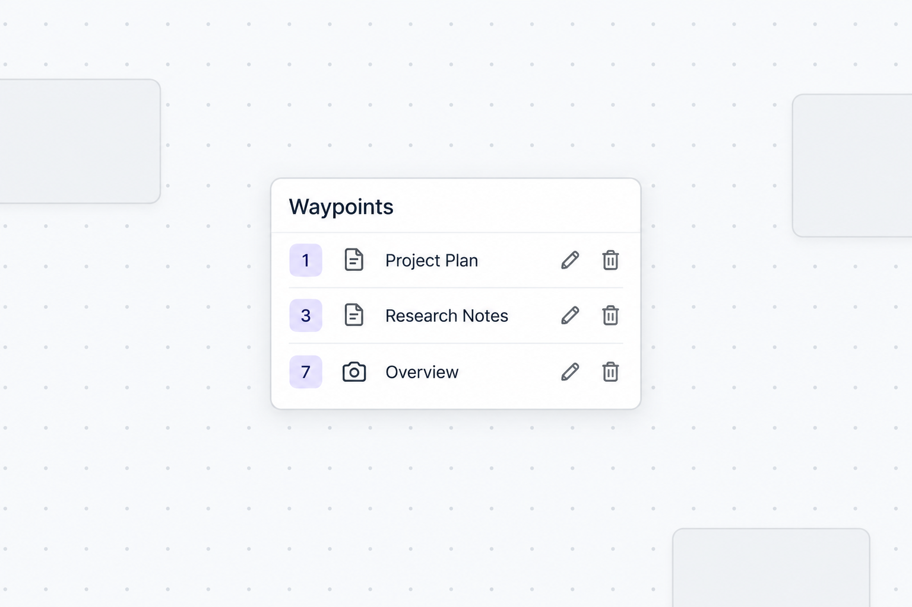

번호·대상 아이콘·이름·연필·휴지통. 등록 번호 오름차순. 항목 클릭은 이동 후 닫기, 연필은 인라인 편집, 휴지통은 등록만 해제. Enter 저장·Esc 취소, 편집 중 외부 클릭은 취소 후 닫기. 테두리·모서리로 크기 조절, 마지막 크기 저장. 별도 조절 버튼 없음.

## 5. 팔레트

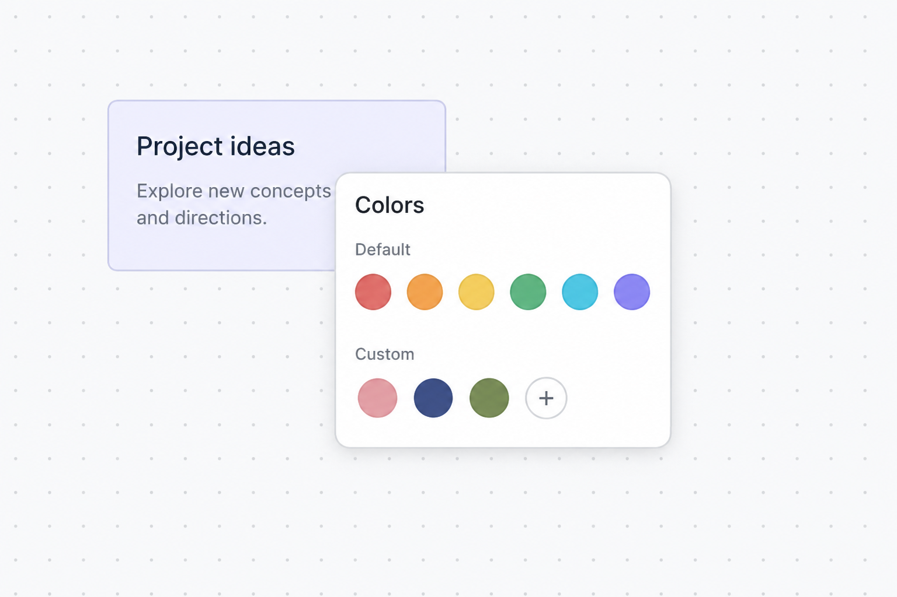

Default / Custom 색상 칩과 ＋. 선택 색을 일괄 적용하고 닫기. 사용자 칩 우클릭 제거 후에도 기존 카드 적용색 유지.

## 6. 색상 선택기

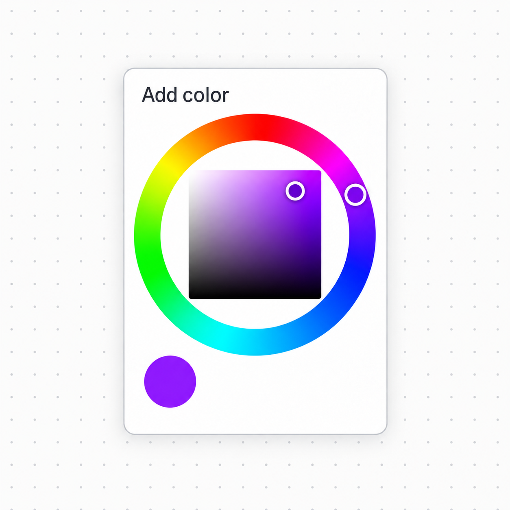

최종 승인: 클립스튜디오 방식의 바깥 색상환과 안쪽 사각형. 바깥에서 색상, 안쪽에서 채도·밝기. 선택색 미리보기, HEX·별도 저장 버튼 없음. 이전 원 전체 그라데이션·별도 밝기 막대 시안은 사용하지 않는다.

## 7. 설정

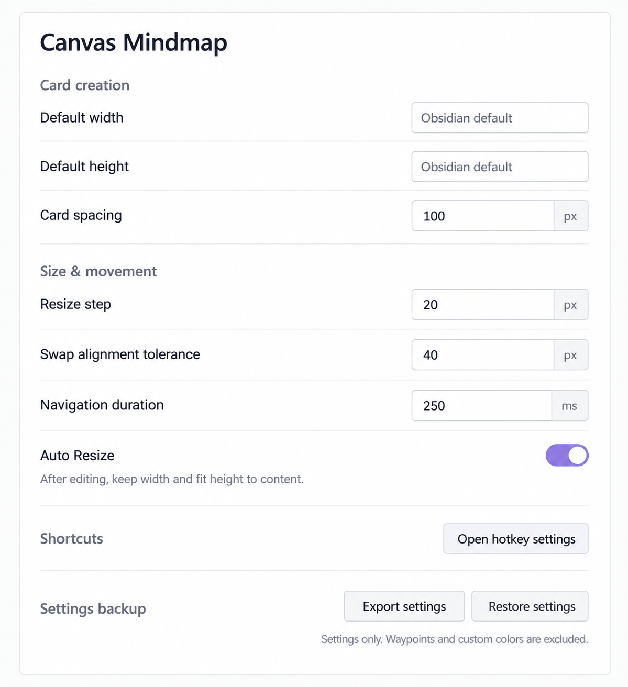

카드 생성 → 크기·이동 → 단축키 → 백업. 최초 카드 크기는 Obsidian 기본값을 숫자로 표시해 수정 가능. Obsidian default는 시안 설명이며 실제 입력값이 아니다. Auto Resize ON은 예시 상태로 최초 기본값을 확정한 것이 아니다. 간격 100px·조절 20px·교환 허용차 40px·이동 250ms는 기존 명세를 따른다.

## 8. 복원 확인

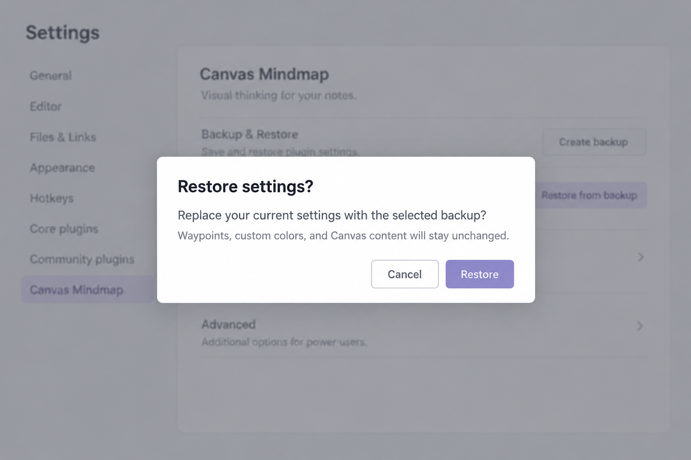

유효한 백업 선택 후 Restore는 설정 전체 교체, Cancel은 유지. Waypoint·사용자 색상·Canvas 원본 제외. 뒤쪽 생성 배경은 설정 화면 기준이 아니다.

## 9. 복원 오류

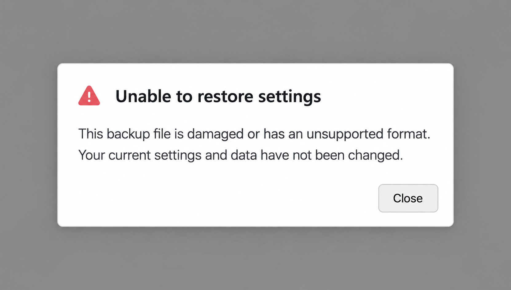

손상·지원하지 않는 형식과 현재 설정·데이터가 변경되지 않았음을 알린다. Close로 닫기. 부분 적용 없음.

## 10. 파일 선택

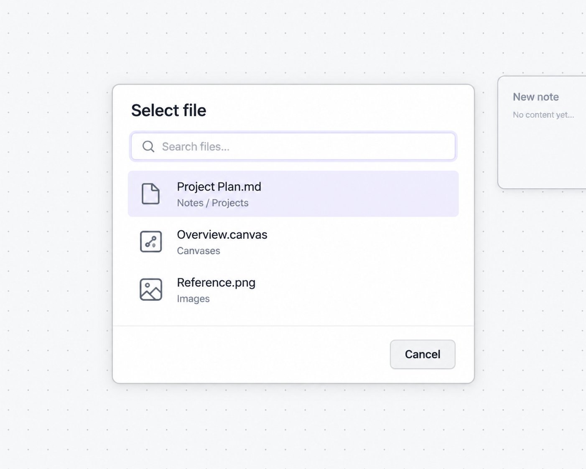

검색창·종류 아이콘·파일명·폴더·Cancel. Markdown·Canvas·Image 대상. 취소 시 원래 빈 카드 유지.

## 11. 이미지 패널

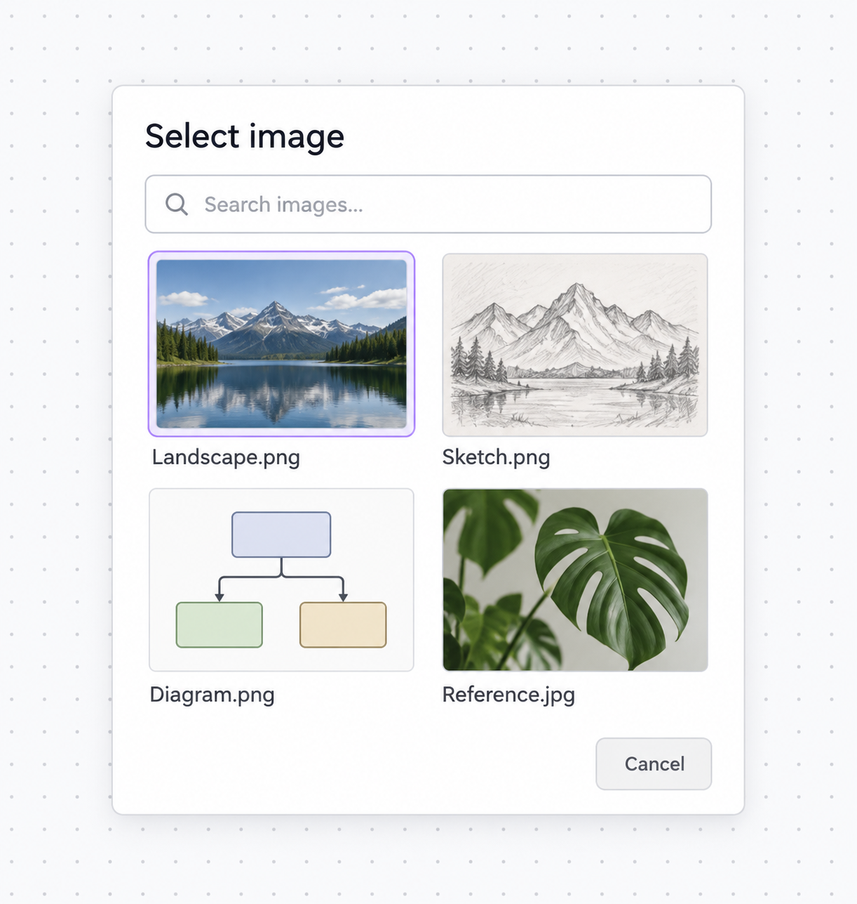

검색창 아래 썸네일·파일명 그리드. Cancel은 원래 빈 카드 유지. 예시 네 개로 실제 목록을 제한하지 않는다.

## 향후 화면 비교

기능 단계에서 위치·상대 크기·여백·정렬·아이콘·선택 표시·조작 순서를 비교한다. 창 경계·좁은 화면·테마도 확인한다. 이 문서 작성은 제품 검증이 아니다.
